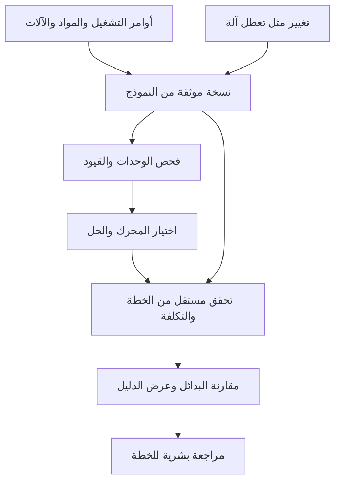

# WOW Decision Intelligence | منصة واو لذكاء القرارات

تساعد المنصة المخطط على الإجابة عن سؤال عملي مثل «تعطلت آلة ساعتين، فما خطة الإنتاج الممكنة الآن، وكم ستتأخر الطلبات، وما الدليل؟». يصف المخطط الموارد والقيود والتكاليف. يحوّل المترجم الوصف إلى نموذج رياضي، ويختار المحرك طريقة حل متوافقة، ثم يتحقق مكوّن مستقل من الخطة باستخدام البيانات الأصلية. تعمل النواة دون نموذج ذكاء اصطناعي مدفوع ودون تثبيت WOW ERP.

**ما يعمل اليوم.** ثلاث تجارب بحثية مكتوبة بـ C#، تشمل إعادة استخدام الحلول المستقلة، وجدولة إنتاج فعلية بمحرك CP-SAT، وتخصيص ساعات بمحرك HiGHS. يمكن إعادة تشغيلها بالأوامر الواردة في [دليل التشغيل](README.md). واجهة Studio واللغة العامة والتكاملات المؤسسية موثّقة ومجدولة للتنفيذ.

في المثال الصغير يرتفع التأخر الموزون من 3 إلى 12 عند تعطل الآلة. وفحص مستقل جرّب كل أزواج أوقات البداية الممكنة وتأكد من النتيجتين. وفي تجربة أخرى أدى إدخال قيد سعة مشترك إلى فقدان استقلال الجزأين، فأعاد البرنامج حل الجزء الموحد. [مواصفة الإنتاج](docs/design/production.md) · [التجربة ونتائجها](docs/research/innovation.md)

| إذا أردت معرفة | ابدأ هنا |
|---|---|
| من هم المنافسون وأين يمكن أن نتميز؟ | [المقارنة الموثقة](docs/research/market.md) و[جدوى أول منتج](docs/research/feasibility.md) |
| ما الطرق الرياضية المناسبة وما ضماناتها؟ | [الخريطة العلمية](docs/research/methods.md) |
| كيف نمنع خلط العملات أو إعادة استخدام حل قديم؟ | [النواة والتحقق](docs/design/engine.md) و[تصميم اللغة](docs/design/language.md) |
| متى يجوز الانتقال من اقتراح إلى تنفيذ؟ | [دورة حياة القرار](docs/design/lifecycle.md) |
| كيف أبدأ المساهمة؟ | [خريطة القضايا](planning/roadmap.md) و[دليل المساهم](CONTRIBUTING.md) |

المستودع عام. يمكن للمالك إضافة المطورين المعنيين بالاسم. بعد منح الصلاحية، يختار المساهم قضية جاهزة ويعلن المسارات التي سيعدلها ويعمل على فرع ومجلد منفصلين. القضايا المفتوحة تعكس العمل المتبقي. وجود التصميم وحده لا يعني اكتمال الميزة.

[تقرير التدقيق والفجوات المفتوحة](docs/audit/engineering-audit.md) · [سجل مصادر المتطلبات](docs/audit/source-register.md) · [حزمة التصميم الأصلية](docs/design/references/) · [مواصفات وحدات Studio](docs/design/studio/)
