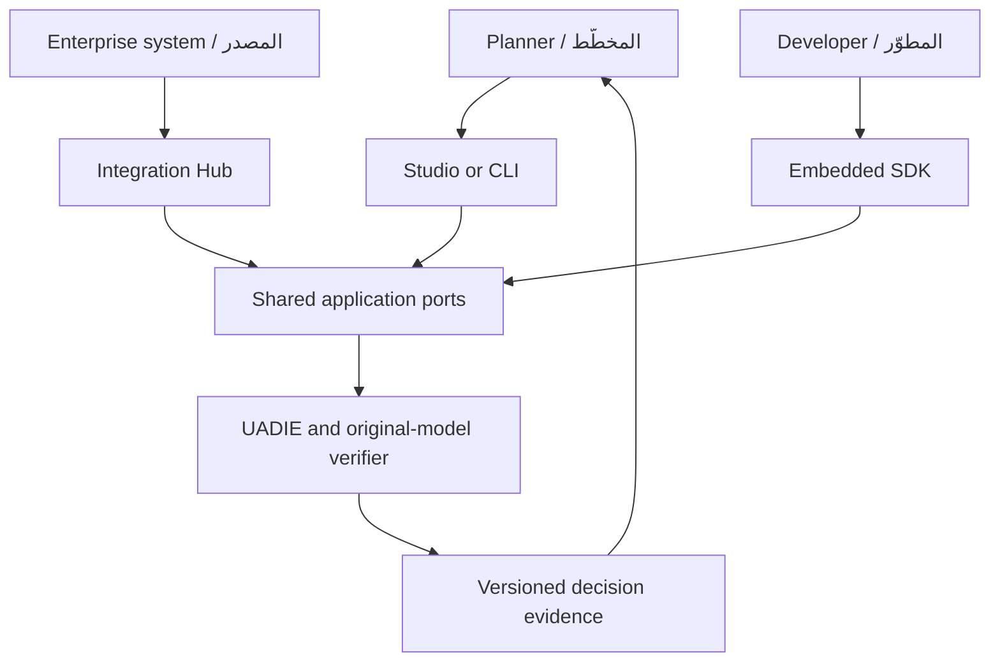
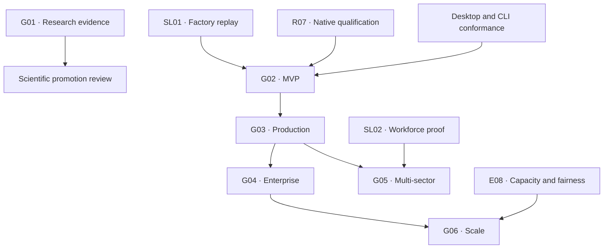
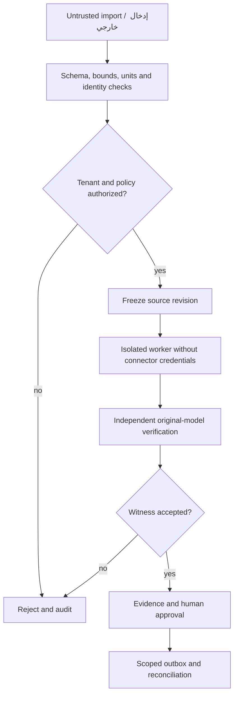
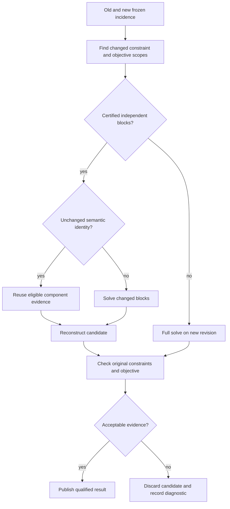

# Engineering views · الرسومات الهندسية

[Complete dependency network (SVG)](diagrams/dependencies.svg) · [Editable Graphviz source](diagrams/dependencies.dot) · [Traceability and baseline](engineering-audit.md)

Every node carries its scope key, GitHub number and a link to the live issue. An arrow runs from prerequisite to consumer. Epic membership is a different relationship in planning/parents.json. The complete diagram is intended for zoom and search; use the views below for release and product decisions. Regenerate the source with the .NET validator and render with Graphviz.

```sh
dotnet run --project tools/Traceability -- --write-dependency-graph
dot -Tsvg docs/audit/diagrams/dependencies.dot -o docs/audit/diagrams/dependencies.svg
```

## System context · سياق النظام



Product boundaries are defined by RT01–RT05. A connector imports authorized, unit-normalized snapshots. Returning a decision to a planner does not authorize an external write. The approved application flow, storage/solver components and sequence are in the [runtime design](../design/operating-modes.md).

## Release dependencies · اعتماديات بوابات الإصدار



Solid arrows summarize selected dependencies. G01 permits a bounded research conclusion and has its own decision. All exact release prerequisites, including security and recovery, are in the complete network. A green CI run for a research fixture cannot approve G02.

## Trust boundaries · حدود الثقة



Inputs cross the Integration Hub boundary (I01, SEC01). The worker boundary (E07, EXT01) separates native code and tenant credentials. The independent verifier (S04) receives the original snapshot, not merely the lowered model. Any future write must satisfy the lifecycle and approval policy (S11, E04).

## Incremental optimization · الحل الكامل وإعادة الاستخدام



The conventional baseline rebuilds and solves the full new revision before the same independent check. The proposal tries to avoid re-solving unaffected blocks. A shared capacity or joint objective may merge all blocks and remove the benefit. H1's 391 finite oracle comparisons cover the research fixture, with no demonstrated general speedup. See [prior art and measured limits](../research/innovation.md).
