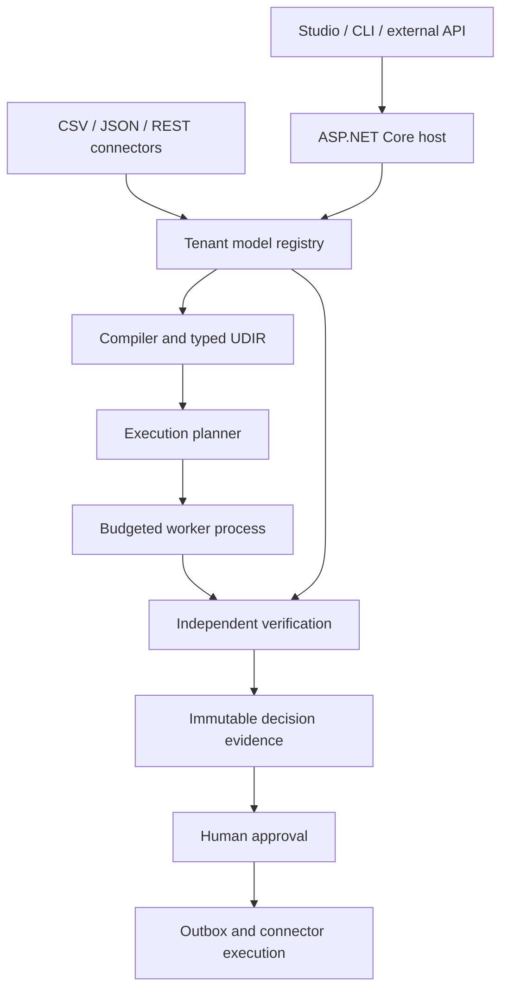

# Architecture and dependency rules

**ADR-001 — Start with a modular monolith and a separate solver process.** A single ASP.NET Core host owns the API, jobs, registry and transactional outbox. A .NET worker launches one constrained native adapter process per admitted job. A process boundary isolates native crashes, memory budgets and cancellation. Durable queue/lease state remains in the database. Core contracts have zero ERP, UI, database or solver references. Compiler and verifier independently consume model semantics. The planner uses capability manifests without linking native libraries. CI should fail forbidden project references.

| Option | Coordination and failure cost | Decision threshold |
|---|---|---|
| Single in-process executable | Simple development, but native faults terminate request processing and budgets share an address space | Appropriate only for research CLI |
| Modular host + isolated worker | One transactional store, fewer network contracts, bounded solver resources; process management is required | Initial deployment |
| Independent services | Independent scale and fault domains, additional tracing, distributed state and migrations | Extract worker pool first when measured queue delay or memory pressure justifies it; separate integration service if connector failures dominate. Preserve versioned contracts. |

**ADR-002 — Relational persistence.** Use PostgreSQL + Npgsql/EF Core as the initial deployment target. Both candidate engines support transactions, indexing, tenant predicates and backup/restore. PostgreSQL fits a self-hostable default, while SQL Server is attractive to existing Microsoft operations teams. Npgsql exposes native PostgreSQL features; SQL Server uses Microsoft's EF provider. Isolate provider-specific leasing, JSON indexing, row security and migrations; dual support requires running the same conformance suite on both. Begin with indexed incidence tables and bounded traversal before adopting a graph database. Introduce Redis only if repeated reads or lease contention show a measurable need; persistent claims stay authoritative. [Npgsql](https://www.npgsql.org/efcore/) · [SQL Server provider](https://learn.microsoft.com/en-us/ef/core/providers/sql-server/)

**ADR-003 — Client technology.** Studio targets Microsoft Blazor components and a Windows/Linux desktop experience, with a separate C# CLI. Qualify a packaged Blazor app with a desktop host such as Photino (third-party shell) and an installable standalone Blazor PWA (browser-managed window). Evaluate first-party MAUI + GTK4 in a research track; Microsoft classifies the Linux backend as experimental. Acceptance requires launch in its own window on both OSes, offline model inspection, RTL, keyboard operation and a tested installer. If a fully supported first-party native shell is mandatory, record the unmet requirement. React/TypeScript are optional for a future web portal. [Blazor PWA](https://learn.microsoft.com/en-us/aspnet/core/blazor/progressive-web-app/?view=aspnetcore-10.0) · [MAUI backend status](https://learn.microsoft.com/en-us/dotnet/maui/developer-tools/platform-backends/?view=net-maui-10.0) · [Photino](https://github.com/tryphotino/photino.Blazor)

**ADR-004 — Contracts before extraction.** Namespace identity uses tenant, model, immutable revision and local symbol ID. A job freezes input snapshots, selected capabilities and execution budgets. REST v1 endpoints cover models/revisions, validation, runs, cancellation, evidence, scenarios, proposals and approvals. POST requests accept tenant-scoped idempotency keys with request body digests. Same key + different payload → conflict. Cursor pagination uses stable revision/ID ordering. Workflow changes use expected revision/ETag. Events record schema version, causation, correlation and aggregate sequence. No synchronous gRPC/MCP dependencies in core.

| Boundary | Owns | Consumes / must avoid |
|---|---|---|
| Model registry / graph | immutable snapshots, source provenance, inbound/outbound incidence | Source IDs and schema versions; no native handles |
| Compiler | syntax, binds, typed IR, exactness ledger and backend lowering | Domain contracts; never owns final solution validation |
| Runtime / research | algorithm registry, features, admission, leases, replay experiments | Adapter capabilities and budgets; benchmark code separate from runtime |
| Verification / evidence | source-domain feasibility, recalculated objectives, bound metadata and replay bundle | Frozen inputs and native results; no native lowering dependency |
| Intelligence | forecasts, scenario branches, simulation, alternatives and risk | Immutable inputs, verified results; uncertainty forecasts never become hard facts implicitly |
| Enterprise / integration | tenant IAM, approvals, audit, queue/outbox, data mappings, notifications | Versioned public ports; secrets resolved inside connector scope |
| Applications | studio, visual editor, graph explorer, scheduling, scenario, benchmark, evidence, admin/developer views | API/SDK contracts; no direct SQL or solver access |

**Resource governance.** Admit jobs by per-tenant and global core, memory and wall-clock limits. Charge solver threads × elapsed time, not elapsed time alone. Track measured peak RSS and use OS process limits. Reserve enough capacity for the host. A subprocess receives a leased job and read-only snapshot. On death, expire lease, fence old worker by token and retry from the immutable inputs; publish output only once. Cancellation retains any previously verified incumbent with its original status. Select one eligible solver by default. Enable portfolios or early switching only under measured equal-budget performance.

**Trust and integration.** All entity keys and unique/idempotency indexes include tenant ID. Authenticated tenant context comes from server identity; never accept a body-supplied tenant as authorization. Use OIDC roles scoped to model view, model write, propose, approve and execute. Denied accesses and sensitive actions are audited without secrets. Native workers run without connector credentials. DML is data; no host-language evaluation. External extensions use process isolation, restricted credentials, input limits and timeouts. Connector manifest includes source/schema version, field types and units, transform version, timezone and currency policy, cursor/offset, source timestamp, retry limits and credential reference. Commit incoming event receipt and checkpoint in one transaction. For external writes record outbound idempotency key, reconcile on unknown outcome and suspend if the target cannot deduplicate. Start with snapshots and read-only export before write-back.

**Operations.** Correlate OpenTelemetry traces by run/revision and measure queue time, compile time, verification, drift, CPU, RSS and rejected results. Keep raw customer data out of metrics and logs. Separate customer deployment keys and evidence retention. Release gates include restores on a fresh host, backward schema migration rehearsal, authenticated offline installer checks and support ownership. Exportable evidence and paid-service-free development are mandatory.
