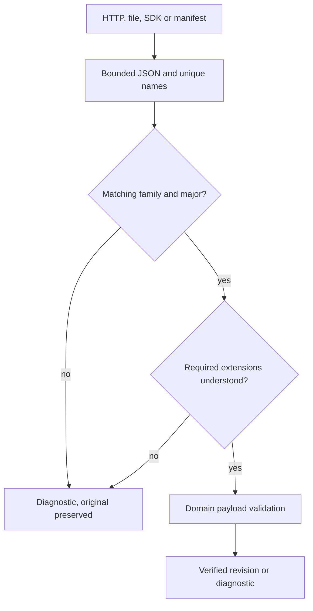

# F05 · Contract compatibility

Public .NET types live in WowDi.Contracts. A single UTF-8 JSON envelope identifies the contract family and wire schema. This library validates the outer compatibility boundary. Domain owners validate the payload and independently verify mathematical results. Handler callbacks perform pure validation; admission, writes and cache publication take place only after all checks succeed.

| Field | Type / requirement | Semantics and failures |
|---|---|---|
| contract | Required ordinal string | Must equal the expected contract ID; fail with contract.identity before model binding. |
| version | Required ASCII major.minor | Each part is 0..65535 without leading zeros; major starts at 1. Patch/build numbers belong to artifact metadata. Different majors require an explicit reader or migrator. |
| payload | Required object | Frozen value returned to the owning validator. Required fields, units and enum recognition are the responsibility of that contract. |
| extensions | Optional object keyed by case-sensitive registry IDs | Each entry has exactly required (Boolean) and value (JSON). Unknown optional metadata can be ignored by consumers and is retained for relaying. Unknown required entries reject the envelope. |

Duplicate keys at any depth, unknown outer properties, more than 1 MiB and more than 64 JSON nesting levels fail. Version 1 writers add optional metadata only in the extension map. Semantic extensions (units, hard constraints, objective direction or security meaning) must be required and explicitly validated. Adding a required core field, changing a default, removing a field or silently reinterpreting an enum is a breaking change. Schema and SDK versions evolve independently; the NuGet package uses semantic versioning for its public API. A wire-major change can coexist with the previous reader in one package.

REST majors belong in the route, for example /api/v1. The endpoint binds its expected contract and wire major explicitly. Reject malformed data before persistence; report structured diagnostic codes. A supported route must not imply support for every extension or newer schema major. For local/SDK calls, return the same code via ContractException. Plugin manifests use their own contract ID and version: parsing a manifest does not authorize plugin activation. Tenant checks and adapter isolation remain at their existing boundaries.

| Reader / writer pair | Required outcome |
|---|---|
| Old reader, v1.1 writer adds optional display metadata | Preserve the payload; retain the opaque extension for export. |
| New reader, v1.0 writer | Absence of optional metadata leaves original meaning unchanged. |
| Either reader, unknown required extension | Reject with extension.required. Reader never strips a semantic requirement to proceed. |
| v1 reader, v2 writer | Reject with contract.major. Caller may select an explicit migration or another endpoint. |

**Breaking migration example.** The fixture family wowdi.example.horizon originally stores an integer minutes field. Version 2 carries duration with an integer value and an explicit unit. The fixture migration copies the exact integer to value and sets unit to minute, writes a fresh artifact and preserves the original unchanged. A general migrator must validate the source, reject unknown required extensions, preserve provenance and validate the new payload before it publishes a new revision. A reverse migration requires explicit unit conversion with range and exactness checks. This example defines a compatibility rule, not a production scheduling schema.

**Downstream contracts.** M01 and M03 may evolve payloads within these boundaries. M10 owns model JSON schema validation, M09 and RT04 own SDK builders and packaging, S12 owns HTTP status mapping, I01 and EXT01 own capabilities and plugin schemas. None may infer mathematical or authorization semantics from unknown optional metadata.

تُحفظ النسخة الأصلية عند رفض التوافق أو إجراء ترحيل. يجب أن تكون أي إضافة تغيّر القيد أو معنى الهدف إلزامية ومعروفة للقارئ.
