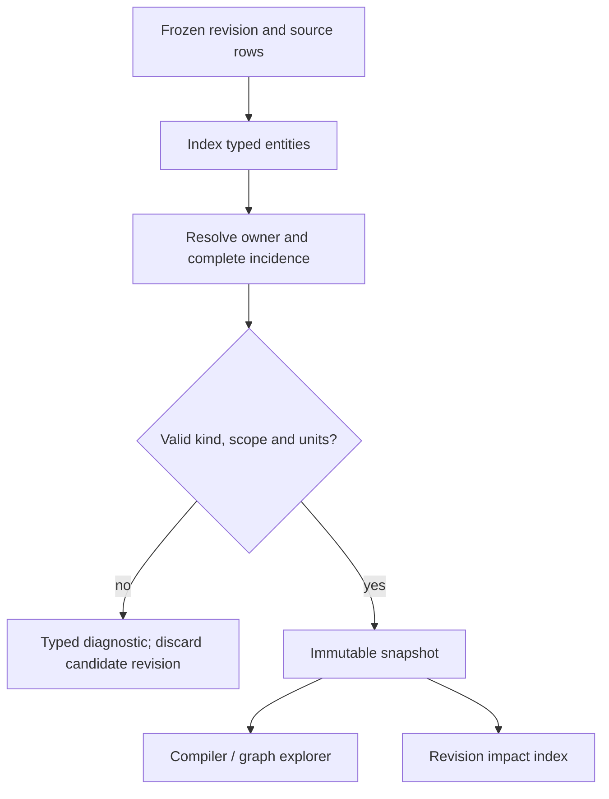

# M01 · Immutable Enterprise Decision Graph

The graph is a description of one tenant/model/revision. Nodes identify domain concepts, variables, derived expressions and objective terms. A directed hyperedge connects an owner to the entire set of referenced entities. An incidence list can contain zero operands for a constant constraint or objective. Graph construction does not certify that a model is separable or feasible.

| Field | Managed type | Scope and rule |
|---|---|---|
| revision | GraphRevision(tenantId, modelId, revisionId) | Required ordinal nonblank IDs; no implicit latest revision. Local workspace binds its own tenant namespace. |
| entity.id, relationship.id | string | Nonblank; unique within its respective namespace in one snapshot. |
| entity.kind | EntityKind | Registered semantic concept; unknown enum values rejected. |
| relationship.kind | RelationKind | ConstraintScope and ObjectiveScope preserve n-ary incidence. Requires, Consumes, Produces, Precedes, Capacity, Availability and Provenance express typed relations. |
| ownerId, targets | string, set of string | References resolve only inside the snapshot. Fail on dangling and duplicate incidences. Scope edges may reference zero nodes; ordinary relations need at least one. |
| source | SourceStamp(sourceKey, recordKey, mappingVersion, observedAt) | Required for each node and relationship, including synthetic and derived entries. Timestamp is an absolute instant. Never store connector credentials. |
| availability | TimeWindow(start, end, calendarId) | Availability windows are half-open instants and carry their source calendar ID. Empty and reversed ranges are invalid. |
| capacity | CapacityLimit(amount, unit) | Capacity edges originate at a resource, require a nonnegative decimal and explicit unit. Zero capacity represents an unavailable resource. |

Call DecisionGraphSnapshot.Create with the revision, entity sequence and relationship inputs. Resolve a local ID through the snapshot's immutable Entities or Relationships map. IncidentRelationships returns incoming and outgoing hyperedge IDs including the owner. Unknown query IDs fail explicitly. The binder is responsible for supplying **all** operands of a constraint or objective; this representation cannot discover an operand omitted by its caller. M02 owns cross-revision impact, M03 owns typed expression semantics, M11 owns durable identity and provenance storage, and S04 owns independent source-model verification.

**Acceptance fixture.** A capacity constraint binds three variables from distinct activities; an objective uses a different scope; two resources have an interval and a capacity budget. A caller can reorder the input without changing the ordinal enumeration. Mutating an input list after construction cannot change a stored snapshot. Concurrent reads observe immutable data. Building a later revision with a changed relation leaves the earlier snapshot intact. A failed build publishes no partial snapshot.

يُمثّل القيد بعلاقة واحدة تشمل جميع المتغيرات التي يقرأها. يحتفظ كل عنصر بمصدره ونسخة النموذج. لا تكفي صلة الرسم وحدها لإثبات استقلال مسألتين رياضياً.
