# SP03 — editable architecture and subsystem diagrams

All diagrams describe the reviewed target design unless explicitly identified as observed synthetic evidence or merged managed classes. They do not represent a deployed system. Each edge is linked to its reviewed source and owning issue. Source file: [diagrams.tsv](diagrams.tsv).

المخططات تصف التصميم المعتمد المستهدف، وليس ادعاءً بنشر المكونات. لكل علاقة مرجع نصي ورقم قضية. النتائج المقاسة محدودة بالأمثلة الاصطناعية الموضحة.

## C4 System Context

Operators and external systems interact through managed application boundaries. Untrusted data is staged and denied operations return scoped diagnostics.

يتفاعل المخطط والمستخدم والأنظمة الخارجية عبر عقود التطبيقات، ولا يُسمح بالوصول المباشر أو تنفيذ قرار دون قبول موثق.

Requirement: SP03-01; bilingual SP03-06; issue #161. [Editable DOT (alternate graph for sequences)](context.dot) · [Rendered SVG](context.svg).

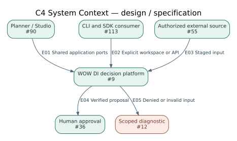

| Edge | Relation | Issue | Reviewed source anchor |
|---|---|---|---|
| E01 | operator → wow: Shared application ports | [#90](https://github.com/ameenalqershi/wow-decision-intelligence/issues/90) | [docs/design/architecture.md](../../architecture.md): Both clients call the same application ports. |
| E02 | cli → wow: Explicit workspace or API | [#131](https://github.com/ameenalqershi/wow-decision-intelligence/issues/131) | [docs/design/operating-modes.md](../../operating-modes.md): Same local or remote bindings |
| E03 | erp → wow: Staged input | [#55](https://github.com/ameenalqershi/wow-decision-intelligence/issues/55) | [docs/design/operating-modes.md](../../operating-modes.md): Map authorized source schemas and units into a staged import |
| E04 | wow → approval: Verified proposal | [#36](https://github.com/ameenalqershi/wow-decision-intelligence/issues/36) | [docs/design/lifecycle.md](../../lifecycle.md): Only a verified feasible incumbent satisfying policy may be proposed |
| E05 | wow → diagnostic: Denied or invalid input | [#12](https://github.com/ameenalqershi/wow-decision-intelligence/issues/12) | [docs/design/tenant-threat-model.md](../../tenant-threat-model.md): Missing context denies |

## C4 Containers

Target modular host and isolated worker; local SQLite and enterprise PostgreSQL are different modes, never simultaneous mandatory services.

يفصل المخطط بين المضيف المحلي وقاعدة SQLite، والخادم المؤسسي وقاعدة PostgreSQL، وعامل الحساب المعزول؛ ولا يوجد اشتراط لتشغيل الخادم في الوضع المحلي.

Requirement: SP03-01; bilingual SP03-06; issue #161. [Editable DOT (alternate graph for sequences)](containers.dot) · [Rendered SVG](containers.svg).

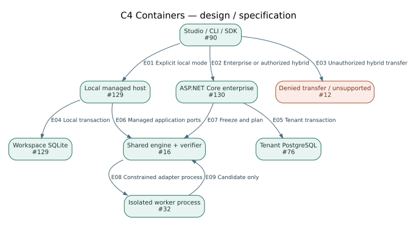

| Edge | Relation | Issue | Reviewed source anchor |
|---|---|---|---|
| E01 | client → local: Explicit local mode | [#129](https://github.com/ameenalqershi/wow-decision-intelligence/issues/129) | [docs/design/operating-modes.md](../../operating-modes.md): Local application host |
| E02 | client → api: Enterprise or authorized hybrid | [#12](https://github.com/ameenalqershi/wow-decision-intelligence/issues/12) | [docs/design/tenant-threat-model.md](../../tenant-threat-model.md): remote server reauthorizes independently |
| E03 | client → diag: Unauthorized hybrid transfer | [#133](https://github.com/ameenalqershi/wow-decision-intelligence/issues/133) | [docs/design/operating-modes.md](../../operating-modes.md): Reject unauthorized upload |
| E04 | local → sqlite: Local transaction | [#129](https://github.com/ameenalqershi/wow-decision-intelligence/issues/129) | [docs/design/operating-modes.md](../../operating-modes.md): One workspace database and immutable evidence store |
| E05 | api → pg: Tenant transaction | [#130](https://github.com/ameenalqershi/wow-decision-intelligence/issues/130) | [docs/design/operating-modes.md](../../operating-modes.md): PostgreSQL and transactional outbox |
| E06 | local → engine: Managed application ports | [#129](https://github.com/ameenalqershi/wow-decision-intelligence/issues/129) | [docs/design/operating-modes.md](../../operating-modes.md): Shared engine and verifier |
| E07 | api → engine: Freeze and plan | [#130](https://github.com/ameenalqershi/wow-decision-intelligence/issues/130) | [docs/design/architecture.md](../../architecture.md): A job freezes input snapshots |
| E08 | engine → worker: Constrained adapter process | [#32](https://github.com/ameenalqershi/wow-decision-intelligence/issues/32) | [docs/design/architecture.md](../../architecture.md): one constrained native adapter process per admitted job |
| E09 | worker → engine: Candidate only | [#29](https://github.com/ameenalqershi/wow-decision-intelligence/issues/29) | [docs/design/operating-modes.md](../../operating-modes.md): A process exit cannot turn an unverified incumbent into a verified result. |

## C4 Engine Components

The engine preserves original semantics and separates lowering from independent verification. Unsupported capability and invalid witness have distinct rejection paths.

يحافظ المحرك على دلالات النموذج الأصلية ويعزل المترجم عن التحقق المستقل، مع رفض القدرة غير المدعومة أو الشاهد غير الصحيح.

Requirement: SP03-01; bilingual SP03-06; issue #161. [Editable DOT (alternate graph for sequences)](engine.dot) · [Rendered SVG](engine.svg).

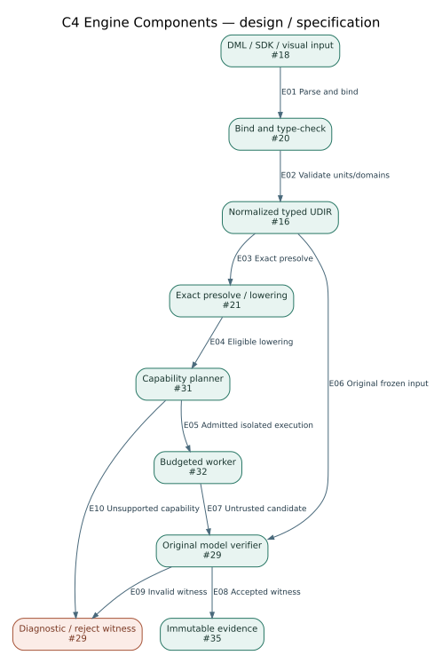

| Edge | Relation | Issue | Reviewed source anchor |
|---|---|---|---|
| E01 | input → bind: Parse and bind | [#20](https://github.com/ameenalqershi/wow-decision-intelligence/issues/20) | [docs/design/engine.md](../../engine.md): Parsing constructs an AST without external IO. |
| E02 | bind → udir: Validate units/domains | [#20](https://github.com/ameenalqershi/wow-decision-intelligence/issues/20) | [docs/design/engine.md](../../engine.md): Validate units, domains and scopes |
| E03 | udir → lower: Exact presolve | [#21](https://github.com/ameenalqershi/wow-decision-intelligence/issues/21) | [docs/design/engine.md](../../engine.md): Exact presolve and reconstruction ledger |
| E04 | lower → plan: Eligible lowering | [#31](https://github.com/ameenalqershi/wow-decision-intelligence/issues/31) | [docs/design/engine.md](../../engine.md): Unsupported exact lowering returns a diagnostic. |
| E05 | plan → worker: Admitted isolated execution | [#32](https://github.com/ameenalqershi/wow-decision-intelligence/issues/32) | [docs/design/architecture.md](../../architecture.md): one constrained native adapter process per admitted job |
| E06 | udir → verify: Original frozen input | [#29](https://github.com/ameenalqershi/wow-decision-intelligence/issues/29) | [docs/design/engine.md](../../engine.md): Independent source-model evaluation |
| E07 | worker → verify: Untrusted candidate | [#29](https://github.com/ameenalqershi/wow-decision-intelligence/issues/29) | [docs/design/tenant-threat-model.md](../../tenant-threat-model.md): Treat candidate as untrusted. |
| E08 | verify → evidence: Accepted witness | [#35](https://github.com/ameenalqershi/wow-decision-intelligence/issues/35) | [docs/design/operating-modes.md](../../operating-modes.md): Commit evidence for this revision |
| E09 | verify → reject: Invalid witness | [#29](https://github.com/ameenalqershi/wow-decision-intelligence/issues/29) | [docs/design/engine.md](../../engine.md): Invalid witness → reject candidate and block proposal. |
| E10 | plan → reject: Unsupported capability | [#31](https://github.com/ameenalqershi/wow-decision-intelligence/issues/31) | [docs/design/engine.md](../../engine.md): no eligible backend → unsupported |

## UDIR v1 managed classes

These are actual merged M03 record relationships, not proposed database tables. Expression references are DAG IDs, not object pointers.

هذه علاقات سجلات C# الفعلية في UDIR، وليست أعمدة قاعدة بيانات؛ وتعتمد التعبيرات على معرفات رسم غير دوري.

Requirement: SP03-02; bilingual SP03-06; issue #161. [Editable DOT (alternate graph for sequences)](udir-classes.dot) · [Rendered SVG](udir-classes.svg).

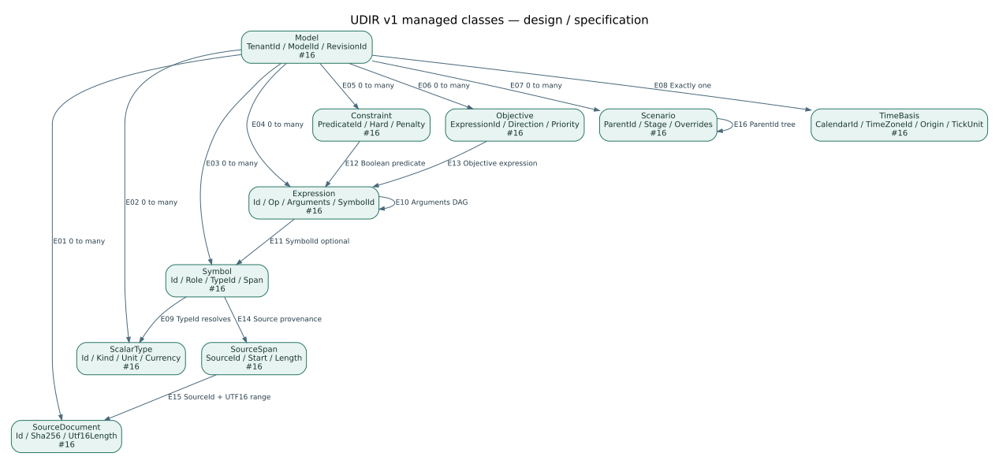

| Edge | Relation | Issue | Reviewed source anchor |
|---|---|---|---|
| E01 | model → sources: 1 to many | [#16](https://github.com/ameenalqershi/wow-decision-intelligence/issues/16) | [src/Udir/Model.cs](../../../../src/Udir/Model.cs): ImmutableArray<SourceDocument> Sources |
| E02 | model → type: 1 to many | [#16](https://github.com/ameenalqershi/wow-decision-intelligence/issues/16) | [src/Udir/Model.cs](../../../../src/Udir/Model.cs): ImmutableArray<ScalarType> Types |
| E03 | model → symbol: 1 to many | [#16](https://github.com/ameenalqershi/wow-decision-intelligence/issues/16) | [src/Udir/Model.cs](../../../../src/Udir/Model.cs): ImmutableArray<Symbol> Symbols |
| E04 | model → expr: 1 to many | [#16](https://github.com/ameenalqershi/wow-decision-intelligence/issues/16) | [src/Udir/Model.cs](../../../../src/Udir/Model.cs): ImmutableArray<Expression> Expressions |
| E05 | model → constraint: 1 to many | [#16](https://github.com/ameenalqershi/wow-decision-intelligence/issues/16) | [src/Udir/Model.cs](../../../../src/Udir/Model.cs): ImmutableArray<Constraint> Constraints |
| E06 | model → objective: 1 to many | [#16](https://github.com/ameenalqershi/wow-decision-intelligence/issues/16) | [src/Udir/Model.cs](../../../../src/Udir/Model.cs): ImmutableArray<Objective> Objectives |
| E07 | model → scenario: 0 to many | [#16](https://github.com/ameenalqershi/wow-decision-intelligence/issues/16) | [src/Udir/Model.cs](../../../../src/Udir/Model.cs): ImmutableArray<Scenario> Scenarios |
| E08 | symbol → type: TypeId resolves | [#16](https://github.com/ameenalqershi/wow-decision-intelligence/issues/16) | [docs/design/udir-v1.md](../../udir-v1.md): Roles Variable, Parameter, Resource. |
| E09 | expr → expr: Arguments DAG | [#16](https://github.com/ameenalqershi/wow-decision-intelligence/issues/16) | [docs/design/udir-v1.md](../../udir-v1.md): Expression IDs allow DAG sharing. |
| E10 | expr → symbol: SymbolId optional | [#16](https://github.com/ameenalqershi/wow-decision-intelligence/issues/16) | [docs/design/udir-v1.md](../../udir-v1.md): literal?, symbolId?, span |
| E11 | constraint → expr: Boolean predicate | [#16](https://github.com/ameenalqershi/wow-decision-intelligence/issues/16) | [docs/design/udir-v1.md](../../udir-v1.md): Predicate has Boolean type. |
| E12 | objective → expr: Objective expression | [#16](https://github.com/ameenalqershi/wow-decision-intelligence/issues/16) | [docs/design/udir-v1.md](../../udir-v1.md): expressionId, direction, priority |
| E13 | symbol → span: Source provenance | [#16](https://github.com/ameenalqershi/wow-decision-intelligence/issues/16) | [src/Udir/Model.cs](../../../../src/Udir/Model.cs): string TypeId, SourceSpan Span |
| E14 | span → sources: SourceId + UTF16 range | [#16](https://github.com/ameenalqershi/wow-decision-intelligence/issues/16) | [docs/design/udir-v1.md](../../udir-v1.md): Half-open UTF-16 range relative to a frozen source. |
| E15 | scenario → scenario: ParentId tree | [#16](https://github.com/ameenalqershi/wow-decision-intelligence/issues/16) | [docs/design/udir-v1.md](../../udir-v1.md): For branching models use one root |

## Factory logical ERD

Approved pilot vocabulary, not an executable migration. All revision and run relationships remain tenant scoped; missing rows and unauthorized references fail before publication.

علاقات بيانات المصنع من القاموس المعتمد، لا تمثل DDL؛ ترتبط جميع العمليات والآلات والنتائج بنسخة ثابتة وسياق مستأجر مصرح به.

Requirement: SP03-02; bilingual SP03-06; issue #161. [Editable DOT (alternate graph for sequences)](pilot-erd.dot) · [Rendered SVG](pilot-erd.svg).

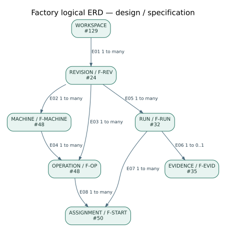

| Edge | Relation | Issue | Reviewed source anchor |
|---|---|---|---|
| E01 | workspace → revision: 1 to many | [#129](https://github.com/ameenalqershi/wow-decision-intelligence/issues/129) | [docs/design/pilot-contracts.md](../../pilot-contracts.md): WORKSPACE \|\|--o{ REVISION : contains |
| E02 | revision → machine: 1 to many | [#48](https://github.com/ameenalqershi/wow-decision-intelligence/issues/48) | [docs/design/pilot-contracts.md](../../pilot-contracts.md): REVISION \|\|--o{ MACHINE : defines |
| E03 | revision → operation: 1 to many | [#48](https://github.com/ameenalqershi/wow-decision-intelligence/issues/48) | [docs/design/pilot-contracts.md](../../pilot-contracts.md): REVISION \|\|--o{ OPERATION : freezes |
| E04 | machine → operation: 1 to many | [#48](https://github.com/ameenalqershi/wow-decision-intelligence/issues/48) | [docs/design/pilot-contracts.md](../../pilot-contracts.md): MACHINE \|\|--o{ OPERATION : serves |
| E05 | revision → run: 1 to many | [#32](https://github.com/ameenalqershi/wow-decision-intelligence/issues/32) | [docs/design/pilot-contracts.md](../../pilot-contracts.md): REVISION \|\|--o{ RUN : evaluated_by |
| E06 | run → evidence: 1 to 0..1 | [#35](https://github.com/ameenalqershi/wow-decision-intelligence/issues/35) | [docs/design/pilot-contracts.md](../../pilot-contracts.md): RUN \|\|--o\| EVIDENCE : records |
| E07 | run → assign: 1 to many | [#50](https://github.com/ameenalqershi/wow-decision-intelligence/issues/50) | [docs/design/pilot-contracts.md](../../pilot-contracts.md): RUN \|\|--o{ ASSIGNMENT : proposes |
| E08 | operation → assign: 1 to many | [#50](https://github.com/ameenalqershi/wow-decision-intelligence/issues/50) | [docs/design/pilot-contracts.md](../../pilot-contracts.md): OPERATION \|\|--o{ ASSIGNMENT : scheduled_in |

## Decision execution sequence

Ordered messages from frozen submission through independent checking. The invalid branch returns diagnostics and never publishes accepted evidence.

تسلسل تنفيذ قرار من تجميد المدخلات حتى التحقق المستقل، وتعود التشخيصات في فرع الرفض دون نشر دليل مقبول.

Requirement: SP03-03; bilingual SP03-06; issue #161. [Editable DOT (alternate graph for sequences)](run-sequence.dot) · [Rendered SVG](run-sequence.svg).

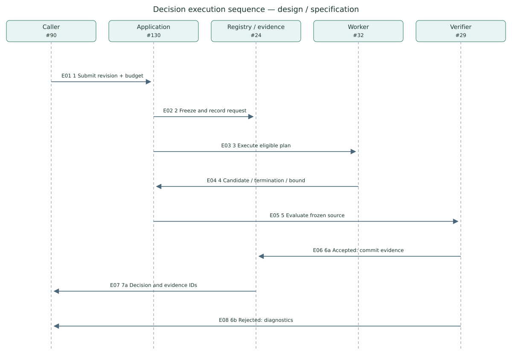

| Edge | Relation | Issue | Reviewed source anchor |
|---|---|---|---|
| E01 | caller → app: 1 Submit revision + budget | [#130](https://github.com/ameenalqershi/wow-decision-intelligence/issues/130) | [docs/design/operating-modes.md](../../operating-modes.md): Submit revision and budget |
| E02 | app → store: 2 Freeze and record request | [#24](https://github.com/ameenalqershi/wow-decision-intelligence/issues/24) | [docs/design/operating-modes.md](../../operating-modes.md): Freeze source and record request |
| E03 | app → worker: 3 Execute eligible plan | [#32](https://github.com/ameenalqershi/wow-decision-intelligence/issues/32) | [docs/design/operating-modes.md](../../operating-modes.md): Execute eligible plan |
| E04 | worker → app: 4 Candidate / termination / bound | [#32](https://github.com/ameenalqershi/wow-decision-intelligence/issues/32) | [docs/design/operating-modes.md](../../operating-modes.md): Candidate, termination, optional bound |
| E05 | app → verify: 5 Evaluate frozen source | [#29](https://github.com/ameenalqershi/wow-decision-intelligence/issues/29) | [docs/design/operating-modes.md](../../operating-modes.md): Evaluate against frozen source |
| E06 | verify → store: 6a Accepted: commit evidence | [#35](https://github.com/ameenalqershi/wow-decision-intelligence/issues/35) | [docs/design/operating-modes.md](../../operating-modes.md): Commit evidence for this revision |
| E07 | store → caller: 7a Decision and evidence IDs | [#35](https://github.com/ameenalqershi/wow-decision-intelligence/issues/35) | [docs/design/operating-modes.md](../../operating-modes.md): Decision and evidence IDs |
| E08 | verify → caller: 6b Rejected: diagnostics | [#29](https://github.com/ameenalqershi/wow-decision-intelligence/issues/29) | [docs/design/operating-modes.md](../../operating-modes.md): Diagnostics and actual termination |

## Contract admission activity

Envelope and payload acceptance are separate. A rejected or unknown required extension never reaches a domain mutation.

تُفحص الحاوية والإصدار والإضافات الإلزامية قبل تحقق المجال؛ ولا تؤدي رسالة غير متوافقة إلى تعديل البيانات.

Requirement: SP03-03; bilingual SP03-06; issue #161. [Editable DOT (alternate graph for sequences)](contract-activity.dot) · [Rendered SVG](contract-activity.svg).

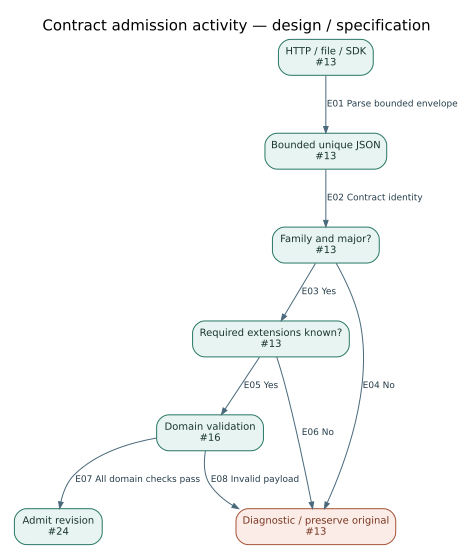

| Edge | Relation | Issue | Reviewed source anchor |
|---|---|---|---|
| E01 | input → json: Parse bounded envelope | [#13](https://github.com/ameenalqershi/wow-decision-intelligence/issues/13) | [docs/design/contract-compatibility.md](../../contract-compatibility.md): Bounded JSON and unique names |
| E02 | json → version: Contract identity | [#13](https://github.com/ameenalqershi/wow-decision-intelligence/issues/13) | [docs/design/contract-compatibility.md](../../contract-compatibility.md): Matching family and major? |
| E03 | version → ext: Yes | [#13](https://github.com/ameenalqershi/wow-decision-intelligence/issues/13) | [docs/design/contract-compatibility.md](../../contract-compatibility.md): Required extensions understood? |
| E04 | version → diag: No | [#13](https://github.com/ameenalqershi/wow-decision-intelligence/issues/13) | [docs/design/contract-compatibility.md](../../contract-compatibility.md): Reject with contract.major. |
| E05 | ext → payload: Yes | [#16](https://github.com/ameenalqershi/wow-decision-intelligence/issues/16) | [docs/design/contract-compatibility.md](../../contract-compatibility.md): Domain payload validation |
| E06 | ext → diag: No | [#13](https://github.com/ameenalqershi/wow-decision-intelligence/issues/13) | [docs/design/contract-compatibility.md](../../contract-compatibility.md): Reject with extension.required. |
| E07 | payload → publish: All domain checks pass | [#24](https://github.com/ameenalqershi/wow-decision-intelligence/issues/24) | [docs/design/contract-compatibility.md](../../contract-compatibility.md): admission, writes and cache publication take place only after all checks succeed. |
| E08 | payload → diag: Invalid payload | [#13](https://github.com/ameenalqershi/wow-decision-intelligence/issues/13) | [docs/design/contract-compatibility.md](../../contract-compatibility.md): Reject malformed data before persistence |

## Decision workflow state machine

All permitted transitions from the lifecycle table, including failure and cancellation. Mathematical status and termination are separate. Terminal retries create linked new revisions.

جميع الانتقالات المسموحة من جدول دورة القرار؛ حالة سير العمل منفصلة عن الحالة الرياضية وسبب التوقف، وتكون المحاولة الجديدة بسجل مرتبط.

Requirement: SP03-03; bilingual SP03-06; issue #161. [Editable DOT (alternate graph for sequences)](decision-state.dot) · [Rendered SVG](decision-state.svg).

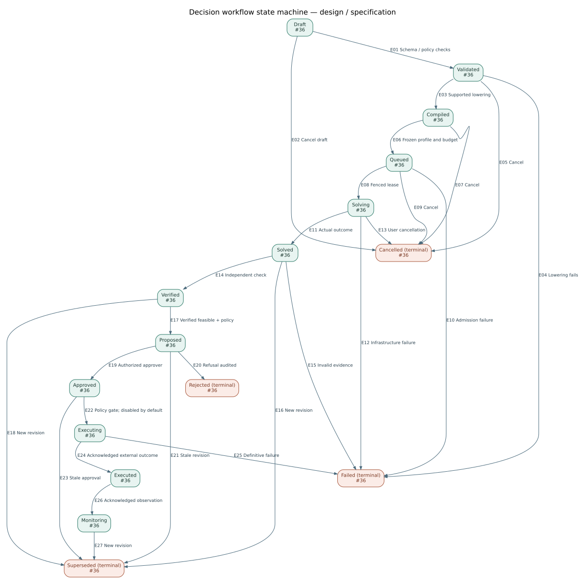

| Edge | Relation | Issue | Reviewed source anchor |
|---|---|---|---|
| E01 | draft → validated: Schema / policy checks | [#36](https://github.com/ameenalqershi/wow-decision-intelligence/issues/36) | [docs/design/lifecycle.md](../../lifecycle.md): Draft \| Validated, Cancelled |
| E02 | draft → cancelled: Cancel draft | [#36](https://github.com/ameenalqershi/wow-decision-intelligence/issues/36) | [docs/design/lifecycle.md](../../lifecycle.md): Draft \| Validated, Cancelled |
| E03 | validated → compiled: Supported lowering | [#36](https://github.com/ameenalqershi/wow-decision-intelligence/issues/36) | [docs/design/lifecycle.md](../../lifecycle.md): Validated \| Compiled, Failed, Cancelled |
| E04 | validated → failed: Lowering fails | [#36](https://github.com/ameenalqershi/wow-decision-intelligence/issues/36) | [docs/design/lifecycle.md](../../lifecycle.md): Validated \| Compiled, Failed, Cancelled |
| E05 | validated → cancelled: Cancel | [#36](https://github.com/ameenalqershi/wow-decision-intelligence/issues/36) | [docs/design/lifecycle.md](../../lifecycle.md): Validated \| Compiled, Failed, Cancelled |
| E06 | compiled → queued: Frozen profile and budget | [#36](https://github.com/ameenalqershi/wow-decision-intelligence/issues/36) | [docs/design/lifecycle.md](../../lifecycle.md): Compiled \| Queued, Cancelled |
| E07 | compiled → cancelled: Cancel | [#36](https://github.com/ameenalqershi/wow-decision-intelligence/issues/36) | [docs/design/lifecycle.md](../../lifecycle.md): Compiled \| Queued, Cancelled |
| E08 | queued → solving: Fenced lease | [#36](https://github.com/ameenalqershi/wow-decision-intelligence/issues/36) | [docs/design/lifecycle.md](../../lifecycle.md): Queued \| Solving, Cancelled, Failed |
| E09 | queued → cancelled: Cancel | [#36](https://github.com/ameenalqershi/wow-decision-intelligence/issues/36) | [docs/design/lifecycle.md](../../lifecycle.md): Queued \| Solving, Cancelled, Failed |
| E10 | queued → failed: Admission failure | [#36](https://github.com/ameenalqershi/wow-decision-intelligence/issues/36) | [docs/design/lifecycle.md](../../lifecycle.md): Queued \| Solving, Cancelled, Failed |
| E11 | solving → solved: Actual outcome | [#36](https://github.com/ameenalqershi/wow-decision-intelligence/issues/36) | [docs/design/lifecycle.md](../../lifecycle.md): Solving \| Solved, Failed, Cancelled |
| E12 | solving → failed: Infrastructure failure | [#36](https://github.com/ameenalqershi/wow-decision-intelligence/issues/36) | [docs/design/lifecycle.md](../../lifecycle.md): Solving \| Solved, Failed, Cancelled |
| E13 | solving → cancelled: User cancellation | [#36](https://github.com/ameenalqershi/wow-decision-intelligence/issues/36) | [docs/design/lifecycle.md](../../lifecycle.md): Solving \| Solved, Failed, Cancelled |
| E14 | solved → verified: Independent check | [#36](https://github.com/ameenalqershi/wow-decision-intelligence/issues/36) | [docs/design/lifecycle.md](../../lifecycle.md): Solved \| Verified, Failed, Superseded |
| E15 | solved → failed: Invalid evidence | [#36](https://github.com/ameenalqershi/wow-decision-intelligence/issues/36) | [docs/design/lifecycle.md](../../lifecycle.md): Solved \| Verified, Failed, Superseded |
| E16 | solved → superseded: New revision | [#36](https://github.com/ameenalqershi/wow-decision-intelligence/issues/36) | [docs/design/lifecycle.md](../../lifecycle.md): Solved \| Verified, Failed, Superseded |
| E17 | verified → proposed: Verified feasible + policy | [#36](https://github.com/ameenalqershi/wow-decision-intelligence/issues/36) | [docs/design/lifecycle.md](../../lifecycle.md): Verified \| Proposed, Superseded |
| E18 | verified → superseded: New revision | [#36](https://github.com/ameenalqershi/wow-decision-intelligence/issues/36) | [docs/design/lifecycle.md](../../lifecycle.md): Verified \| Proposed, Superseded |
| E19 | proposed → approved: Authorized approver | [#36](https://github.com/ameenalqershi/wow-decision-intelligence/issues/36) | [docs/design/lifecycle.md](../../lifecycle.md): Proposed \| Approved, Rejected, Superseded |
| E20 | proposed → rejected: Refusal audited | [#36](https://github.com/ameenalqershi/wow-decision-intelligence/issues/36) | [docs/design/lifecycle.md](../../lifecycle.md): Proposed \| Approved, Rejected, Superseded |
| E21 | proposed → superseded: Stale revision | [#36](https://github.com/ameenalqershi/wow-decision-intelligence/issues/36) | [docs/design/lifecycle.md](../../lifecycle.md): Proposed \| Approved, Rejected, Superseded |
| E22 | approved → executing: Policy gate; disabled by default | [#36](https://github.com/ameenalqershi/wow-decision-intelligence/issues/36) | [docs/design/lifecycle.md](../../lifecycle.md): Approved \| Executing, Superseded |
| E23 | approved → superseded: Stale approval | [#36](https://github.com/ameenalqershi/wow-decision-intelligence/issues/36) | [docs/design/lifecycle.md](../../lifecycle.md): Approved \| Executing, Superseded |
| E24 | executing → executed: Acknowledged external outcome | [#36](https://github.com/ameenalqershi/wow-decision-intelligence/issues/36) | [docs/design/lifecycle.md](../../lifecycle.md): Executing \| Executed, Failed |
| E25 | executing → failed: Definitive failure | [#36](https://github.com/ameenalqershi/wow-decision-intelligence/issues/36) | [docs/design/lifecycle.md](../../lifecycle.md): Executing \| Executed, Failed |
| E26 | executed → monitoring: Acknowledged observation | [#36](https://github.com/ameenalqershi/wow-decision-intelligence/issues/36) | [docs/design/lifecycle.md](../../lifecycle.md): Executed \| Monitoring |
| E27 | monitoring → superseded: New revision | [#36](https://github.com/ameenalqershi/wow-decision-intelligence/issues/36) | [docs/design/lifecycle.md](../../lifecycle.md): Monitoring \| Superseded |

## Tenant trust boundaries

Target controls B1–B7 with fail-closed behavior. These are security specifications, not an attestation that all controls are deployed.

حدود الثقة السبعة توضح المصادقة والعزل والاستيراد والعامل والأدلة والتنفيذ والعمليات؛ وهي مواصفات أمان لا شهادة نشر إنتاجي.

Requirement: SP03-04; bilingual SP03-06; issue #161. [Editable DOT (alternate graph for sequences)](trust.dot) · [Rendered SVG](trust.svg).

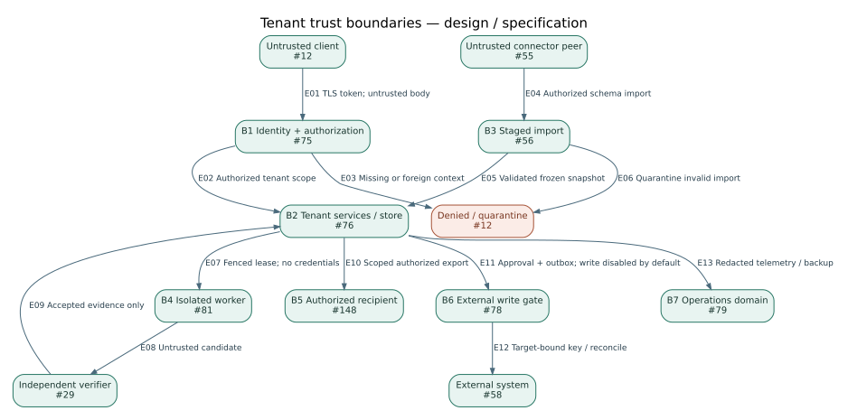

| Edge | Relation | Issue | Reviewed source anchor |
|---|---|---|---|
| E01 | caller → identity: TLS token; untrusted body | [#75](https://github.com/ameenalqershi/wow-decision-intelligence/issues/75) | [docs/design/tenant-threat-model.md](../../tenant-threat-model.md): Validate issuer/audience/signature/lifetime |
| E02 | identity → store: Authorized tenant scope | [#75](https://github.com/ameenalqershi/wow-decision-intelligence/issues/75) | [docs/design/tenant-threat-model.md](../../tenant-threat-model.md): Scoped application context |
| E03 | identity → deny: Missing or foreign context | [#12](https://github.com/ameenalqershi/wow-decision-intelligence/issues/12) | [docs/design/tenant-threat-model.md](../../tenant-threat-model.md): Missing context denies |
| E04 | source → import: Authorized schema import | [#55](https://github.com/ameenalqershi/wow-decision-intelligence/issues/55) | [docs/design/tenant-threat-model.md](../../tenant-threat-model.md): Authorized connector |
| E05 | import → store: Validated frozen snapshot | [#56](https://github.com/ameenalqershi/wow-decision-intelligence/issues/56) | [docs/design/tenant-threat-model.md](../../tenant-threat-model.md): Validated immutable snapshot |
| E06 | import → deny: Quarantine invalid import | [#56](https://github.com/ameenalqershi/wow-decision-intelligence/issues/56) | [docs/design/tenant-threat-model.md](../../tenant-threat-model.md): quarantine without advancing state |
| E07 | store → worker: Fenced lease; no credentials | [#81](https://github.com/ameenalqershi/wow-decision-intelligence/issues/81) | [docs/design/tenant-threat-model.md](../../tenant-threat-model.md): Frozen input + fenced lease |
| E08 | worker → verify: Untrusted candidate | [#29](https://github.com/ameenalqershi/wow-decision-intelligence/issues/29) | [docs/design/tenant-threat-model.md](../../tenant-threat-model.md): Untrusted candidate |
| E09 | verify → store: Accepted evidence only | [#35](https://github.com/ameenalqershi/wow-decision-intelligence/issues/35) | [docs/design/tenant-threat-model.md](../../tenant-threat-model.md): Accepted evidence only |
| E10 | store → export: Scoped authorized export | [#148](https://github.com/ameenalqershi/wow-decision-intelligence/issues/148) | [docs/design/tenant-threat-model.md](../../tenant-threat-model.md): Export authorized scope |
| E11 | store → outbox: Approval + outbox; write disabled by default | [#36](https://github.com/ameenalqershi/wow-decision-intelligence/issues/36) | [docs/design/tenant-threat-model.md](../../tenant-threat-model.md): Disabled by default for financial, industrial and sensitive decisions |
| E12 | outbox → target: Target-bound key / reconcile | [#58](https://github.com/ameenalqershi/wow-decision-intelligence/issues/58) | [docs/design/tenant-threat-model.md](../../tenant-threat-model.md): Target-bound key |
| E13 | store → ops: Redacted telemetry / backup | [#79](https://github.com/ameenalqershi/wow-decision-intelligence/issues/79) | [docs/design/tenant-threat-model.md](../../tenant-threat-model.md): Redacted signals / encrypted backup |

## Deployment and operating modes

Target topology for local, enterprise, headless, embedded and hybrid modes. Local has no listener requirement; hybrid transfer must be explicit.

طبولوجيا أوضاع التشغيل الخمسة؛ لا يشترط الوضع المحلي خادماً أو شبكة، والوضع الهجين يحتاج تصريحاً صريحاً.

Requirement: SP03-04; bilingual SP03-06; issue #161. [Editable DOT (alternate graph for sequences)](deployment.dot) · [Rendered SVG](deployment.svg).

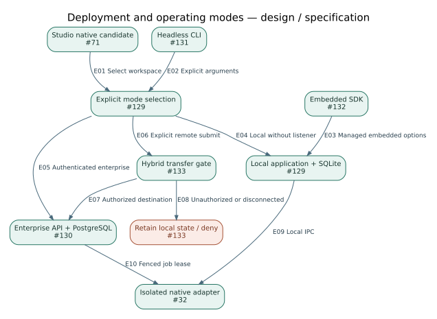

| Edge | Relation | Issue | Reviewed source anchor |
|---|---|---|---|
| E01 | studio → mode: Select workspace | [#90](https://github.com/ameenalqershi/wow-decision-intelligence/issues/90) | [docs/design/operating-modes.md](../../operating-modes.md): Select the workspace context first. |
| E02 | cli → mode: Explicit arguments | [#131](https://github.com/ameenalqershi/wow-decision-intelligence/issues/131) | [docs/design/operating-modes.md](../../operating-modes.md): Configuration comes from explicit arguments and host configuration. |
| E03 | sdk → local: Managed embedded options | [#132](https://github.com/ameenalqershi/wow-decision-intelligence/issues/132) | [docs/design/operating-modes.md](../../operating-modes.md): Consumer supplies managed options and a cancellation token |
| E04 | mode → local: Local without listener | [#129](https://github.com/ameenalqershi/wow-decision-intelligence/issues/129) | [docs/design/operating-modes.md](../../operating-modes.md): No listener or external network prerequisite. |
| E05 | mode → remote: Authenticated enterprise | [#130](https://github.com/ameenalqershi/wow-decision-intelligence/issues/130) | [docs/design/operating-modes.md](../../operating-modes.md): Resolve tenant from authentication |
| E06 | mode → hybrid: Explicit remote submit | [#133](https://github.com/ameenalqershi/wow-decision-intelligence/issues/133) | [docs/design/operating-modes.md](../../operating-modes.md): Local revision remains authoritative until explicit remote submit. |
| E07 | hybrid → remote: Authorized destination | [#133](https://github.com/ameenalqershi/wow-decision-intelligence/issues/133) | [docs/design/operating-modes.md](../../operating-modes.md): Pin destination, digest and permitted transfer scope. |
| E08 | hybrid → deny: Unauthorized or disconnected | [#133](https://github.com/ameenalqershi/wow-decision-intelligence/issues/133) | [docs/design/operating-modes.md](../../operating-modes.md): A disconnected client can inspect local history. |
| E09 | local → worker: Local IPC | [#129](https://github.com/ameenalqershi/wow-decision-intelligence/issues/129) | [docs/design/operating-modes.md](../../operating-modes.md): Start a worker over local IPC. |
| E10 | remote → worker: Fenced job lease | [#130](https://github.com/ameenalqershi/wow-decision-intelligence/issues/130) | [docs/design/operating-modes.md](../../operating-modes.md): acquire a fenced job lease |

## CLI command families

Command families are the approved CLI design, not a claim all handlers exist. Help/version require no workspace, solver or network.

شجرة عائلات أوامر الطرفية وفق التصميم المعتمد؛ لا يعني الرسم أن جميع المعالجات منفذة، والمساعدة والإصدار بلا اعتماد على المحرك.

Requirement: SP03-05; bilingual SP03-06; issue #161. [Editable DOT (alternate graph for sequences)](cli-tree.dot) · [Rendered SVG](cli-tree.svg).

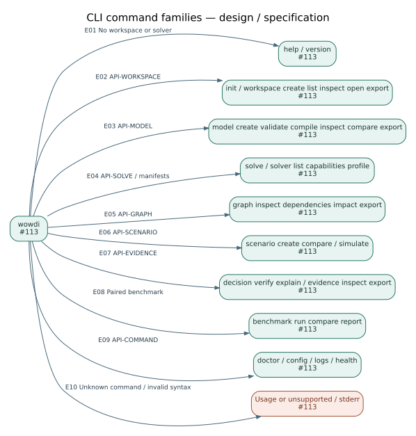

| Edge | Relation | Issue | Reviewed source anchor |
|---|---|---|---|
| E01 | root → help: No workspace or solver | [#113](https://github.com/ameenalqershi/wow-decision-intelligence/issues/113) | [docs/design/cli-contract.md](../../cli-contract.md): Help, version and syntax validation never require network access |
| E02 | root → workspace: API-WORKSPACE | [#113](https://github.com/ameenalqershi/wow-decision-intelligence/issues/113) | [docs/design/cli-contract.md](../../cli-contract.md): init, workspace create/list/inspect/open/export |
| E03 | root → model: API-MODEL | [#113](https://github.com/ameenalqershi/wow-decision-intelligence/issues/113) | [docs/design/cli-contract.md](../../cli-contract.md): model create/validate/compile/inspect/compare/export |
| E04 | root → solve: API-SOLVE / manifests | [#113](https://github.com/ameenalqershi/wow-decision-intelligence/issues/113) | [docs/design/cli-contract.md](../../cli-contract.md): solver list/capabilities/profile |
| E05 | root → graph: API-GRAPH | [#113](https://github.com/ameenalqershi/wow-decision-intelligence/issues/113) | [docs/design/cli-contract.md](../../cli-contract.md): graph inspect/dependencies/impact/export |
| E06 | root → scenario: API-SCENARIO | [#113](https://github.com/ameenalqershi/wow-decision-intelligence/issues/113) | [docs/design/cli-contract.md](../../cli-contract.md): scenario create/compare, simulate |
| E07 | root → evidence: API-EVIDENCE | [#113](https://github.com/ameenalqershi/wow-decision-intelligence/issues/113) | [docs/design/cli-contract.md](../../cli-contract.md): decision verify/explain, evidence inspect/export |
| E08 | root → benchmark: Paired benchmark | [#113](https://github.com/ameenalqershi/wow-decision-intelligence/issues/113) | [docs/design/cli-contract.md](../../cli-contract.md): benchmark run/compare/report |
| E09 | root → diagnostics: API-COMMAND | [#113](https://github.com/ameenalqershi/wow-decision-intelligence/issues/113) | [docs/design/cli-contract.md](../../cli-contract.md): doctor, version, config, logs, health |
| E10 | root → fail: Unknown command / invalid syntax | [#113](https://github.com/ameenalqershi/wow-decision-intelligence/issues/113) | [docs/design/cli-contract.md](../../cli-contract.md): Unknown commands return a nonzero usage status. |

## Before and after incremental reuse

Reference full solve versus proposed exact reuse. New coupling invalidates affected scope; independent checker and valid global bound remain necessary. No unmeasured speedup is claimed.

مقارنة الحل الكامل بإعادة الاستخدام المشروطة بالفصل الرياضي؛ العلاقة الجديدة تبطل النطاق المتأثر، ولا يُدعى تحسن الأداء دون قياس.

Requirement: SP03-07; bilingual SP03-06; issue #161. [Editable DOT (alternate graph for sequences)](incremental.dot) · [Rendered SVG](incremental.svg).

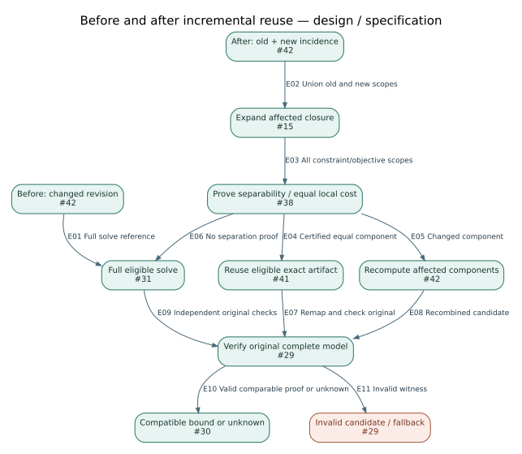

| Edge | Relation | Issue | Reviewed source anchor |
|---|---|---|---|
| E01 | before → full: Full solve reference | [#42](https://github.com/ameenalqershi/wow-decision-intelligence/issues/42) | [docs/design/engine.md](../../engine.md): Initial deterministic preference |
| E02 | after → closure: Union old and new scopes | [#15](https://github.com/ameenalqershi/wow-decision-intelligence/issues/15) | [docs/design/engine.md](../../engine.md): compute closure on both old and new incidence |
| E03 | closure → proof: All constraint/objective scopes | [#38](https://github.com/ameenalqershi/wow-decision-intelligence/issues/38) | [docs/design/engine.md](../../engine.md): Recalculate connected components using all constraint and objective-term scopes. |
| E04 | proof → reuse: Certified equal component | [#41](https://github.com/ameenalqershi/wow-decision-intelligence/issues/41) | [docs/design/engine.md](../../engine.md): Equal canonical local feasible set and cost |
| E05 | proof → recompute: Changed component | [#42](https://github.com/ameenalqershi/wow-decision-intelligence/issues/42) | [docs/design/engine.md](../../engine.md): A crossing edge merges components |
| E06 | proof → full: No separation proof | [#42](https://github.com/ameenalqershi/wow-decision-intelligence/issues/42) | [docs/design/engine.md](../../engine.md): Heuristic graph partitioning can propose candidates but cannot prove independence. |
| E07 | reuse → verify: Remap and check original | [#29](https://github.com/ameenalqershi/wow-decision-intelligence/issues/29) | [docs/design/engine.md](../../engine.md): Remap stable IDs and verify against current complete model |
| E08 | recompute → verify: Recombined candidate | [#29](https://github.com/ameenalqershi/wow-decision-intelligence/issues/29) | [docs/design/engine.md](../../engine.md): reoptimization can produce only a candidate until a global bound closes. |
| E09 | full → verify: Independent original checks | [#29](https://github.com/ameenalqershi/wow-decision-intelligence/issues/29) | [docs/design/engine.md](../../engine.md): Independently evaluate all original hard rows |
| E10 | verify → bound: Valid comparable proof or unknown | [#30](https://github.com/ameenalqershi/wow-decision-intelligence/issues/30) | [docs/design/engine.md](../../engine.md): Unknown bound → unknown gap. |
| E11 | verify → reject: Invalid witness | [#29](https://github.com/ameenalqershi/wow-decision-intelligence/issues/29) | [docs/design/engine.md](../../engine.md): Invalid witness → reject candidate and block proposal. |

## Factory mathematical example (observed synthetic proof)

Synthetic baseline and outage hand-proved optimum using V01 independent exhaustive checks. These costs are weighted minutes, not revenue or measured production savings.

مثال اصطناعي موثق بتعداد مستقل: القيمة المثلى 3 قبل التوقف و12 بعده، بوحدة دقائق موزونة وليست وفراً تجارياً.

Requirement: SP03-07; bilingual SP03-06; issue #161. [Editable DOT (alternate graph for sequences)](mathematical-fixture.dot) · [Rendered SVG](mathematical-fixture.svg).

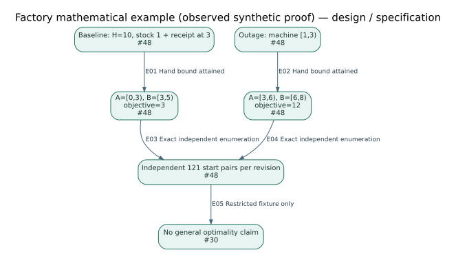

| Edge | Relation | Issue | Reviewed source anchor |
|---|---|---|---|
| E01 | base → opt1: Hand bound attained | [#48](https://github.com/ameenalqershi/wow-decision-intelligence/issues/48) | [docs/design/manufacturing-source-v1.md](../../manufacturing-source-v1.md): A=0,B=3 attains 3. |
| E02 | outage → opt2: Hand bound attained | [#48](https://github.com/ameenalqershi/wow-decision-intelligence/issues/48) | [docs/design/manufacturing-source-v1.md](../../manufacturing-source-v1.md): A=3,B=6 attains 12. |
| E03 | opt1 → proof: Exact independent enumeration | [#48](https://github.com/ameenalqershi/wow-decision-intelligence/issues/48) | [tests/Manufacturing.Data/evidence/oracle.txt](../../../../tests/Manufacturing.Data/evidence/oracle.txt): evaluated=121 feasible=41 optimum=3 |
| E04 | opt2 → proof: Exact independent enumeration | [#48](https://github.com/ameenalqershi/wow-decision-intelligence/issues/48) | [tests/Manufacturing.Data/evidence/oracle.txt](../../../../tests/Manufacturing.Data/evidence/oracle.txt): evaluated=121 feasible=12 optimum=12 |
| E05 | proof → unknown: Restricted fixture only | [#48](https://github.com/ameenalqershi/wow-decision-intelligence/issues/48) | [docs/design/manufacturing-source-v1.md](../../manufacturing-source-v1.md): This is not a production optimizer or verifier. |

## Studio navigation and module registry

All 23 reviewed module identities, organized by the ten official sidebar groups. Group placement is a presentation design decision, and unavailable feature providers remain explicitly unavailable.

توزيع الوحدات الثلاث والعشرين على مجموعات القائمة العشر المعتمدة؛ لا يعني ظهور الوحدة أن مزود الخدمة أو التنفيذ جاهز، ولا يجوز اختلاق البيانات.

Requirement: SP03-05; bilingual SP03-06; issue #161. [Editable DOT (alternate graph for sequences)](studio-navigation.dot) · [Rendered SVG](studio-navigation.svg).

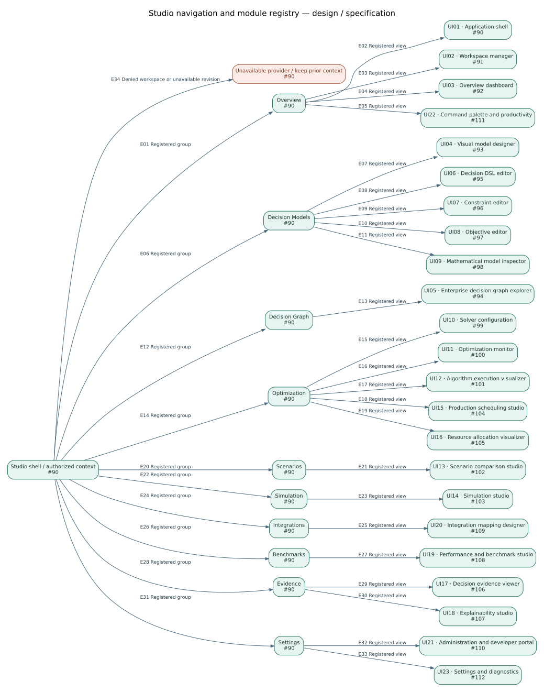

| Edge | Relation | Issue | Reviewed source anchor |
|---|---|---|---|
| E01 | shell → overview: Registered group | [#90](https://github.com/ameenalqershi/wow-decision-intelligence/issues/90) | [docs/design/references/IMPLEMENTATION-SPEC.md](../../references/IMPLEMENTATION-SPEC.md): Sidebar order: Overview, Decision Models, Decision Graph, Optimization, Scenarios, Simulation, Integrations, Benchmarks, Evidence, Settings. |
| E02 | overview → UI01: Registered view | [#90](https://github.com/ameenalqershi/wow-decision-intelligence/issues/90) | [docs/design/studio/UI01.md](../../studio/UI01.md): # UI01 · Application shell |
| E03 | overview → UI02: Registered view | [#91](https://github.com/ameenalqershi/wow-decision-intelligence/issues/91) | [docs/design/studio/UI02.md](../../studio/UI02.md): # UI02 · Workspace manager |
| E04 | overview → UI03: Registered view | [#92](https://github.com/ameenalqershi/wow-decision-intelligence/issues/92) | [docs/design/studio/UI03.md](../../studio/UI03.md): # UI03 · Overview dashboard |
| E05 | overview → UI22: Registered view | [#111](https://github.com/ameenalqershi/wow-decision-intelligence/issues/111) | [docs/design/studio/UI22.md](../../studio/UI22.md): # UI22 · Command palette and productivity |
| E06 | shell → models: Registered group | [#90](https://github.com/ameenalqershi/wow-decision-intelligence/issues/90) | [docs/design/references/IMPLEMENTATION-SPEC.md](../../references/IMPLEMENTATION-SPEC.md): Sidebar order: Overview, Decision Models, Decision Graph, Optimization, Scenarios, Simulation, Integrations, Benchmarks, Evidence, Settings. |
| E07 | models → UI04: Registered view | [#93](https://github.com/ameenalqershi/wow-decision-intelligence/issues/93) | [docs/design/studio/UI04.md](../../studio/UI04.md): # UI04 · Visual model designer |
| E08 | models → UI06: Registered view | [#95](https://github.com/ameenalqershi/wow-decision-intelligence/issues/95) | [docs/design/studio/UI06.md](../../studio/UI06.md): # UI06 · Decision DSL editor |
| E09 | models → UI07: Registered view | [#96](https://github.com/ameenalqershi/wow-decision-intelligence/issues/96) | [docs/design/studio/UI07.md](../../studio/UI07.md): # UI07 · Constraint editor |
| E10 | models → UI08: Registered view | [#97](https://github.com/ameenalqershi/wow-decision-intelligence/issues/97) | [docs/design/studio/UI08.md](../../studio/UI08.md): # UI08 · Objective editor |
| E11 | models → UI09: Registered view | [#98](https://github.com/ameenalqershi/wow-decision-intelligence/issues/98) | [docs/design/studio/UI09.md](../../studio/UI09.md): # UI09 · Mathematical model inspector |
| E12 | shell → graph: Registered group | [#90](https://github.com/ameenalqershi/wow-decision-intelligence/issues/90) | [docs/design/references/IMPLEMENTATION-SPEC.md](../../references/IMPLEMENTATION-SPEC.md): Sidebar order: Overview, Decision Models, Decision Graph, Optimization, Scenarios, Simulation, Integrations, Benchmarks, Evidence, Settings. |
| E13 | graph → UI05: Registered view | [#94](https://github.com/ameenalqershi/wow-decision-intelligence/issues/94) | [docs/design/studio/UI05.md](../../studio/UI05.md): # UI05 · Enterprise decision graph explorer |
| E14 | shell → optimization: Registered group | [#90](https://github.com/ameenalqershi/wow-decision-intelligence/issues/90) | [docs/design/references/IMPLEMENTATION-SPEC.md](../../references/IMPLEMENTATION-SPEC.md): Sidebar order: Overview, Decision Models, Decision Graph, Optimization, Scenarios, Simulation, Integrations, Benchmarks, Evidence, Settings. |
| E15 | optimization → UI10: Registered view | [#99](https://github.com/ameenalqershi/wow-decision-intelligence/issues/99) | [docs/design/studio/UI10.md](../../studio/UI10.md): # UI10 · Solver configuration |
| E16 | optimization → UI11: Registered view | [#100](https://github.com/ameenalqershi/wow-decision-intelligence/issues/100) | [docs/design/studio/UI11.md](../../studio/UI11.md): # UI11 · Optimization monitor |
| E17 | optimization → UI12: Registered view | [#101](https://github.com/ameenalqershi/wow-decision-intelligence/issues/101) | [docs/design/studio/UI12.md](../../studio/UI12.md): # UI12 · Algorithm execution visualizer |
| E18 | optimization → UI15: Registered view | [#104](https://github.com/ameenalqershi/wow-decision-intelligence/issues/104) | [docs/design/studio/UI15.md](../../studio/UI15.md): # UI15 · Production scheduling studio |
| E19 | optimization → UI16: Registered view | [#105](https://github.com/ameenalqershi/wow-decision-intelligence/issues/105) | [docs/design/studio/UI16.md](../../studio/UI16.md): # UI16 · Resource allocation visualizer |
| E20 | shell → scenarios: Registered group | [#90](https://github.com/ameenalqershi/wow-decision-intelligence/issues/90) | [docs/design/references/IMPLEMENTATION-SPEC.md](../../references/IMPLEMENTATION-SPEC.md): Sidebar order: Overview, Decision Models, Decision Graph, Optimization, Scenarios, Simulation, Integrations, Benchmarks, Evidence, Settings. |
| E21 | scenarios → UI13: Registered view | [#102](https://github.com/ameenalqershi/wow-decision-intelligence/issues/102) | [docs/design/studio/UI13.md](../../studio/UI13.md): # UI13 · Scenario comparison studio |
| E22 | shell → simulation: Registered group | [#90](https://github.com/ameenalqershi/wow-decision-intelligence/issues/90) | [docs/design/references/IMPLEMENTATION-SPEC.md](../../references/IMPLEMENTATION-SPEC.md): Sidebar order: Overview, Decision Models, Decision Graph, Optimization, Scenarios, Simulation, Integrations, Benchmarks, Evidence, Settings. |
| E23 | simulation → UI14: Registered view | [#103](https://github.com/ameenalqershi/wow-decision-intelligence/issues/103) | [docs/design/studio/UI14.md](../../studio/UI14.md): # UI14 · Simulation studio |
| E24 | shell → integrations: Registered group | [#90](https://github.com/ameenalqershi/wow-decision-intelligence/issues/90) | [docs/design/references/IMPLEMENTATION-SPEC.md](../../references/IMPLEMENTATION-SPEC.md): Sidebar order: Overview, Decision Models, Decision Graph, Optimization, Scenarios, Simulation, Integrations, Benchmarks, Evidence, Settings. |
| E25 | integrations → UI20: Registered view | [#109](https://github.com/ameenalqershi/wow-decision-intelligence/issues/109) | [docs/design/studio/UI20.md](../../studio/UI20.md): # UI20 · Integration mapping designer |
| E26 | shell → benchmarks: Registered group | [#90](https://github.com/ameenalqershi/wow-decision-intelligence/issues/90) | [docs/design/references/IMPLEMENTATION-SPEC.md](../../references/IMPLEMENTATION-SPEC.md): Sidebar order: Overview, Decision Models, Decision Graph, Optimization, Scenarios, Simulation, Integrations, Benchmarks, Evidence, Settings. |
| E27 | benchmarks → UI19: Registered view | [#108](https://github.com/ameenalqershi/wow-decision-intelligence/issues/108) | [docs/design/studio/UI19.md](../../studio/UI19.md): # UI19 · Performance and benchmark studio |
| E28 | shell → evidence: Registered group | [#90](https://github.com/ameenalqershi/wow-decision-intelligence/issues/90) | [docs/design/references/IMPLEMENTATION-SPEC.md](../../references/IMPLEMENTATION-SPEC.md): Sidebar order: Overview, Decision Models, Decision Graph, Optimization, Scenarios, Simulation, Integrations, Benchmarks, Evidence, Settings. |
| E29 | evidence → UI17: Registered view | [#106](https://github.com/ameenalqershi/wow-decision-intelligence/issues/106) | [docs/design/studio/UI17.md](../../studio/UI17.md): # UI17 · Decision evidence viewer |
| E30 | evidence → UI18: Registered view | [#107](https://github.com/ameenalqershi/wow-decision-intelligence/issues/107) | [docs/design/studio/UI18.md](../../studio/UI18.md): # UI18 · Explainability studio |
| E31 | shell → settings: Registered group | [#90](https://github.com/ameenalqershi/wow-decision-intelligence/issues/90) | [docs/design/references/IMPLEMENTATION-SPEC.md](../../references/IMPLEMENTATION-SPEC.md): Sidebar order: Overview, Decision Models, Decision Graph, Optimization, Scenarios, Simulation, Integrations, Benchmarks, Evidence, Settings. |
| E32 | settings → UI21: Registered view | [#110](https://github.com/ameenalqershi/wow-decision-intelligence/issues/110) | [docs/design/studio/UI21.md](../../studio/UI21.md): # UI21 · Administration and developer portal |
| E33 | settings → UI23: Registered view | [#112](https://github.com/ameenalqershi/wow-decision-intelligence/issues/112) | [docs/design/studio/UI23.md](../../studio/UI23.md): # UI23 · Settings and diagnostics |
| E34 | shell → unavailable: Denied workspace or unavailable revision | [#90](https://github.com/ameenalqershi/wow-decision-intelligence/issues/90) | [docs/design/studio/review/UI01/shell-contract.md](../../studio/review/UI01/shell-contract.md): restore only if still available and authorized |

## EDD reference versus exact small optimum

The merged V02 reference and V01 exhaustive oracle use identical synthetic input hashes. Observed cost difference is algorithmic for these fixtures; no speed or commercial savings claims.

مقارنة عادلة بين الخوارزمية المرجعية والحل الأمثل في أمثلة ثابتة؛ اختلاف التكلفة مرتبط بالجدولة هنا ولا يمثل قياس سرعة أو وفراً تجارياً.

Requirement: SP03-07; bilingual SP03-06; issue #161. [Editable DOT (alternate graph for sequences)](dispatch-comparison.dot) · [Rendered SVG](dispatch-comparison.svg).

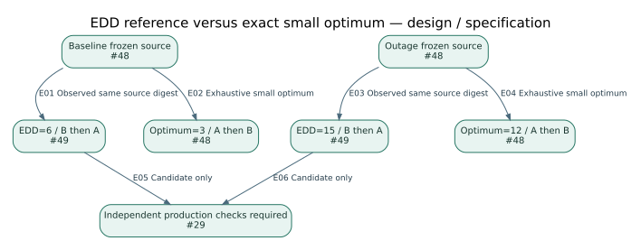

| Edge | Relation | Issue | Reviewed source anchor |
|---|---|---|---|
| E01 | baseline → edd1: Observed same source digest | [#49](https://github.com/ameenalqershi/wow-decision-intelligence/issues/49) | [tests/Manufacturing.Dispatch/evidence/reference-dispatch.txt](../../../../tests/Manufacturing.Dispatch/evidence/reference-dispatch.txt): EDD=6 starts=3,0 |
| E02 | baseline → exact1: Exhaustive small optimum | [#48](https://github.com/ameenalqershi/wow-decision-intelligence/issues/48) | [tests/Manufacturing.Data/evidence/oracle.txt](../../../../tests/Manufacturing.Data/evidence/oracle.txt): evaluated=121 feasible=41 optimum=3 |
| E03 | outage → edd2: Observed same source digest | [#49](https://github.com/ameenalqershi/wow-decision-intelligence/issues/49) | [tests/Manufacturing.Dispatch/evidence/reference-dispatch.txt](../../../../tests/Manufacturing.Dispatch/evidence/reference-dispatch.txt): EDD=15 starts=5,3 |
| E04 | outage → exact2: Exhaustive small optimum | [#48](https://github.com/ameenalqershi/wow-decision-intelligence/issues/48) | [tests/Manufacturing.Data/evidence/oracle.txt](../../../../tests/Manufacturing.Data/evidence/oracle.txt): evaluated=121 feasible=12 optimum=12 |
| E05 | edd1 → verify: Candidate only | [#29](https://github.com/ameenalqershi/wow-decision-intelligence/issues/29) | [docs/design/manufacturing-dispatch-v1.md](../../manufacturing-dispatch-v1.md): NoCandidate is not an Infeasible mathematical status |
| E06 | edd2 → verify: Candidate only | [#29](https://github.com/ameenalqershi/wow-decision-intelligence/issues/29) | [docs/design/manufacturing-dispatch-v1.md](../../manufacturing-dispatch-v1.md): No run ID, bound, certificate or evidence digest is |
