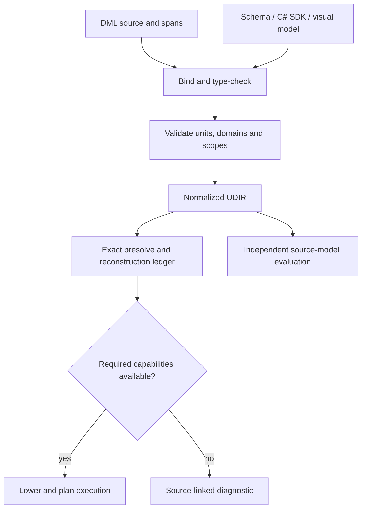

# UADIE semantics and contracts

## EDG, UDIR and the compiler

EDG stores semantic entities (orders, resources, policies, events, outcomes) and typed relations (requires, consumes, precedes, constrains, producedBy). Immutable snapshots retain external source key, mapping version, timestamp, unit and provenance. Time windows are half-open and normalized against an explicit calendar. Attach risk/uncertainty distributions to input snapshots and policy limits to the affected resources. A constraint is a hyperedge over every variable it reads. Store it as a factor node plus incident variables: bipartite representation makes degree, reverse reachability and multi-variable scope explicit. Record shared parameters, objective terms and derived expressions too. Heuristic graph partitioning can propose candidates but cannot prove independence.

UDIR v0 semantic contract: revision + input fingerprints; typed symbols with ID, domain and finite/infinite endpoints; expression DAG with typed operator, exact literal/interval or symbol references; constraint with hard/soft status, capacity/time semantics and source span; ordered objective vector with direction, unit and tolerances; scenario tree with stage and information set; capabilities and provenance on all transformed nodes. Base types are Boolean, bounded Integer, Rational, Instant, Duration, Quantity[dimension], Money[currency], Rate[numerator/denominator]. Addition and comparisons require identical dimensions and compatible units. Normalize exact scales by rational arithmetic checked for overflow. Currency conversions require an explicit exchange-rate snapshot and effective date. No implicit conversion between period rates and quantities. Preserve horizon, timezone, DST/calendar and integer scaling details in replay metadata.

Parsing constructs an AST without external IO. Semantic analysis resolves references; repeated IDs and cyclic derived expressions fail. Normalization folds exact constants, sorts commutative arguments and removes **identical hard rows** only after preserving all origin links. Duplicate soft penalties cannot be dropped. Dropping an unused variable needs a nonempty domain and a reconstruction value. Tightening bounds requires an implication from the original constraints. Constant contradiction proves infeasibility; inability to find a contradiction proves nothing. Presolve must supply reconstruction/projection maps. Every exact rewrite must preserve feasible original assignments up to projection and objective values. Test both directions on finite enumerated models. Approximation is an explicit revision with error contract and caller opt-in. Unsupported exact lowering returns a diagnostic. Integerizing rational constraints needs a common denominator and range proof for the entire expression.

## Solver orchestration

Capability manifests describe numeric domains, coefficient or horizon limits, global constraints, objective hierarchy, hints, interruptions, native threads, bound semantics and version/RID. First reject incompatible backends; then extract variable/constraint counts, integer ratio, incidence density, component sizes, temporal features, uncertainty, objective class, accuracy and budget. Initial deterministic preference: integer interval scheduling → CP-SAT; LP → HiGHS; no eligible backend → unsupported. Benchmark alternative formulations and retain explainable tie-breaks. Test single solver, hinted solve, time slicing, parallel portfolio and cooperative feasible incumbents with identical core-second budgets. Bounds transfer only across a proven equivalent model with direction and tolerance. A learned selector requires held-out families, feature cost accounting and measured improvement versus single-best and rule baselines.

## Exact incremental reuse

For a minimization model, if feasible set F = F₁ × … × Fₖ and cost f(x) = c + Σ fᵢ(xᵢ), every feasible solution has f(x) ≥ c + Σ min fᵢ. Concatenating exact minimizers attains the bound. If a component is empty the product is empty. The implemented experiment covers nonempty finite binary domains, scoped count constraints and scoped additive activation costs. The general engine needs further work for multiobjective, uncertainty and numerical tolerances.

On change, compute closure on both old and new incidence (including removed edges), expand derived symbols, shared capacities, material balances, global objectives and policy/calendar references. Recalculate connected components using all constraint and objective-term scopes. A crossing edge merges components; a removed edge can split one. An SCC in a directed data graph does not certify mathematical independence. For a non-additive max or product, separability must be separately demonstrated. Fixed separators yield a conditional subproblem; reoptimization can produce only a candidate until a global bound closes. Example: two independent preferred jobs both consume a last common material unit. Reusing the pair violates capacity, even if neither local schedule changed. Joint objective penalties can also alter the optimum without changing constraint feasibility.

| Reusable artifact | Required identity/check | Reject or downgrade when |
|---|---|---|
| Lowered structure and plan | Canonical typed structure + capabilities + compiler and adapter versions | Unit, expression, capability or index mapping changed |
| Input snapshot / preprocessing | Data hash + constraint hash + units, calendar, policies and exact transformation proof | Assumptions changed or row removed |
| Assignment / warm hint | Remap stable IDs and verify against current complete model | Feasibility fails; a valid hint alone supplies no optimality claim |
| Exact component optimum | Equal canonical local feasible set and cost, certified separation, compatible evidence and tenant | Cross-component terms, unknown semantics or missing evidence |
| Lower/upper bound | Direction, objective definition, feasible-set implication and numerical tolerance proven | Structural resemblance, changed currency or reversed objective |
| Solver configuration | Backend version, flags, hardware class, budgets and model family | Treat as a candidate; compare again on current workload |

Use versioned canonical bytes and SHA-256 for indexing, domain-separated by tenant, artifact kind, structure/data/constraint/objective/solver config and semantics version. Compare canonical bytes or equivalent semantic provenance before reuse; hashing a sorted list of IDs alone omits meaning. Never share private evidence across tenants. The research cache compares complete serialized local content in memory. It is not the production fingerprint implementation.

## Verification and explanations

Independently evaluate all original hard rows, domains, availability over half-open intervals, material prefixes and objectives. Verify finite values, integer exactness where required, and residuals using versioned absolute and relative tolerances. Primal verification certifies feasibility only. A minimization lower bound L and feasible U imply absolute gap U−L if L≤U within tolerance. For comparable reports use (U−L)/max(1,|U|) with a declared objective unit/scale and record native gap separately. Unknown bound → unknown gap. Exact proof, tolerance-qualified solver attestation and independently validated certificate are different evidence levels. Invalid witness → reject candidate and block proposal. LP dual bounds need dual feasibility, consistent units and objective direction. Infeasibility needs certificate verification where supported, else label the solver attestation. No proof from timeouts.

Explain “why” via individual contributions and actual binding constraints, without asserting causation from binding alone. To explain a rejected alternative, force its choice and re-solve under the same snapshot/budget. Supply feasibility and bounds for both alternatives. Marginal LP prices require a qualified continuous model and a basis/range; use a scenario re-solve for discrete choices. An IIS is irreducible, not necessarily smallest. For least-cost relaxation define the permitted softening variables, units, weights and immutable safety constraints; certify minimality only with sufficient evidence. Compare plans with separate cost, uncertainty and stability metrics. Optional generated text can quote evidence IDs but cannot set mathematical status.
