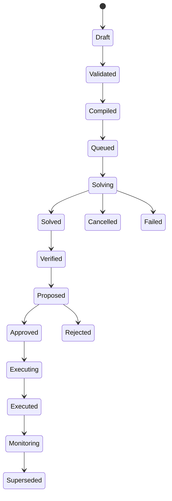

# Decision lifecycle and authorization contract

A decision revision carries a workflow state, a mathematical state, a termination reason and a verification level. Changes to inputs create a new revision in Draft. All transitions require an actor, expected state and revision, timestamp, causation and an append-only audit event. A stale transition fails atomically.

| From | Allowed destinations | Guard |
|---|---|---|
| Draft | Validated, Cancelled | Schema, policy, units and source checks pass for Validated; invalid drafts retain diagnostics |
| Validated | Compiled, Failed, Cancelled | Exact supported lowering or an explicitly approved approximation revision |
| Compiled | Queued, Cancelled | Frozen input, adapter profile and budget |
| Queued | Solving, Cancelled, Failed | Fenced lease for Solving |
| Solving | Solved, Failed, Cancelled | Persist outcome including absence of incumbent; infrastructure failure and user cancellation separately classified |
| Solved | Verified, Failed, Superseded | Independent verification of the available result or certificate; invalid evidence fails |
| Verified | Proposed, Superseded | Only a verified feasible incumbent satisfying policy may be proposed |
| Proposed | Approved, Rejected, Superseded | Authorize approver; require current revision and policy. Refusal is audited |
| Approved | Executing, Superseded | Recheck freshness, policy, actor separation, target, expiry and approval digest |
| Executing | Executed, Failed | External acknowledgement and idempotency reconciliation required. Ambiguous outcome stays Executing pending reconciliation |
| Executed | Monitoring | Observation begins on acknowledged execution |
| Monitoring | Superseded | New revision takes effect without rewriting the original history |
| Rejected, Superseded, Failed, Cancelled | None | A retry or revised proposal creates a linked new run/revision |

All unlisted transitions are forbidden. The final sentence of the brief ends before stating an exception for sensitive execution. Initial product policy disables external execution of financial, industrial and sensitive decisions; they may be exported for human review. Any later enabled execution must require human approval linked to tenant, model/revision, proposal hash, target and expiry. An approval cannot itself enable a disabled connector/policy. A creator may not approve their own sensitive proposal. A new outage invalidates the proposal even if its previous plan still happens to be feasible.

The table is exhaustive; the diagram shows the main path. Mathematical status includes Optimal, Feasible, Infeasible, Unbounded and Unknown. Run termination can be Completed, Timeout, Cancelled or Failed. The API exposes the requested Timeout/Cancelled/Failed outcomes alongside incumbent status rather than discarding a verified solution. Example: workflow Solved, math Feasible, termination Timeout, incumbent checked, global lower bound unavailable. Cancellation can preserve verified evidence for inspection but cannot propose it directly. A timeout without evidence is Unknown. Native “infeasible or unbounded” stays Unknown pending disambiguation. Never promote a gap-triggered stop to exact Optimal unless the proof convention justifies it.
