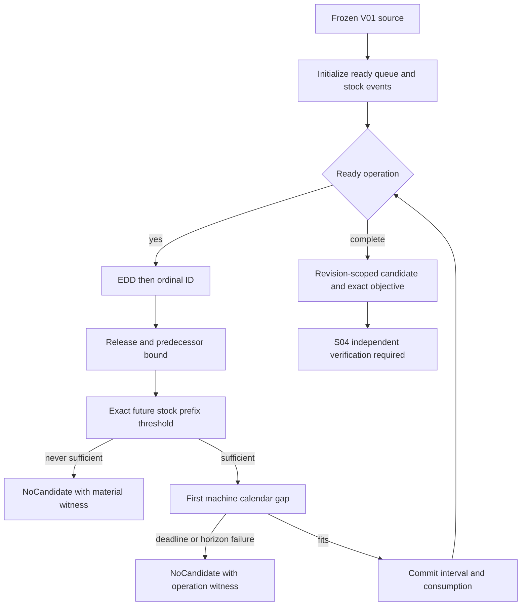

# V02 — deterministic dispatch reference

The serial earliest-due-date insertion policy consumes the immutable
V01 source admitted by FactoryAdmission. It is a reference heuristic
for comparisons, not a solver, original-model verifier or proof of
optimality. Version: edd-serial-insertion/1.

## Algorithm and invariants

At each step choose a precedence-ready operation by ascending due minute
and ordinal operation ID. A ready operation has all predecessors placed.
Compute the earliest release/predecessor end. For each consumed material,
maintain an ordered balance delta timeline (initial stock, receipts and
already assigned starts). Find the first tick after the last balance
interval insufficient for the new quantity. Adding consumption at that
tick or later preserves *all* later prefix inequalities. Take the maximum
of these material thresholds and the release/predecessor bound. Find
the first machine gap of sufficient duration at or beyond that bound,
using existing assignments and calendar downtime as half-open busy
intervals. Respect the horizon and any separate hard deadline. Commit
the new start to the material timelines, then release ready successors.

The material sweep accounts for previously assigned future consumption;
checking only inventory at the proposed start would be incorrect.
Receipt and consumption deltas at a common tick are aggregated exactly.
All quantity/cost arithmetic uses reduced BigInteger rationals, without
rounding or cross-unit/currency conversion. Time additions are widened
before checking horizon bounds. The algorithm jumps between event
boundaries rather than iterating every minute, including a near-Int32
horizon test. It cooperatively checks cancellation while traversing
operations and events.

For n operations, e precedence edges and b maximum busy intervals on
a machine, the queue costs O((n+e) log n); scanning busy intervals and
material timelines per operation depends on actual assigned operations,
receipts and consumption coefficients. Worst-case scans can be
quadratic in the number of relevant events. This reference makes
no general throughput or superiority claim; benchmark V05/X07 must
measure workload and scope. BigInteger arithmetic cost depends on
operand width.

## Output and failure semantics

Result includes algorithm version, source revision, digest, objective
unit, dispatch order, and sorted complete candidate assignments. Exact
objective is weighted tardiness in the original source unit.
A failure carries reason, operation, optional material/earliest tick,
and number already placed; it exposes no partial candidate or objective.
Cancellation throws OperationCanceledException; it does not publish a
result. NoCandidate is not an Infeasible mathematical status: the
calendar/deadline falsification fixture has a valid alternative even
though EDD fails. No run ID, bound, certificate or evidence digest is
invented. S04/S10 own those capabilities.

## Reference results

| Synthetic input | Hand-proved optimum (V01) | EDD observed | Starts A,B[,C] |
|---|---:|---:|---|
| baseline | 3 | 6 | 3,0 |
| outage | 12 | 15 | 5,3 |
| multi | 1/2 USD | 1/2 USD | 0,4,6 |
| no-stock | no feasible assignment | NoCandidate | none |

Independent test-only tick-by-tick checks validate machine intervals,
all material prefix balances, precedence, deadlines and exact objective
for complete candidates. Tests also verify row-order invariance, ordinal
ties, simultaneous starts and same-tick receipts, future reservation
protection, cancellation, near-int-max horizon and a nonoptimal failure.

Evidence: [observed baseline outputs](../../tests/Manufacturing.Dispatch/evidence/reference-dispatch.txt).
Local .NET 10 Linux: 11/11 passed. Reproduce with
`dotnet test tests/Manufacturing.Dispatch -c Release --logger "console;verbosity=normal"`.
CI repeats on Windows/Linux. No paid dependency or solver is required.
