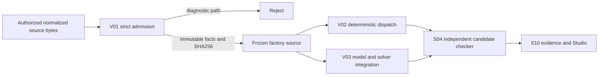

# V01 — immutable manufacturing source profile

This is the domain-owned factory source profile `wowdi.factory.source/1`,
not a public SDK/REST envelope, UDIR lowering, or a solver. It implements
the source facts of [production.md](production.md) and the accepted
[F-REV/F-MACHINE/F-OP/F-DURATION/F-RELEASE/F-DUE/F-WEIGHT dictionary](pilot-field-dictionary-v1.md).
M09/M10/M11 own model construction, transport and registry publication;
V03 owns solver integration, S04 independent verification, S05 evidence
of bounds. V01 admission is structural, not a feasibility certificate.

## Source contract and ownership

All required members are explicit, with no defaults for missing facts.
The optional currency and hard deadline have null meaning respectively
nonmonetary weighted minutes and no hard deadline. IDs are ordinal,
bounded nonblank source keys. Model/tenant namespace is assigned by the
trusted registry context, not accepted from these source bytes.
The source reader owns immutable bytes and lowercase SHA-256; revision
label alone is not unique content identity. No real factory data included.

| Record | Fields | Rule |
|---|---|---|
| Clock | calendarId, timeZoneId, origin, tickUnit, horizonMinutes | UTC second-precision origin, installed time zone, elapsed integer minutes, finite positive horizon |
| Machine calendar | machineId, downtime[startMinute,endMinute] | unique explicit calendar per machine; no missing calendar assumed open; sorted interval validation, half-open, touching permitted |
| Stock | materialId, unit, initialQuantity | unique material and explicit unit, nonnegative exact quantity |
| Receipt | receiptId, materialId, unit, quantity, availableMinute | unique receipt, reference and exact unit equality, availability in [0,H] |
| Operation | operationId, jobId, machineId, releaseMinute, durationMinutes, dueMinute, tardinessWeight, materials, hardDeadlineMinute? | fixed machine, mandatory uninterrupted operation, unique ID, positive duration, release in [0,H], due nonnegative (may exceed horizon), nonnegative exact weight, optional separate nonnegative deadline |
| Consumption | materialId, unit, quantity | one coefficient per operation/material, exact same material unit, nonnegative; consumed at operation start |
| Precedence | predecessor, successor | both operation IDs exist; no duplicate, self-edge or cycle |
| Metadata | profile, revisionId, objectiveUnit, currency? | explicit profile/revision; weighted-minute synthetic cost or single three-letter currency code, no currency conversion |

Quantities and weights in this **source profile** are canonical UDIR
integer/reduced rational strings (e.g. "1/2") validated by the existing
ExactValues comparison. There is no floating-point conversion, implicit
unit conversion or assumption that F-WEIGHT is an UDIR Objective.Weight.
An ingress adapter must normalize source units using M04 before admission;
V01 rejects mismatching declared units. Currency code syntax is checked,
not an assertion of a live currency registry or exchange rate. F-WEIGHT
means objectiveUnit per elapsed minute. A public pilot wire numeric field
needs a versioned exact conversion from its owning contract; do not
publish these source records as arbitrary API payloads.

JSON is bounded to 16 MiB and 32 levels; rejects duplicate/unknown members
and missing required members. Diagnostics identify the failing JSON row/
member path, not raw untrusted contents. No automatic defaults for missing
calendar, stock, receipts or release dates.

## Mathematical model

For operation i, start s_i is integer, release <= s_i, end =
s_i + duration_i <= H, and hardDeadline if supplied bounds the end.
Each predecessor's end <= successor start. For all operations sharing a
machine, the half-open intervals [s_i,end_i) are disjoint from each other
and that machine's downtime. For every material k and event tick t:
sum of quantity consumed by operations starting <= t must be <= initial
stock plus receipts available <= t. Receipts at t precede starts at t;
simultaneous starts consume jointly. No horizon-total substitute.
Minimize the single exact sum of weight_i * max(0,end_i-due_i).
No setups, alternate machines, lot splitting, FX, safety rule inference,
inventory holding objective or actuation is implied. A structural cycle is
rejected; insufficient stock can be a valid but infeasible dataset.

## Hand proof and executed independent oracle

Fixtures under tests/Manufacturing.Data/Fixtures are synthetic, public.
An independent **test-only** tick-by-tick exhaustive enumerator (bounded
to <=4 operations and H<=20) checks every integer start combination,
original machine occupancy, precedence, material prefix and exact cost.
This is not a production optimizer or verifier.

- Baseline: A duration 3, due 4, weight 3; B duration 2, due 2, weight 1;
  initial stock 1, receipt 1 at tick 3, H=10. A first cannot finish before
  3, B cannot start before 3; B ends >=5, cost >=3. A=0,B=3 attains 3.
  B first cannot enable A before tick 3, A ends >=6, cost >=6.
  Therefore 3 is optimal.
- Outage [1,3): neither duration fits before outage, so first starts >=3.
  A first yields B end >=8 and A end >=6, cost >=6+6=12;
  B first yields A end >=8 and B end >=5, cost >=12+3=15.
  A=3,B=6 attains 12. Therefore 12 is optimal.
- Multi: A on M1, B/C on M2; B consumes one kg resin, half available
  initially and half at tick 4. B cannot start before 4 and ends >=6,
  due 5, weight 1/2 USD/minute, lower bound 1/2 USD. A=0,B=4,C=6
  respects A→C, downtime [3,4), stock and C hard deadline 12.
  A and C contribute zero, attaining the lower bound.
- No-stock: mandatory demand 2 pieces with total stock 1 and no receipts.
  No feasible start assignment, regardless of ordering.

Actual local test output: [oracle.txt](../../tests/Manufacturing.Data/evidence/oracle.txt).
39/39 .NET 10 Linux tests passed, including exact bytes/hash, invalid row
and unit tests, and the four exhaustive examples. Cross-platform CI
reruns the same tests. Downstream consumers must verify their own
candidate, bound, scenario and import semantics, not reuse this oracle
as an assertion about arbitrary large models.

Reproduce: `dotnet test tests/Manufacturing.Data -c Release --logger "console;verbosity=normal"`.
