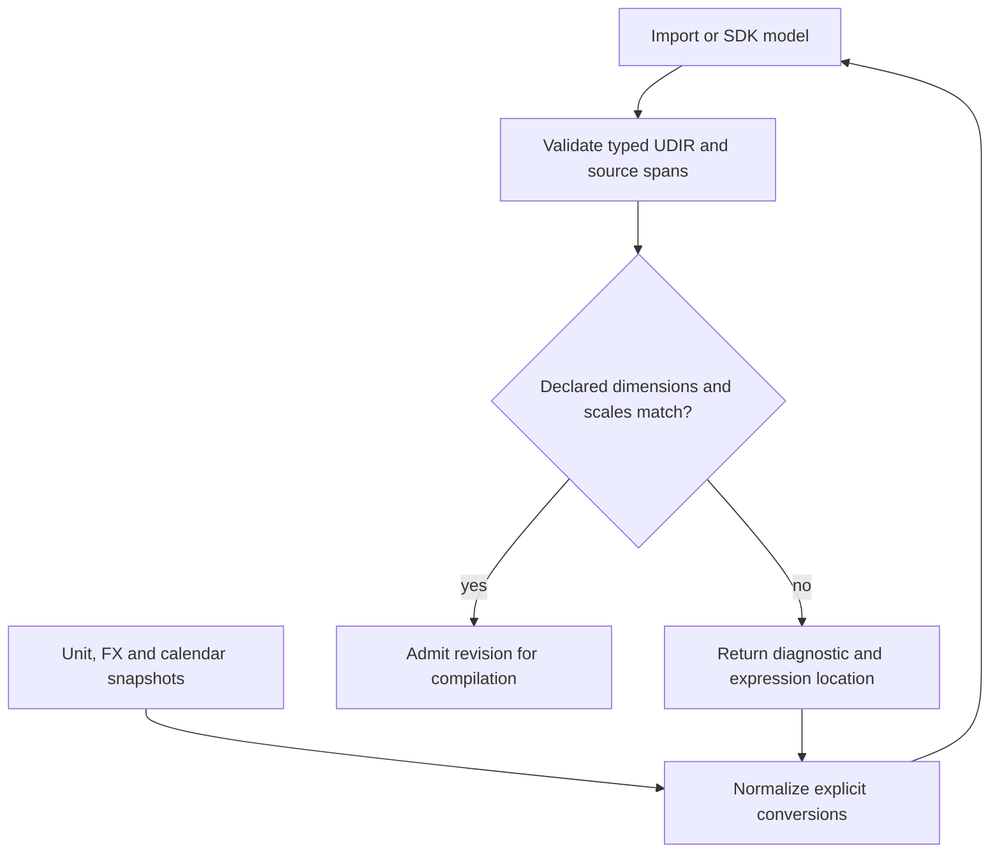

# M04 · Measurement admission and exact conversions

Model builders and importers resolve explicit scale, FX and calendar choices against a frozen host catalog. Call `UdirDocument.ValidateMeasurements(catalog)` on the structurally validated document before compilation or solver admission. Structural reading remains available for migration and inspection of models using custom units. Both entry points use the same exact UDIR rational syntax. Model admission checks every declared type and each product/quotient, including expressions outside the objective. Additive, comparison and instant operations are already type-checked in the structural pass.

| Input | Managed representation and acceptance |
|---|---|
| Unit definition | Case-sensitive ASCII symbol and dimension, positive canonical rational scale in that dimension's base unit. Define elapsed units under `time`. Products and quotients associate left to right. Fractions reduce exactly. |
| Model expression | Dimension exponents and declared scale must match. An invalid product reports expression ID and source span. Example: minutes × USD/minute yields USD. Convert USD/hour explicitly before multiplying by minutes. |
| Money and FX | Each admitted three-letter currency has a distinct dimension. Converting money requires a directional, positive rate with version and effective UTC instant in a half-open validity interval. The receipt retains snapshot, time, amount and currency for replay. Importers store the rate snapshot alongside original input evidence. |
| Time basis | Registered calendar ID, exact time-zone ID, offset-bearing origin and fixed elapsed tick unit. Tick rescaling requires the same calendar, zone and absolute origin. Instants use the model tick scale. Calendar periods require explicit expansion into elapsed intervals before admission. |
| Wall time | Resolve an unspecified local DateTime against its zone. Reject skipped times. Repeated times require one of the two valid offsets. Retain the resolved UTC value and offset with the imported calendar snapshot. |
| Numeric output | Canonical signed rational with at most 256 digits per reduced numerator and denominator. Reject a fractional or overflowing value when narrowing to Int64. |
| Host responsibilities | Freeze catalog definitions, calendar data, FX provenance and time-zone rules used for a replay. The component does not fetch market quotes or holiday calendars. |

API-MODEL consumers use the duration, release, due and weight fields documented in the pilot dictionary. SDK/compiler callers should test both structural and measurement diagnostics. Explicit conversions occur before producing the admitted UDIR, with their evidence retained by the caller.

يربط فحص النموذج كل قيمة بوحدتها وتقويمها. يحتاج تحويل العملة إلى سعر مؤرّخ ذي إصدار، ويحتاج الوقت المحلي المتكرر إلى تحديد الإزاحة. تحفظ طبقة الاستيراد دليل التحويل لإعادة التشغيل.
