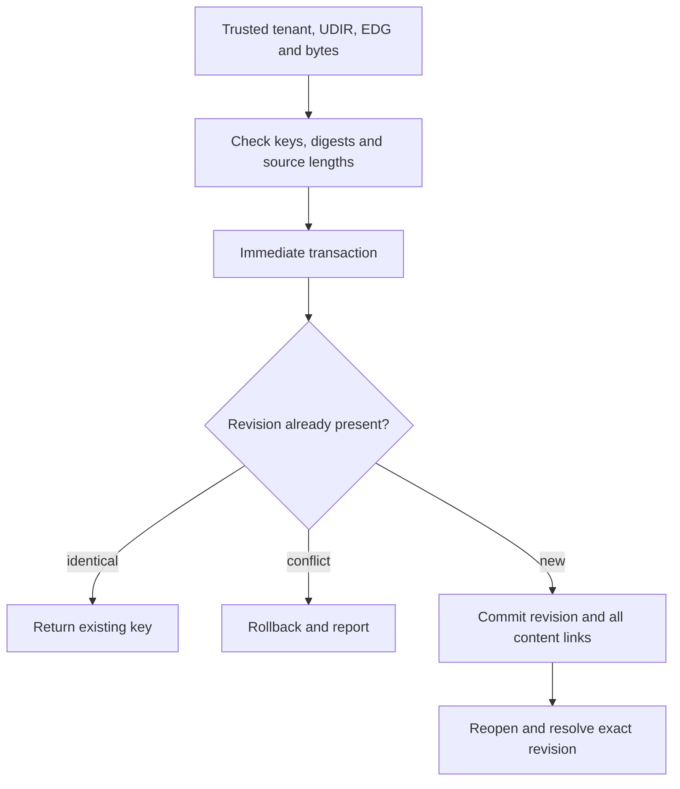

# M11 · Immutable revision registry

The SQLite reference implementation stores each frozen UDIR document, its matching EDG, and the exact input/source bytes. API-MODEL callers supply a trusted tenant namespace. Host authorization is enforced by the caller before selecting a registry and tenant. Model/domain libraries do not depend on SQLite. RT01 owns workspace hosting and E02 owns enterprise persistence.

| Record or field | Type and contract |
|---|---|
| revision key | Three nonblank, ordinal, tenant/model/revision text keys. Matches F-REV and both frozen documents. Reads require the full key. |
| model, graph | BLOB, required. The UDIR envelope retains extensions. EDG includes all nodes, relations and provenance. SQL ordering or input positions cannot change incidence. |
| model_hash, graph_hash | SHA-256 of the exact stored model and graph bytes. Reads check both before materialization. |
| blob key | Tenant and lowercase SHA-256; equal bytes deduplicate only within a tenant. Source-document digest and UTF-16 length must match the actual UTF-8 source. |
| revision input | Foreign keys to a frozen revision and content in the same tenant; exactly covers source and input digests, including binary non-source inputs. |

A single immediate transaction publishes all records. A retry with identical model, graph and inputs succeeds. A conflicting reuse of a key fails. Readers obtain one consistent snapshot. Lookups for missing or foreign keys return absent. Corrupt content yields a diagnostic. A failed write or schema upgrade rolls back. Host services must impose import quotas and provision the database path outside customer-controlled directories.

Storage edition 1 is the compatibility fixture: model/graph BLOBs, tenant-local content and revision references. Edition 2 adds document integrity digests. Opening v1 validates the entire legacy revision and its references, backfills the hashes without rewriting the original document bytes, and advances the schema number in the same transaction. Unsupported future editions and unrelated databases are rejected. This is a storage-format migration and does not change UDIR semantic versions.

تُستعاد النسخة المطلوبة بمفتاح المؤسسة والنموذج والنسخة. تُحفظ المدخلات الأصلية ودليل المصدر، ويُفحص تطابقها حتى بعد ترحيل قاعدة البيانات.
