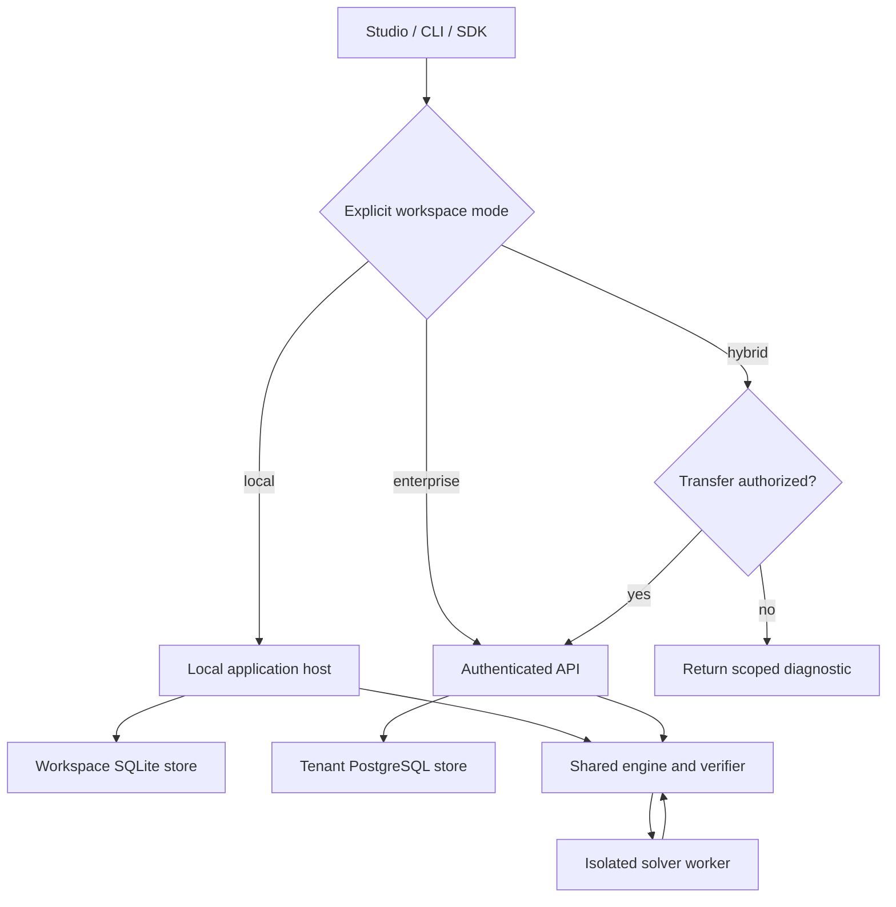
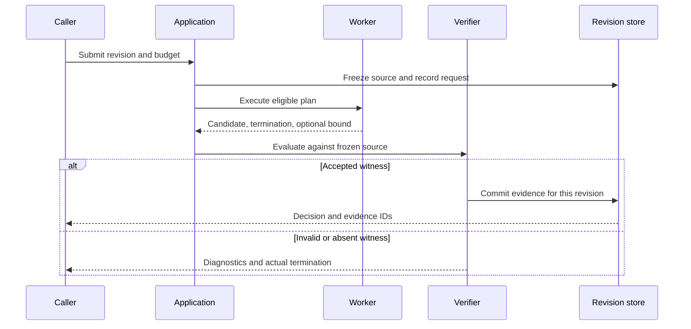

# Products, runtime modes and trust boundaries

Architecture amendment to ADR-001–004. These contracts describe target behavior. The research executables exercise a smaller mathematical surface.

| Product | Entry point and owned behavior | Dependencies and failure boundary |
|---|---|---|
| Engine | Typed source model → validate → compile → plan → solve → independently verify | Managed application ports, frozen inputs, versioned solver capabilities. No UI, external ERP, database provider or required AI model. |
| Studio | Blazor/Razor desktop shell and shared Fluent components | Select the workspace context first. Route via the same application ports used by CLI. A native failure leaves the workspace available for inspection. |
| CLI | System.CommandLine commands with a plain or Spectre.Console presenter | Help and version require neither a workspace nor a solver. Machine results and progress have separate streams. |
| Server | Authenticated ASP.NET Core API, authorization, revision registry and admission | PostgreSQL and transactional outbox. Idempotency conflicts fail before creating a second job. |
| SDK | Versioned .NET packages and a documented consumer entry point | Accept explicit workspace/store options and cancellation. Return domain diagnostics; no window, console output or hidden remote call. |
| Worker | Receive a frozen revision, run an admitted isolated adapter, return candidate and metrics | Fence publication by lease. A process exit cannot turn an unverified incumbent into a verified result. |
| Integration Hub | Map authorized source schemas and units into a staged import, export approved artifacts | Hold connector credentials here. Production pilot inputs and exports are read-only relative to the source system. |

## Runtime selection · اختيار وضع التشغيل

| Mode | Storage and execution | Qualification |
|---|---|---|
| Local | One workspace database and immutable evidence store under the selected directory. Start a worker over local IPC. Write the verified result, history link and evidence digest transactionally. No listener or external network prerequisite. | RT01. Create, close, reopen, restore and replay with outbound traffic blocked. An interrupted import leaves the previous revision current. |
| Enterprise | Resolve tenant from authentication, freeze a revision and acquire a fenced job lease. Persist only after independent checks. | RT02. Concurrent requests under two tenants, duplicate requests, stale lease and cancellation. |
| Headless | Same local or remote bindings, no display dependency. Configuration comes from explicit arguments and host configuration. | RT03. Run published commands on Windows/Linux and in a Linux container without GUI or interactive prompts. |
| Embedded | Consumer supplies managed options and a cancellation token, uses the SDK without running a server. A native adapter still runs inside its isolation boundary. | RT04. Restore consumer from local NuGet feed, compile, execute and verify. |
| Hybrid | Local revision remains authoritative until explicit remote submit. Pin destination, digest and permitted transfer scope. A disconnected client can inspect local history. | RT05. Reject unauthorized upload. On ambiguous submission, query by idempotency key before retry. |

## Decision execution · مسار القرار

تستخدم الواجهة والطرفية وSDK العقود نفسها. يحتفظ التشغيل المحلي بسجل القرار ودليله دون اتصال. يمر الحل المرشح عبر تحقق مستقل من مدخلات النسخة الأصلية قبل إتاحة إجراءات الاعتماد.
