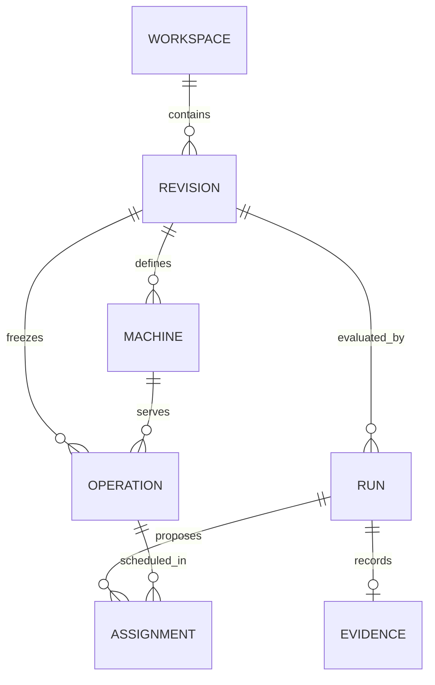

# Pilot field and application contract

Scope: first factory scheduling replay, a frozen model revision, a run result and its evidence. Draft storage and wire mappings below establish a shared vocabulary. Additional UI edit fields, registry migrations, generic UDIR schemas, connectors and post-MVP domains remain subject to SP01.

All listed identifiers use ordinal case-sensitive UTF-8 text. A field marked required has no implicit default. Integers on the wire are JSON numbers within the supported exact range. Wider exact numeric values require a versioned decimal string representation. A missing measurement is null, distinct from zero. Factory records are tenant-confidential unless produced by a published synthetic fixture.

| Field ID / JSON key | Type, default and validation | Source, storage and relationship | API, SDK and presentation | Example / rejection |
|---|---|---|---|---|
| F-REV / revisionId | Required immutable string, nonblank | Registry, key within tenant+model | Frozen revision in all requests; CLI and Studio show the same ID | r17 / reject mutable alias on solve |
| F-MACHINE / machineId | Required nonblank string, unique within revision | Resource import, machine key | Operation foreign key; Gantt lane | M1 / reject absent machine |
| F-OP / operationId | Required nonblank string, unique within revision | Order import, operation key | SDK operation reference; CLI result and Gantt item | A / reject duplicate |
| F-DURATION / durationMinutes | Required positive integer minutes, at most horizon | Operations table and original model | Exact integer in CLI/SDK; interval width in Studio | 3 / reject 0 |
| F-RELEASE / releaseMinute | Required integer within [0,horizon] | Operation availability | Constraint builder; Gantt earliest start | 0 / reject negative |
| F-DUE / dueMinute | Required nonnegative integer minutes | Order commitment | Objective evaluation; due marker | 4 / reject missing |
| F-WEIGHT / tardinessWeight | Required nonnegative exact cost per minute, single objective currency per fixture | Order cost snapshot | Weighted tardiness in original checker and inspector | 2 / reject implicit mixed currency |
| F-START / startMinute | Required integer for each assigned operation, release ≤ start, start+duration ≤ horizon | Candidate for frozen revision and operation | CLI schedule entry and Gantt left edge | 3 / reject overlap on machine |
| F-RUN / runId | Required opaque string, unique within tenant | Job registry and evidence foreign key | Poll/cancel handle; monitor link | run-7 / reject other tenant |
| F-STATUS / mathematicalStatus | Required enum Optimal, Feasible, Infeasible, Unbounded, Unknown | Worker outcome and proof policy | Status indicator on all clients | Feasible / reject unsupported exact Optimal claim |
| F-TERM / termination | Required enum Completed, Timeout, Cancelled, Failed | Worker run record | Separate field from math status | Timeout / never synthesize infeasibility |
| F-OBJ / objectiveValue | Nullable finite exact value in objective units, null before evaluation | Original-model verifier | Objective table; CLI JSON null when unavailable | 12 / reject NaN |
| F-BOUND / bestBound | Nullable finite objective value, direction, scope and evidence required | Adapter observation | Monitor and CLI, optional | null / reject incompatible direction |
| F-EVID / evidenceDigest | Required SHA-256 hex for exported evidence | Immutable byte bundle key with revision and run | Evidence link and replay command | 64 lower-case hex digits / reject byte mismatch |
| F-ELAPSED / elapsedMs | Nullable nonnegative integer, milliseconds | Monotonic runtime measurement | CLI/Studio format for locale; JSON always ms | 56 / reject negative |
| F-CPU / cpuMs | Nullable nonnegative integer, aggregate process CPU ms | Worker tree accounting | Profiler and machine reports | 31 / unavailable counter is null |
| F-MEM / peakBytes | Nullable nonnegative integer bytes | Worker process-tree measurement with platform recorded | Bytes in JSON, labeled display unit in Studio | 8192 / reject undocumented measurement scope |

## Application ports

| Contract ID | Inputs / outputs | Validation, failure and retry |
|---|---|---|
| API-WORKSPACE | Create/open explicit path → workspace handle and schema version | No network. Existing non-workspace directory requires explicit import. No implicit overwrite. |
| API-MODEL | Read/validate/compile frozen revision → diagnostics, source spans and normalized representation | Diagnostics stem from that revision. Editing creates a new revision. |
| API-GRAPH | Read graph by revision and filters → stable node/edge IDs, incidence and provenance | Unknown revision fails; filtering never deletes semantic incidence. |
| API-SOLVE | Submit frozen revision, eligible solver profile, budget, scoped idempotency key → run ID | Same payload/key returns original run. Changed payload/key collision is a conflict. Local execution uses the same request shape. |
| API-RUN | Inspect/subscribe/cancel run → state, termination, optional metrics | Deduplicate sequence numbers; on gap refresh snapshot. Repeated cancel is safe. |
| API-EVIDENCE | Verify/export by run and revision → original row checks, objective vector, digest | Reject cross-revision and cross-tenant reads. Unknown proof and absent bound remain explicit. |
| API-SCENARIO | Fork immutable revision with typed delta → new revision; compare compatible results | Record changed source IDs. Reject silent unit/currency conversion. |
| API-COMMAND | Parse argv and host options → command invocation, human or structured result | CLI01 help/version succeed without model or remote host. Errors and progress respect output mode. |

مفتاح العملية والآلة مرتبط بنسخة النموذج. يعاد حساب الهدف والتحقق من التداخل قبل حفظ دليل الحل. لا تُعرض قيمة صفرية مكان قياس غائب.

## Additional Studio ports under design review

These ports distinguish specialized Studio operations from common run and workspace reads. Their domain schemas remain attached to the indicated owner until reviewed. A front end cannot route administration through a local workspace command.

| Contract ID | Inputs / outputs | Validation, failure and retry |
|---|---|---|
| API-SIMULATION | Frozen scenario, model, seed and sample budget → distributions, actual sample count and diagnostics | Reject invalid parameters. Persist explicit termination and deterministic replay settings. A04, UI14. |
| API-ALLOCATION | Revision, resource and horizon → occupied/available capacity plus contributing assignments | Normalize units and horizon. Zero denominator yields no utilization. V03, UI16. |
| API-EXPLAIN | Run, counterfactual choice, evidence revision and budget → verified comparison and binding rows | Reject mixed revisions and unsupported sensitivity. A02, A03, UI18. |
| API-BENCHMARK | Suite manifest, budgets and solver profiles → paired samples, failures and environment | Group by held-out family. Mark missing or incomparable observations. X07, UI19. |
| API-MAPPING | Authorized connector schema, field map, target units and preview rows → normalized values or row diagnostics | Stage before commit. Do not leak secrets or partially apply bad mappings. I01, I02, UI20. |
| API-ADMIN | Authenticated tenant context, actor, intended role mutation and expected policy version → audit outcome | Enforce permission and tenant isolation on server even for direct API clients. E01, U06, UI21. |
| API-SETTINGS | Workspace/user scope, typed settings and expected config revision → effective config and redacted diagnostics | Validate before atomic replace and retain last valid configuration. UI23, CLI10. |
