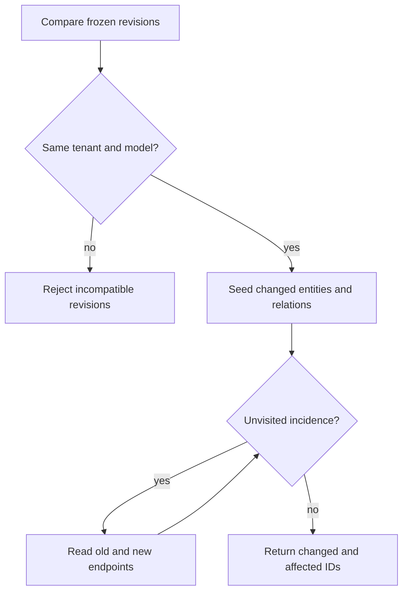

# M02 · Cross-revision impact

Input: two immutable EDG snapshots belonging to the same tenant and model. Compare entity records and relationship kind, owner, complete target set, source, capacity and time window. Ordering has no semantic effect because M01 normalizes targets. A different source stamp is conservatively a change. A changed snapshot under the same revision identity fails.

The output lists changed and potentially affected entity IDs and relationship IDs separately, with both full revision identities attached. IDs removed from the new revision remain inspectable in the result. Empty changes produce empty impact. Each changed entity or relationship seeds the traversal. For an entity, visit incident relations in both revisions. For a relation, visit its owner and all of its targets in both revisions. Stop when neither queue has a new ID. Newly joined global constraints/objectives and deleted connecting edges are both covered.

Every queued ID is changed or incident to an affected ID; thus it is reachable in the union. Every incident neighbor is visited from both versions before the queue drains; induction on path length proves no reachable ID is missed. This is a conservative mathematical-coupling view, not a directed causal interpretation of each relation kind. It does not establish that a cached assignment remains valid.

The full comparison still scans both snapshots, including endpoint lists. Closure visits each affected entity/relation once and scans its old/new incidences. Sorted-map lookups and deterministic final sorting add logarithmic costs. Peak working storage is proportional to discovered IDs plus the output. A global objective may make the complete graph reachable. No sublinear diff or measured speedup is claimed.

Validation uses named add/delete/merge/split cases and a separate iterative oracle that scans every old/new relationship until its reachable set stabilizes. Fixed seeds and input bounds make the oracle repeatable.

المسار المتأثر يُحسب من النسختين معاً كي لا تختفي العلاقة المحذوفة من الحساب. إذا ربط هدف عام جزأين، تدخل عناصر الجزأين في نطاق المراجعة.
