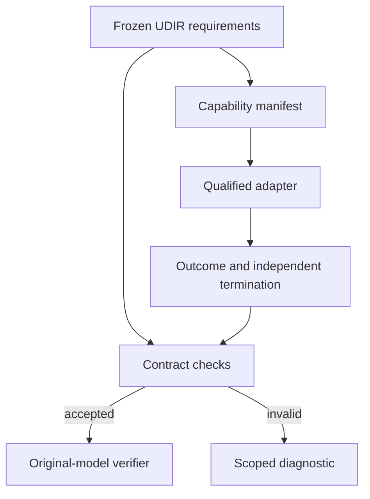

# S01 · Solver capability and result contracts

A planner reads the manifest before loading native code. Identity is (solver ID, native version, runtime identifier). Exact feature tokens are compared ordinally against UDIR requirements. The planner also checks numeric limits, domain support, horizon, threads and bound availability for the chosen lowering. Registration, scoring, execution and independent verification have separate owners.

| Field | Wire/domain meaning and validation |
|---|---|
| capabilities | Unique required-feature tokens, supported scalar domains, exact coefficient magnitude ceiling, maximum horizon ticks, maximum threads, hints, interruption and objective-bound support. A missing ceiling is unspecified. |
| tenantId/modelId/revisionId/runId | Frozen revision identity, checked against UDIR before accepting a report; run ID is a required opaque identifier. |
| mathematicalStatus / termination | Optimal, Feasible, Infeasible, Unbounded or Unknown independently of Completed, Timeout, Cancelled or Failed. A timeout without a witness cannot become infeasibility. |
| incumbent | Nullable set of exact variable assignments. A present assignment set covers every original decision variable, including the empty assignment for a constant model. |
| objectives | Exactly one observation per original objective. Values are exact UDIR strings in the objective's own units. A null bound remains unknown. The lower bound of a minimizing objective or upper bound of a maximizing objective carries its evidence reference. |
| tolerances | Absolute tolerance in objective units and dimensionless relative tolerance; both nonnegative. Included for replay. A nonzero tolerance never creates an optimality proof. |
| trust | Explicit producer attribution and evidence reference. An adapter attestation, candidate, and independently checked certificate have distinct meanings. The publisher supplies evidence for any definitive Optimal, Infeasible or Unbounded claim. |
| elapsedMs/cpuMs/peakBytes | Nullable, nonnegative measured values. CPU and peak memory cover the worker process tree. Null and measured zero are distinct. |

The result validator checks identities, shapes, exact numbers and bound orientation. A feasible witness is still independently checked against the original revision in S04. In a multiobjective model each reported bound must be qualified for its objective stage; its reference identifies the fixed higher-priority context. Bounds for a different context must not be reported together. Adapters conservatively omit unavailable bounds. S05 classifies evidence strength and verifies native bound claims.

مثال: عند انتهاء المهلة يمكن الاحتفاظ بحل مرشّح مع حد مجهول. يراجع المتحقق المستقل قيود النموذج الأصلي قبل اعتماد الحل.
