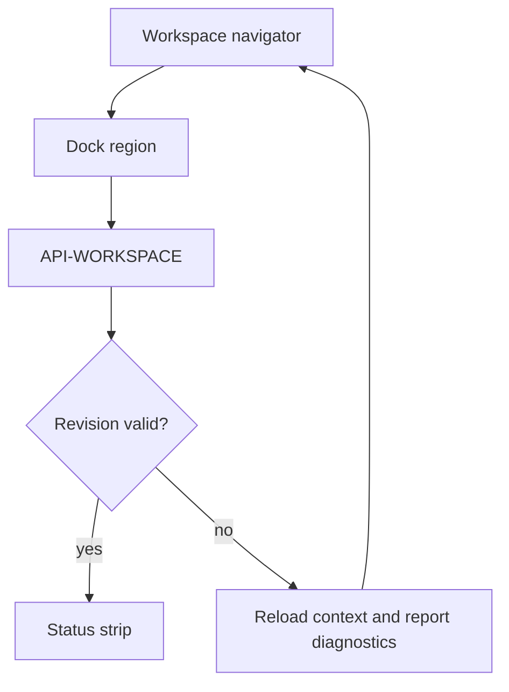
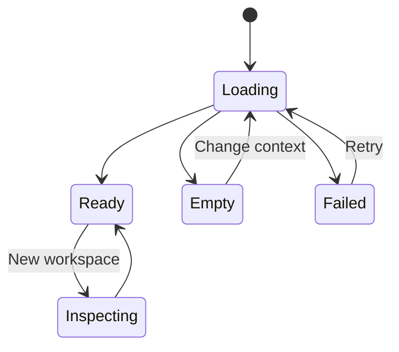

# UI01 · Application shell

Design study for directive §10. The official English dark reference governs visual geometry; the original draft studies are retained for history. The [reviewed module specification](review/modules/UI01.md) and [SP02 disposition](review/FINAL-DISPOSITION.md) govern implementation design; concrete provider and runtime acceptance are separate.

**Operator journey.** Overview → Workspace navigator → Dock region → Switch workspace tab → Status strip.

[Wireframe](drafts/UI01-wire.svg) · [High-fidelity reference or draft](drafts/UI01.svg) · [Field and port dictionary](../pilot-contracts.md)

| Interaction requirement | Scope |
|---|---|
| UI01-01 | Main navigation |
| UI01-02 | Title and status bars |
| UI01-03 | Workspace switching |
| UI01-04 | Resizable and dockable panels |
| UI01-05 | Split views and multi-tab restoration |

**Data contract.** API-WORKSPACE supplies the shared pilot context. Read F-REV. These are the cross-product fields used here; specialized edit payloads and adapters require SP01 and feature review. Actions: New workspace,Restore layout.

**Component and data flow.**

**Interaction states.**

**Acceptance scenario.** Resize two panes, reopen a saved layout and switch tabs by keyboard while the selected revision remains stable.

**Failure and recovery.** Discard a layout referring to a disconnected monitor and restore a visible window. Keep navigation and diagnostic focus available on failure.

**Implementation gates.** DS01, DS02, SP02. Pin the visual comparison environment and test both input directions and keyboard operation before UI acceptance.
