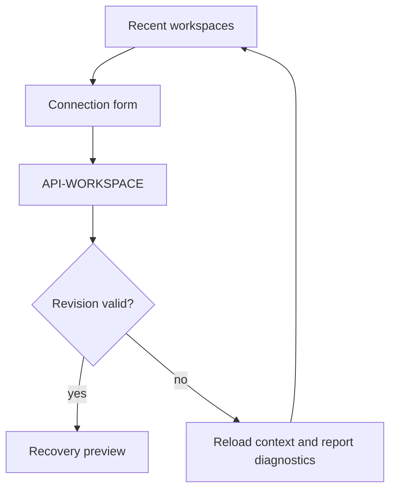
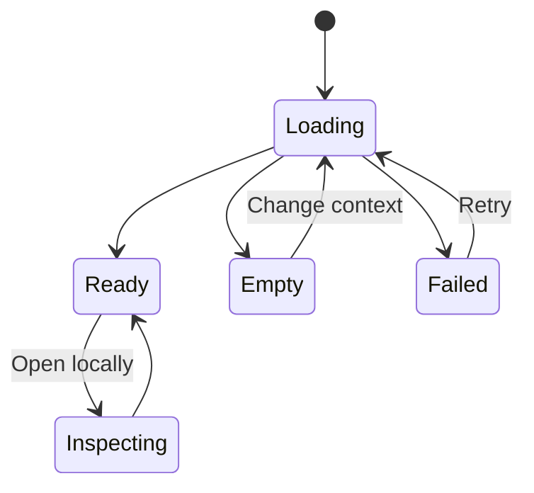

# UI02 · Workspace manager

Design study for directive §10. The official English dark reference governs visual geometry; individual screen studies are proposed layouts pending review.

**Operator journey.** Workspaces → Recent workspaces → Connection form → Restore workspace backup → Recovery preview.

[Wireframe](drafts/UI02-wire.svg) · [High-fidelity reference or draft](drafts/UI02.svg) · [Field and port dictionary](../pilot-contracts.md)

| Interaction requirement | Scope |
|---|---|
| UI02-01 | Create and open workspaces |
| UI02-02 | Recent workspaces |
| UI02-03 | Local and remote connections |
| UI02-04 | Workspace settings |
| UI02-05 | Backup and recovery |

**Data contract.** API-WORKSPACE supplies the shared pilot context. Read F-REV. These are the cross-product fields used here; specialized edit payloads and adapters require SP01 and feature review. Actions: Open locally,Restore backup.

**Component and data flow.**

**Interaction states.**

**Acceptance scenario.** Create a local workspace, back it up, restore into another directory and compare revision and evidence digests.

**Failure and recovery.** Refuse an incompatible backup before replacing current data. Keep navigation and diagnostic focus available on failure.

**Implementation gates.** UI01, RT01, SP02. Pin the visual comparison environment and test both input directions and keyboard operation before UI acceptance.
