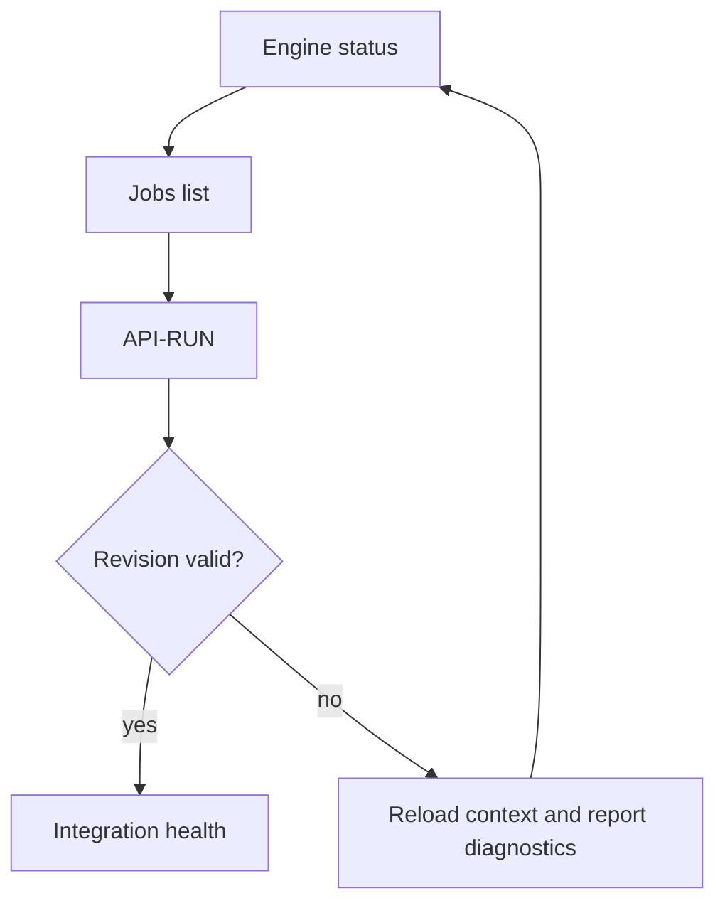
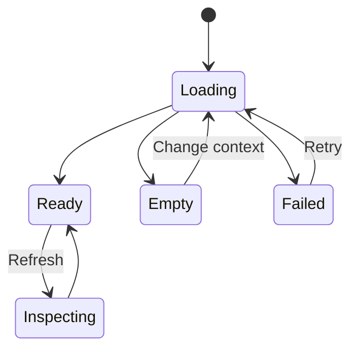

# UI03 · Overview dashboard

Design study for directive §10. The official English dark reference governs visual geometry; individual screen studies are proposed layouts pending review.

**Operator journey.** Overview → Engine status → Jobs list → Inspect recent decision → Integration health.

[Wireframe](drafts/UI03-wire.svg) · [High-fidelity reference or draft](drafts/UI03.svg) · [Field and port dictionary](../pilot-contracts.md)

| Interaction requirement | Scope |
|---|---|
| UI03-01 | Engine health |
| UI03-02 | Recent models and decisions |
| UI03-03 | Active jobs |
| UI03-04 | Measured performance |
| UI03-05 | Integration health |

**Data contract.** API-RUN supplies the shared pilot context. Read F-RUN,F-TERM,F-EVID. These are the cross-product fields used here; specialized edit payloads and adapters require SP01 and feature review. Actions: Refresh,Inspect run.

**Component and data flow.**

**Interaction states.**

**Acceptance scenario.** Exercise an empty workspace and one with two runs. Follow a recent decision to its exact revision.

**Failure and recovery.** Show an unknown health or measurement state when a source is unavailable. Keep navigation and diagnostic focus available on failure.

**Implementation gates.** UI01, RT01, SP02. Pin the visual comparison environment and test both input directions and keyboard operation before UI acceptance.
