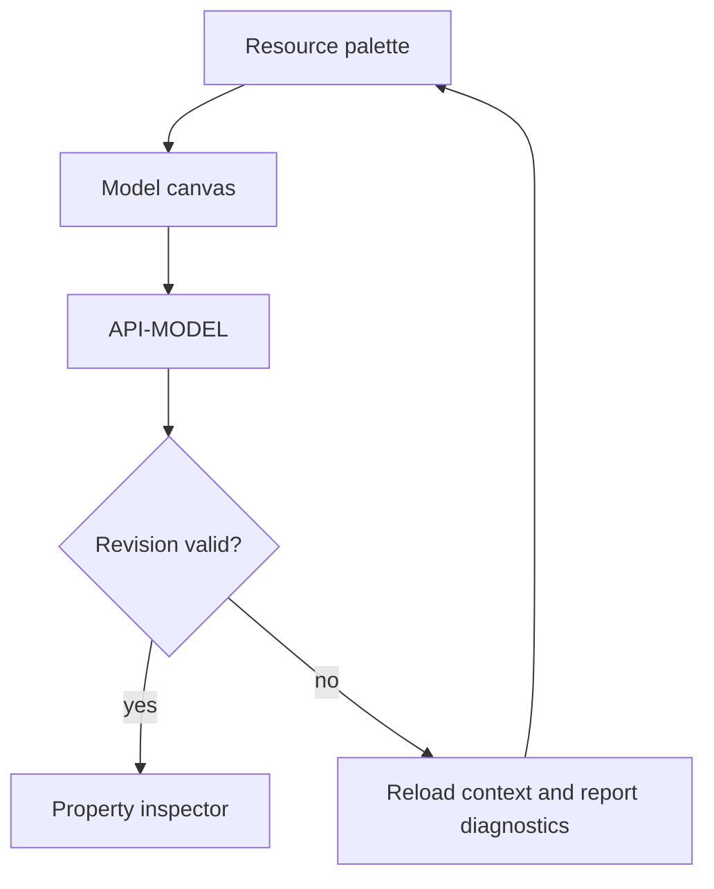
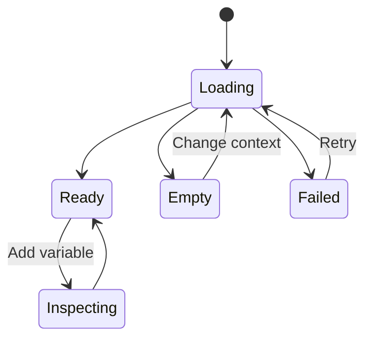

# UI04 · Visual model designer

Design study for directive §10. The official English dark reference governs visual geometry; individual screen studies are proposed layouts pending review.

**Operator journey.** Decision Models → Resource palette → Model canvas → Add resource and constrain a decision → Property inspector.

[Wireframe](drafts/UI04-wire.svg) · [High-fidelity reference or draft](drafts/UI04.svg) · [Field and port dictionary](../pilot-contracts.md)

| Interaction requirement | Scope |
|---|---|
| UI04-01 | Drag-and-drop editing |
| UI04-02 | Resources and variables |
| UI04-03 | Constraints and objectives |
| UI04-04 | Live validation |

**Data contract.** API-MODEL supplies the shared pilot context. Read F-REV,F-MACHINE,F-OP. These are the cross-product fields used here; specialized edit payloads and adapters require SP01 and feature review. Actions: Add variable,Validate draft.

**Component and data flow.**

**Interaction states.**

**Acceptance scenario.** Build the Batch example by pointer and keyboard, then compare normalized output with the DSL fixture.

**Failure and recovery.** Leave the saved revision intact on a dangling variable reference. Keep navigation and diagnostic focus available on failure.

**Implementation gates.** UI01, M01, M09, SP02. Pin the visual comparison environment and test both input directions and keyboard operation before UI acceptance.
