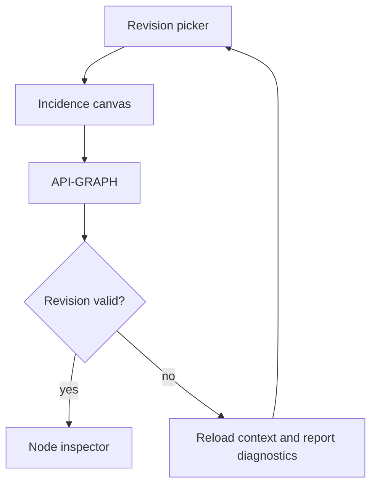
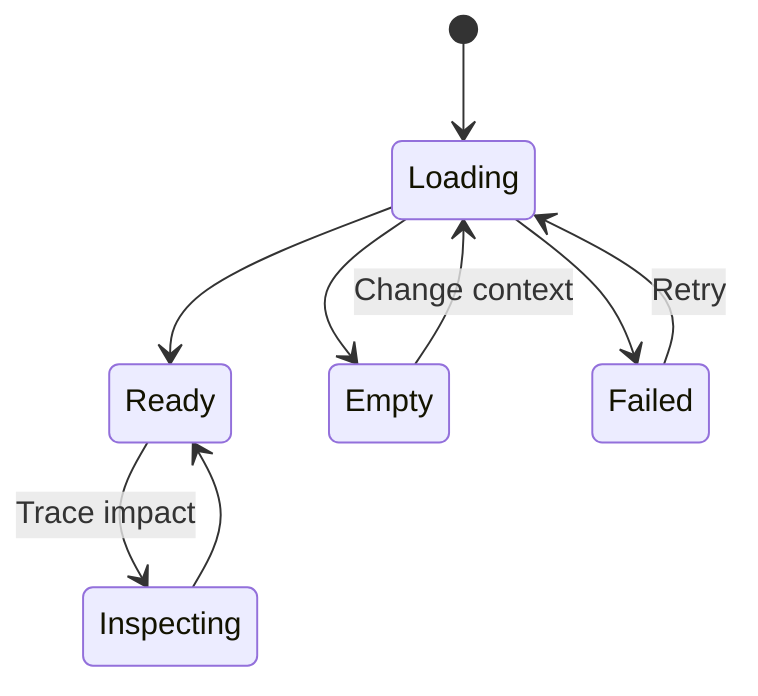

# UI05 · Enterprise decision graph explorer

Design study for directive §10. The official English dark reference governs visual geometry; individual screen studies are proposed layouts pending review.

**Operator journey.** Decision Graph → Revision picker → Incidence canvas → Trace impact across revisions → Node inspector.

[Wireframe](drafts/UI05-wire.svg) · [High-fidelity reference or draft](../references/01-WOW-DI-Studio.svg) · [Field and port dictionary](../pilot-contracts.md)

| Interaction requirement | Scope |
|---|---|
| UI05-01 | Hypergraph incidence |
| UI05-02 | Zoom and pan |
| UI05-03 | Node search |
| UI05-04 | Edge filtering |
| UI05-05 | Dependency tracing |
| UI05-06 | Impact analysis |
| UI05-07 | Provenance |
| UI05-08 | Revision comparison |

**Data contract.** API-GRAPH supplies the shared pilot context. Read F-REV,F-MACHINE,F-OP. These are the cross-product fields used here; specialized edit payloads and adapters require SP01 and feature review. Actions: Trace impact,Compare revisions.

**Component and data flow.**

**Interaction states.**

**Acceptance scenario.** Select a three-variable constraint, filter an edge and compare before/after reachability against the unfiltered graph queries.

**Failure and recovery.** Deletion must remain visible in the revision diff. Filtering is presentation-only. Keep navigation and diagnostic focus available on failure.

**Implementation gates.** UI01, M01, M02, SP02, DS04. Pin the visual comparison environment and test both input directions and keyboard operation before UI acceptance.
