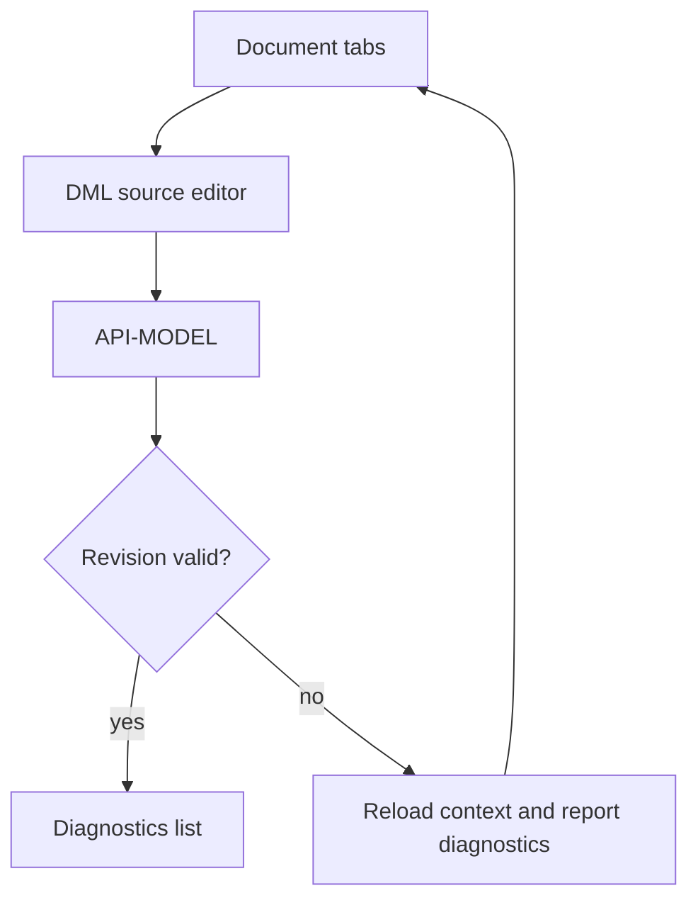
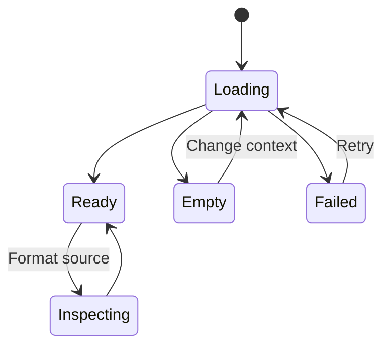

# UI06 · Decision DSL editor

Design study for directive §10. The official English dark reference governs visual geometry; individual screen studies are proposed layouts pending review.

**Operator journey.** Decision Models → Document tabs → DML source editor → Fix a diagnostic in source → Diagnostics list.

[Wireframe](drafts/UI06-wire.svg) · [High-fidelity reference or draft](drafts/UI06.svg) · [Field and port dictionary](../pilot-contracts.md)

| Interaction requirement | Scope |
|---|---|
| UI06-01 | Syntax highlighting |
| UI06-02 | Autocompletion |
| UI06-03 | Source-span diagnostics |
| UI06-04 | Formatting |
| UI06-05 | Validation and live compilation |

**Data contract.** API-MODEL supplies the shared pilot context. Read F-REV. These are the cross-product fields used here; specialized edit payloads and adapters require SP01 and feature review. Actions: Format source,Validate model.

**Component and data flow.**

**Interaction states.**

**Acceptance scenario.** Edit a symbol in Batch, navigate to its exact diagnostic, repair the edit and compare formatted and original typed trees.

**Failure and recovery.** Discard stale diagnostics arriving after a newer edit. Keep navigation and diagnostic focus available on failure.

**Implementation gates.** UI01, M06, M07, SP02. Pin the visual comparison environment and test both input directions and keyboard operation before UI acceptance.
