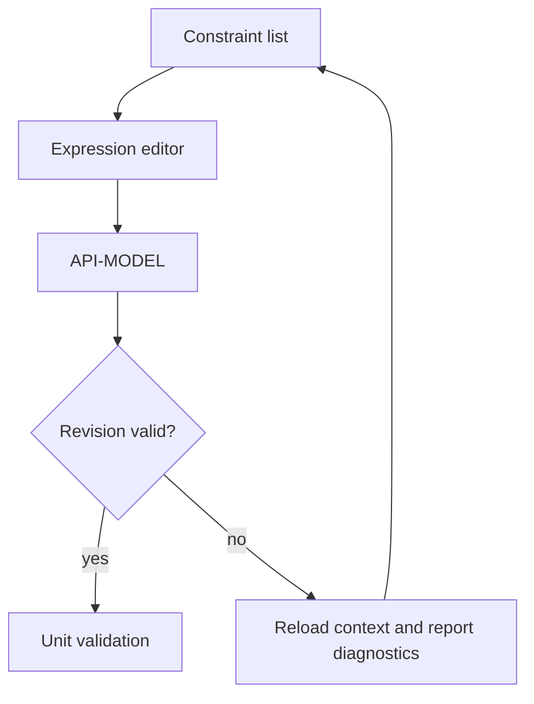
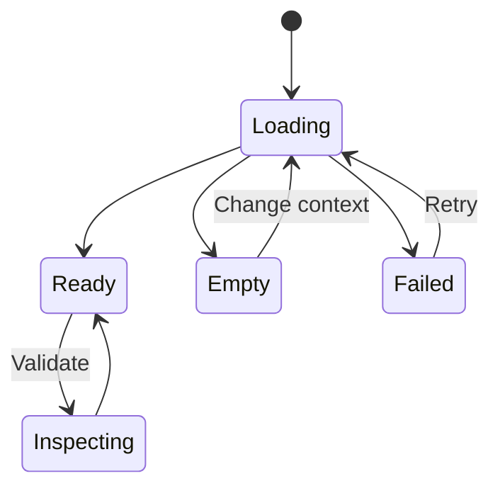

# UI07 · Constraint editor

Design study for directive §10. The official English dark reference governs visual geometry; the original draft studies are retained for history. The [reviewed module specification](review/modules/UI07.md) and [SP02 disposition](review/FINAL-DISPOSITION.md) govern implementation design; concrete provider and runtime acceptance are separate.

**Operator journey.** Decision Models → Constraint list → Expression editor → Set a constraint bound → Unit validation.

[Wireframe](drafts/UI07-wire.svg) · [High-fidelity reference or draft](drafts/UI07.svg) · [Field and port dictionary](../pilot-contracts.md)

| Interaction requirement | Scope |
|---|---|
| UI07-01 | Hard and soft constraints |
| UI07-02 | Expressions |
| UI07-03 | Units and bounds |
| UI07-04 | Conflict detection |

**Data contract.** API-MODEL supplies the shared pilot context. Read F-REV,F-DURATION. These are the cross-product fields used here; specialized edit payloads and adapters require SP01 and feature review. Actions: Validate,Save constraint.

**Component and data flow.**

**Interaction states.**

**Acceptance scenario.** Save an equivalent capacity expression in two units and compare normalized quantities and bound inclusivity.

**Failure and recovery.** Reject incompatible dimensions. Label conflicts as proven only with supporting evidence. Keep navigation and diagnostic focus available on failure.

**Implementation gates.** UI04, M04, SP02. Pin the visual comparison environment and test both input directions and keyboard operation before UI acceptance.
