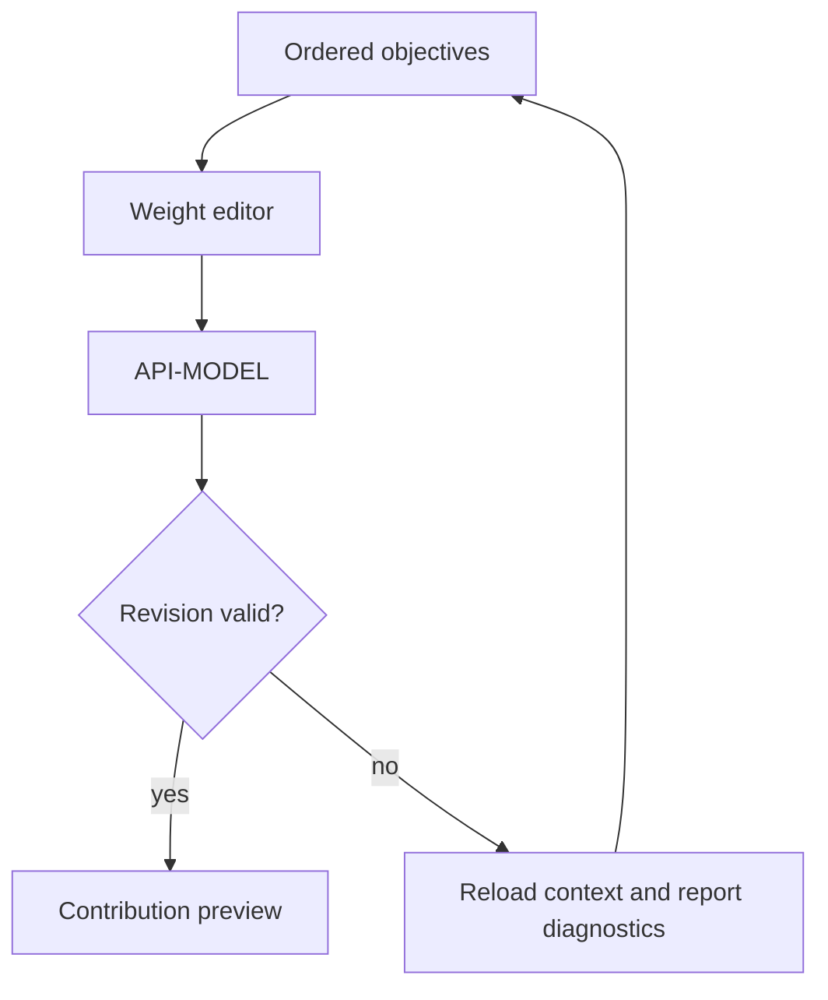
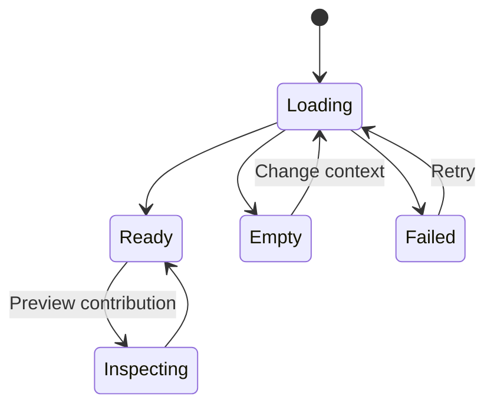

# UI08 · Objective editor

Design study for directive §10. The official English dark reference governs visual geometry; the original draft studies are retained for history. The [reviewed module specification](review/modules/UI08.md) and [SP02 disposition](review/FINAL-DISPOSITION.md) govern implementation design; concrete provider and runtime acceptance are separate.

**Operator journey.** Decision Models → Ordered objectives → Weight editor → Review objective contribution → Contribution preview.

[Wireframe](drafts/UI08-wire.svg) · [High-fidelity reference or draft](drafts/UI08.svg) · [Field and port dictionary](../pilot-contracts.md)

| Interaction requirement | Scope |
|---|---|
| UI08-01 | Minimize and maximize |
| UI08-02 | Weights |
| UI08-03 | Lexicographic priority |
| UI08-04 | Multi-objective models |
| UI08-05 | Contribution preview |

**Data contract.** API-MODEL supplies the shared pilot context. Read F-REV,F-WEIGHT,F-OBJ. These are the cross-product fields used here; specialized edit payloads and adapters require SP01 and feature review. Actions: Preview contribution,Apply.

**Component and data flow.**

**Interaction states.**

**Acceptance scenario.** Reverse one goal direction, adjust a weight and compare a known assignment against the displayed objective vector.

**Failure and recovery.** Reject duplicate priorities in the v0 language and disable unsupported Pareto requests. Keep navigation and diagnostic focus available on failure.

**Implementation gates.** UI04, NUM02, SP02. Pin the visual comparison environment and test both input directions and keyboard operation before UI acceptance.
