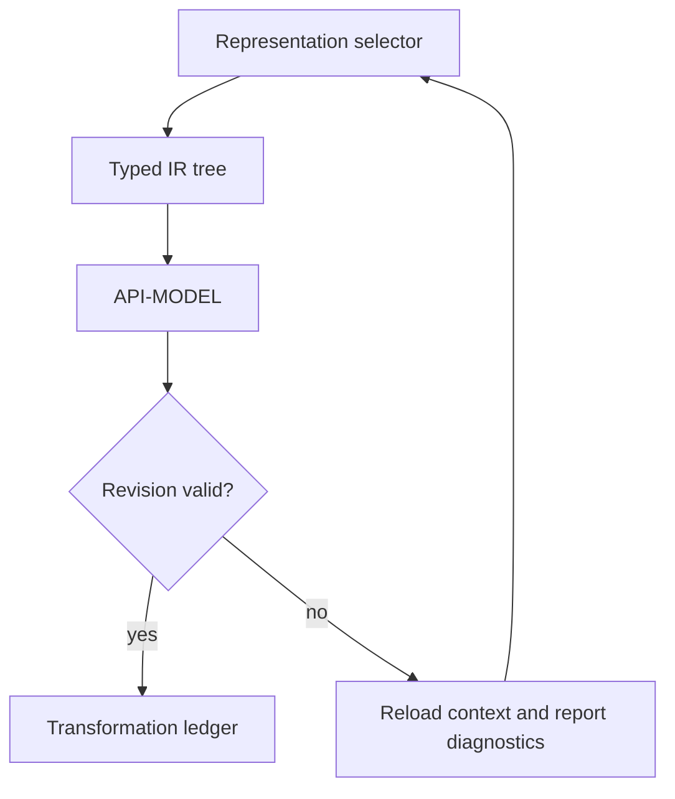
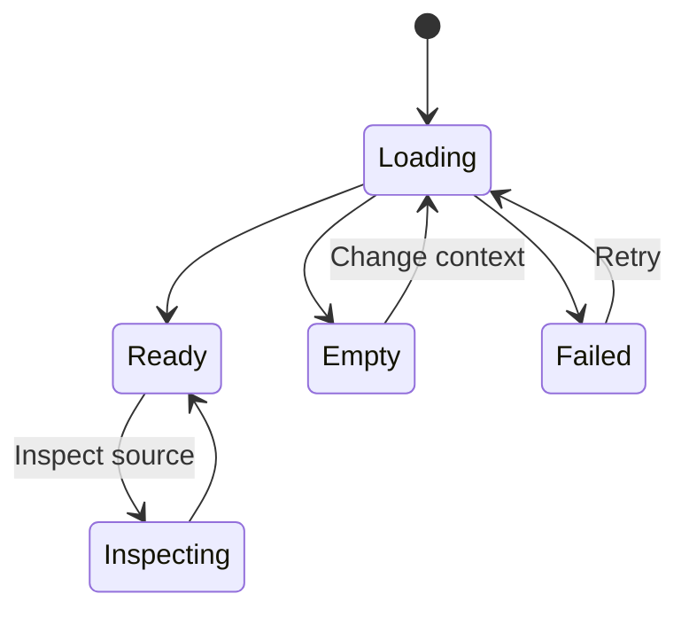

# UI09 · Mathematical model inspector

Design study for directive §10. The official English dark reference governs visual geometry; the original draft studies are retained for history. The [reviewed module specification](review/modules/UI09.md) and [SP02 disposition](review/FINAL-DISPOSITION.md) govern implementation design; concrete provider and runtime acceptance are separate.

**Operator journey.** Decision Models → Representation selector → Typed IR tree → Trace a normalized row to source → Transformation ledger.

[Wireframe](drafts/UI09-wire.svg) · [High-fidelity reference or draft](drafts/UI09.svg) · [Field and port dictionary](../pilot-contracts.md)

| Interaction requirement | Scope |
|---|---|
| UI09-01 | Source AST |
| UI09-02 | Typed UDIR |
| UI09-03 | Normalized model |
| UI09-04 | Solver representation |
| UI09-05 | Transformation ledger |
| UI09-06 | Source mapping |

**Data contract.** API-MODEL supplies the shared pilot context. Read F-REV. These are the cross-product fields used here; specialized edit payloads and adapters require SP01 and feature review. Actions: Inspect source,Show rewrite.

**Component and data flow.**

**Interaction states.**

**Acceptance scenario.** Follow one normalized row across all views back to its original span and inspect the reconstruction rule.

**Failure and recovery.** Display unavailable lowering for an unsupported backend. Keep navigation and diagnostic focus available on failure.

**Implementation gates.** UI06, M08, M12, SP02. Pin the visual comparison environment and test both input directions and keyboard operation before UI acceptance.
