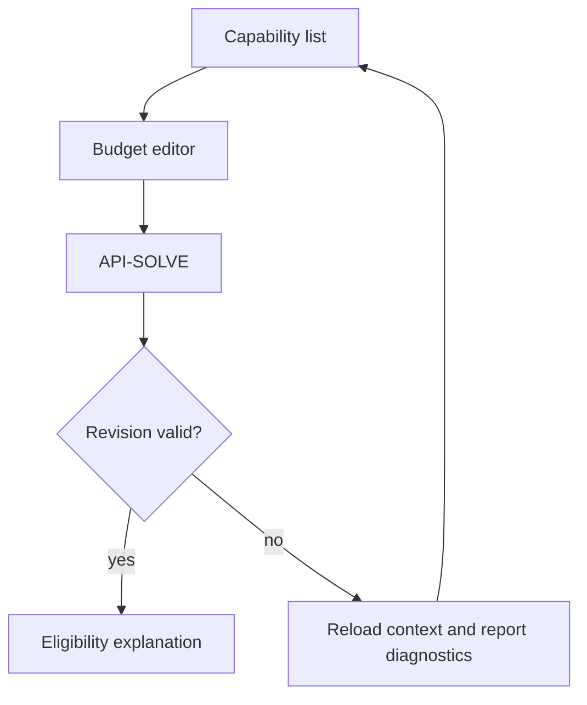
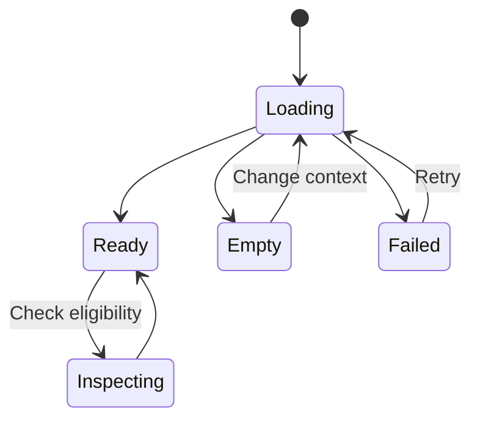

# UI10 · Solver configuration

Design study for directive §10. The official English dark reference governs visual geometry; individual screen studies are proposed layouts pending review.

**Operator journey.** Optimization → Capability list → Budget editor → Set run limits → Eligibility explanation.

[Wireframe](drafts/UI10-wire.svg) · [High-fidelity reference or draft](drafts/UI10.svg) · [Field and port dictionary](../pilot-contracts.md)

| Interaction requirement | Scope |
|---|---|
| UI10-01 | Solver capabilities and selection |
| UI10-02 | Time, CPU and memory budgets |
| UI10-03 | Parallelism and options |

**Data contract.** API-SOLVE supplies the shared pilot context. Read F-REV,F-CPU,F-MEM. These are the cross-product fields used here; specialized edit payloads and adapters require SP01 and feature review. Actions: Check eligibility,Apply budget.

**Component and data flow.**

**Interaction states.**

**Acceptance scenario.** Select auto on a finite interval model, explain eligibility and round-trip its budget through the planner.

**Failure and recovery.** Reject options outside the selected adapter manifest before creating a run. Keep navigation and diagnostic focus available on failure.

**Implementation gates.** UI01, S06, S07, SP02. Pin the visual comparison environment and test both input directions and keyboard operation before UI acceptance.
