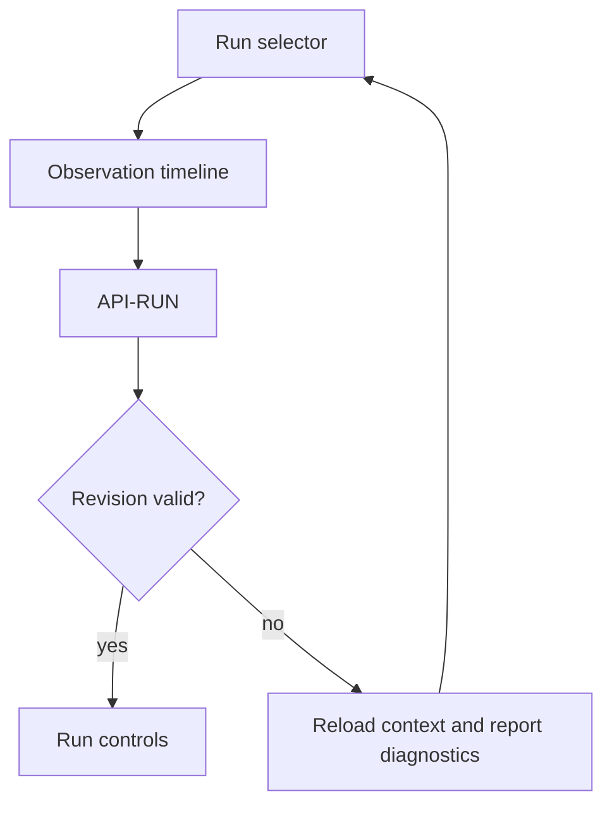
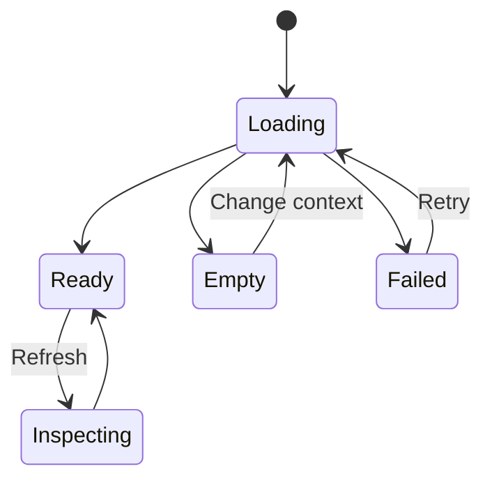

# UI11 · Optimization monitor

Design study for directive §10. The official English dark reference governs visual geometry; individual screen studies are proposed layouts pending review.

**Operator journey.** Optimization → Run selector → Observation timeline → Inspect convergence and cancel → Run controls.

[Wireframe](drafts/UI11-wire.svg) · [High-fidelity reference or draft](drafts/UI11.svg) · [Field and port dictionary](../pilot-contracts.md)

| Interaction requirement | Scope |
|---|---|
| UI11-01 | Live state and elapsed time |
| UI11-02 | Measured CPU and memory |
| UI11-03 | Incumbent, bound and gap |
| UI11-04 | Cancellation |
| UI11-05 | Solver transitions |
| UI11-06 | Convergence |

**Data contract.** API-RUN supplies the shared pilot context. Read F-RUN,F-ELAPSED,F-OBJ,F-BOUND,F-TERM. These are the cross-product fields used here; specialized edit payloads and adapters require SP01 and feature review. Actions: Refresh,Cancel run.

**Component and data flow.**

**Interaction states.**

**Acceptance scenario.** Replay events with an incumbent and absent bound. Show measured values and preserve the verified incumbent after cancellation.

**Failure and recovery.** Handle duplicate or out-of-order events and avoid synthetic percent completion. Keep navigation and diagnostic focus available on failure.

**Implementation gates.** UI01, S07, S10, SP02, DS04. Pin the visual comparison environment and test both input directions and keyboard operation before UI acceptance.
