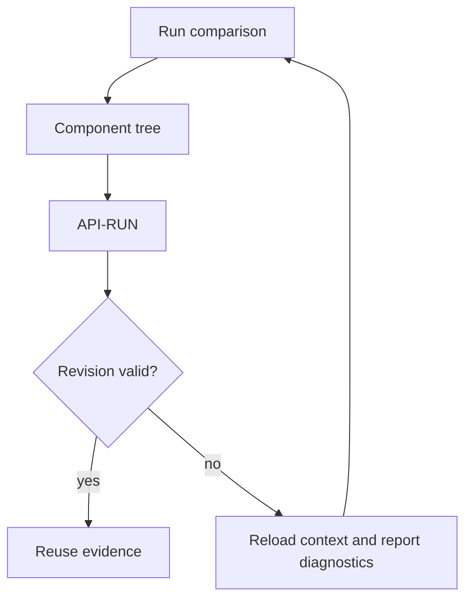
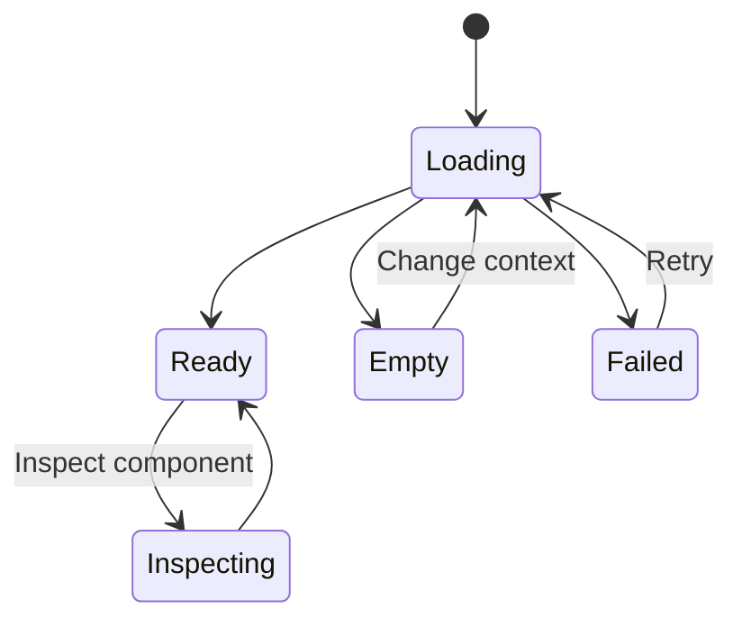

# UI12 · Algorithm execution visualizer

Design study for directive §10. The official English dark reference governs visual geometry; individual screen studies are proposed layouts pending review.

**Operator journey.** Optimization → Run comparison → Component tree → Inspect a fallback → Reuse evidence.

[Wireframe](drafts/UI12-wire.svg) · [High-fidelity reference or draft](drafts/UI12.svg) · [Field and port dictionary](../pilot-contracts.md)

| Interaction requirement | Scope |
|---|---|
| UI12-01 | Backend-exposed search |
| UI12-02 | Decomposition |
| UI12-03 | Incremental reoptimization |
| UI12-04 | Reused and invalidated components |
| UI12-05 | Full-solve fallback |
| UI12-06 | Algorithm comparison |

**Data contract.** API-RUN supplies the shared pilot context. Read F-REV,F-RUN,F-EVID. These are the cross-product fields used here; specialized edit payloads and adapters require SP01 and feature review. Actions: Inspect component,Compare full solve.

**Component and data flow.**

**Interaction states.**

**Acceptance scenario.** Compare a disconnected edit and a new coupling edge. Link each reuse or fallback to its recorded evidence.

**Failure and recovery.** Display capability unavailable when native search events are absent. Keep navigation and diagnostic focus available on failure.

**Implementation gates.** UI11, X05, SP02. Pin the visual comparison environment and test both input directions and keyboard operation before UI acceptance.
