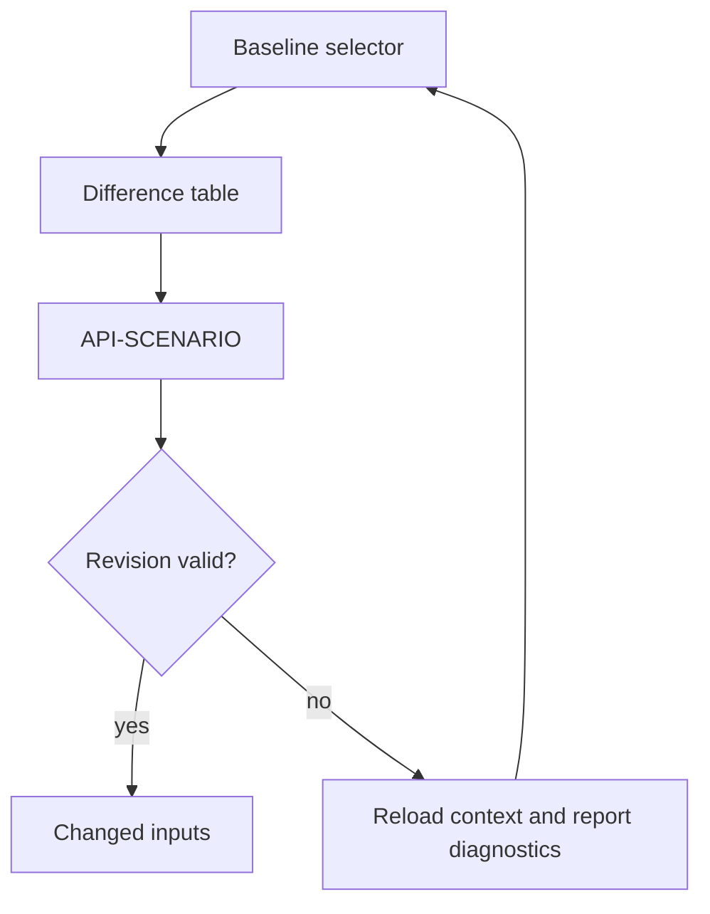
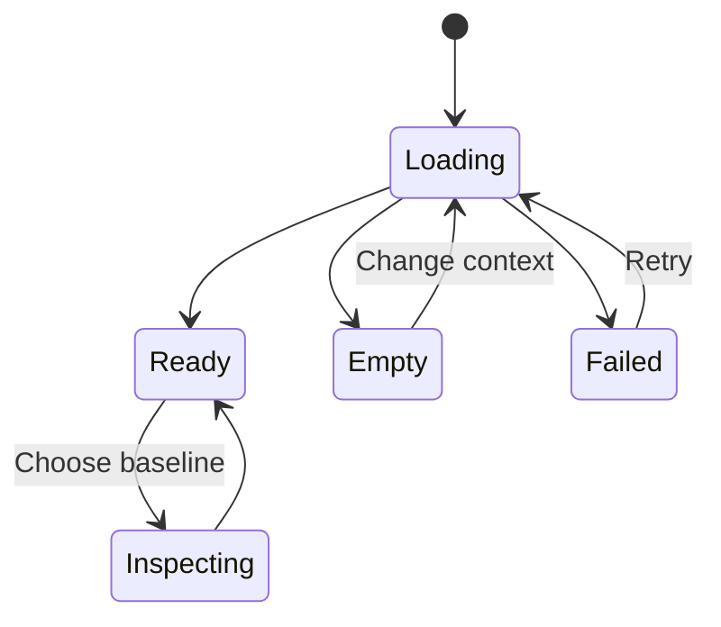

# UI13 · Scenario comparison studio

Design study for directive §10. The official English dark reference governs visual geometry; individual screen studies are proposed layouts pending review.

**Operator journey.** Scenarios → Baseline selector → Difference table → Compare an outage alternative → Changed inputs.

[Wireframe](drafts/UI13-wire.svg) · [High-fidelity reference or draft](drafts/UI13.svg) · [Field and port dictionary](../pilot-contracts.md)

| Interaction requirement | Scope |
|---|---|
| UI13-01 | Baseline and alternative scenarios |
| UI13-02 | Input changes |
| UI13-03 | Decision changes |
| UI13-04 | Cost and risk comparisons |

**Data contract.** API-SCENARIO supplies the shared pilot context. Read F-REV,F-MACHINE,F-OBJ. These are the cross-product fields used here; specialized edit payloads and adapters require SP01 and feature review. Actions: Choose baseline,Inspect delta.

**Component and data flow.**

**Interaction states.**

**Acceptance scenario.** Compare two frozen revisions, show changed inputs and report comparable cost deltas with units.

**Failure and recovery.** Suppress savings on incompatible objectives or missing baselines. Keep navigation and diagnostic focus available on failure.

**Implementation gates.** UI01, A01, SP02. Pin the visual comparison environment and test both input directions and keyboard operation before UI acceptance.
