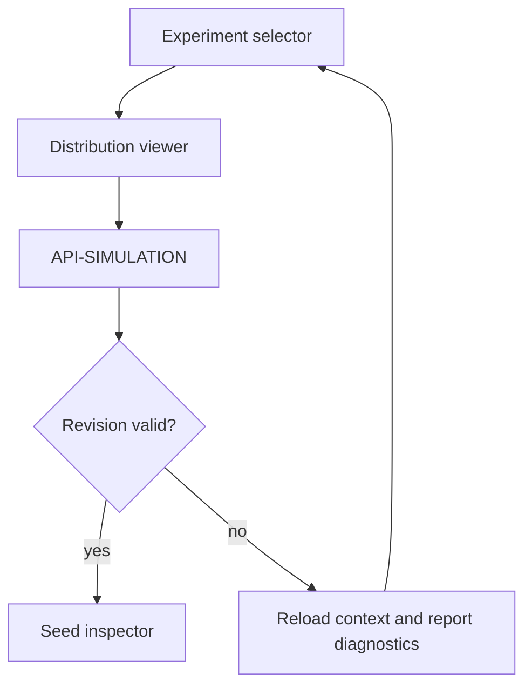
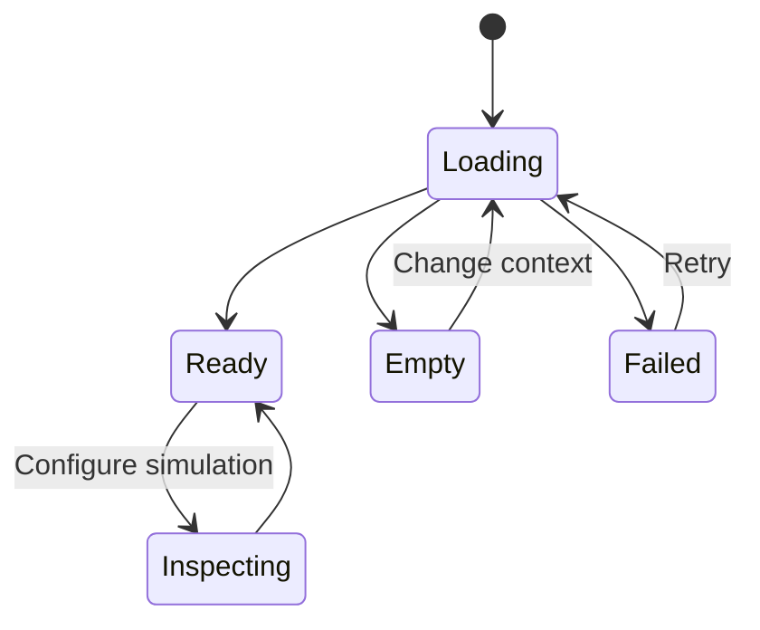

# UI14 · Simulation studio

Design study for directive §10. The official English dark reference governs visual geometry; the original draft studies are retained for history. The [reviewed module specification](review/modules/UI14.md) and [SP02 disposition](review/FINAL-DISPOSITION.md) govern implementation design; concrete provider and runtime acceptance are separate.

**Operator journey.** Simulation → Experiment selector → Distribution viewer → Replay a seeded experiment → Seed inspector.

[Wireframe](drafts/UI14-wire.svg) · [High-fidelity reference or draft](drafts/UI14.svg) · [Field and port dictionary](../pilot-contracts.md)

| Interaction requirement | Scope |
|---|---|
| UI14-01 | Discrete-event simulation |
| UI14-02 | Monte Carlo experiments |
| UI14-03 | Configuration and seeds |
| UI14-04 | Uncertainty and distributions |

**Data contract.** API-SIMULATION supplies the shared pilot context. Read F-REV,F-OBJ. These are the cross-product fields used here; logical specialized field profiles are defined in [edition 1](../specialized-studio-ports-v1.md); concrete payloads and adapters require provider acceptance. Actions: Configure simulation,Replay.

**Component and data flow.**

**Interaction states.**

**Acceptance scenario.** Replay identical seeds and compare quantiles, sample counts and event traces against recorded simulation output.

**Failure and recovery.** Reject invalid distribution parameters and disclose truncated runs. Keep navigation and diagnostic focus available on failure.

**Implementation gates.** UI01, A04, SP02. Pin the visual comparison environment and test both input directions and keyboard operation before UI acceptance.
