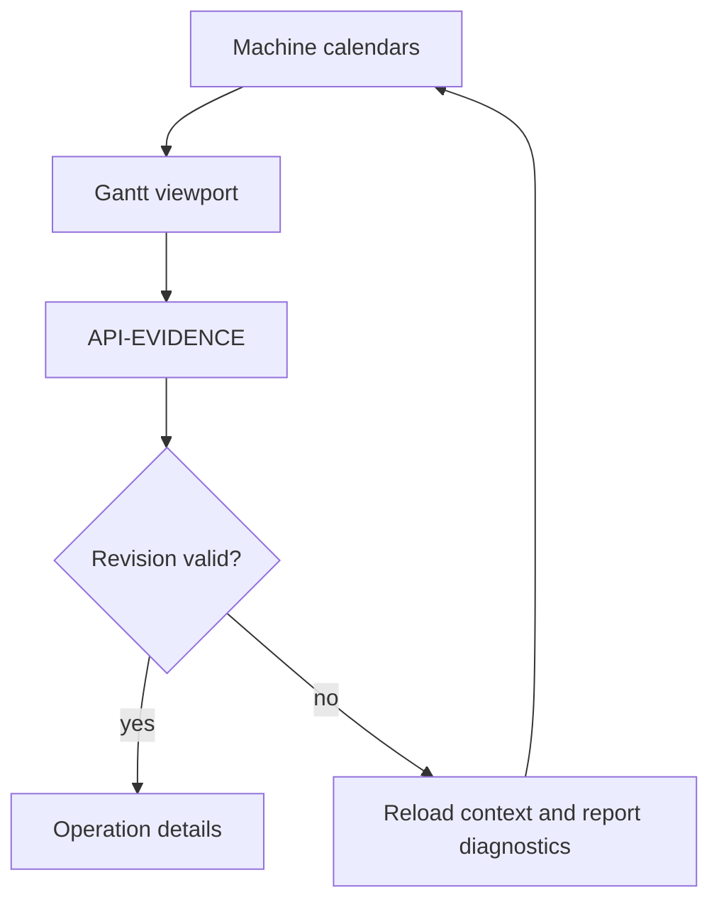
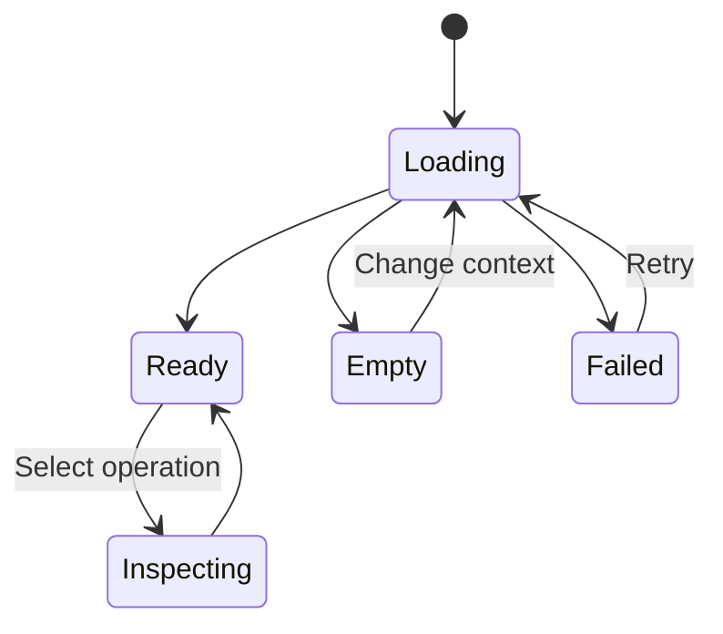

# UI15 · Production scheduling studio

Design study for directive §10. The official English dark reference governs visual geometry; the original draft studies are retained for history. The [reviewed module specification](review/modules/UI15.md) and [SP02 disposition](review/FINAL-DISPOSITION.md) govern implementation design; concrete provider and runtime acceptance are separate.

**Operator journey.** Optimization → Machine calendars → Gantt viewport → Inspect machine schedule after outage → Operation details.

[Wireframe](drafts/UI15-wire.svg) · [High-fidelity reference or draft](drafts/UI15.svg) · [Field and port dictionary](../pilot-contracts.md)

| Interaction requirement | Scope |
|---|---|
| UI15-01 | Interactive Gantt |
| UI15-02 | Machine calendars |
| UI15-03 | Production orders |
| UI15-04 | Maintenance windows |
| UI15-05 | Resource conflicts |
| UI15-06 | Alternatives |

**Data contract.** API-EVIDENCE supplies the shared pilot context. Read F-REV,F-MACHINE,F-OP,F-START,F-DURATION. These are the cross-product fields used here; specialized edit payloads and adapters require SP01 and feature review. Actions: Select operation,Compare schedule.

**Component and data flow.**

**Interaction states.**

**Acceptance scenario.** Select an operation before and after an outage, confirm its half-open interval and expose its machine and original-model checks.

**Failure and recovery.** Handle overlapping downtime and blocked schedules without drawing a feasible plan. Keep navigation and diagnostic focus available on failure.

**Implementation gates.** UI01, V03, V04, SP02. Pin the visual comparison environment and test both input directions and keyboard operation before UI acceptance.
