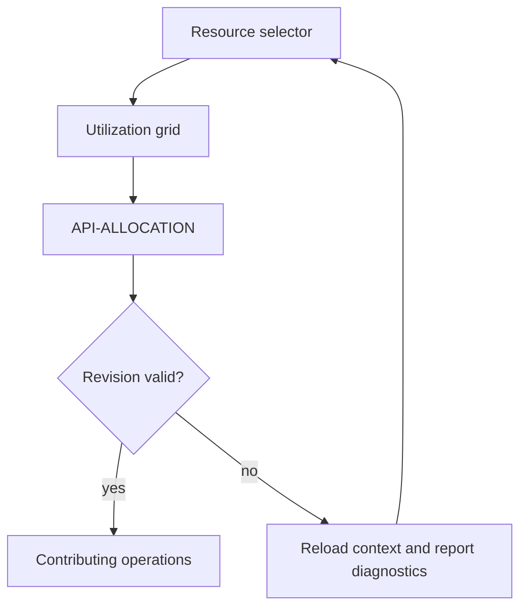
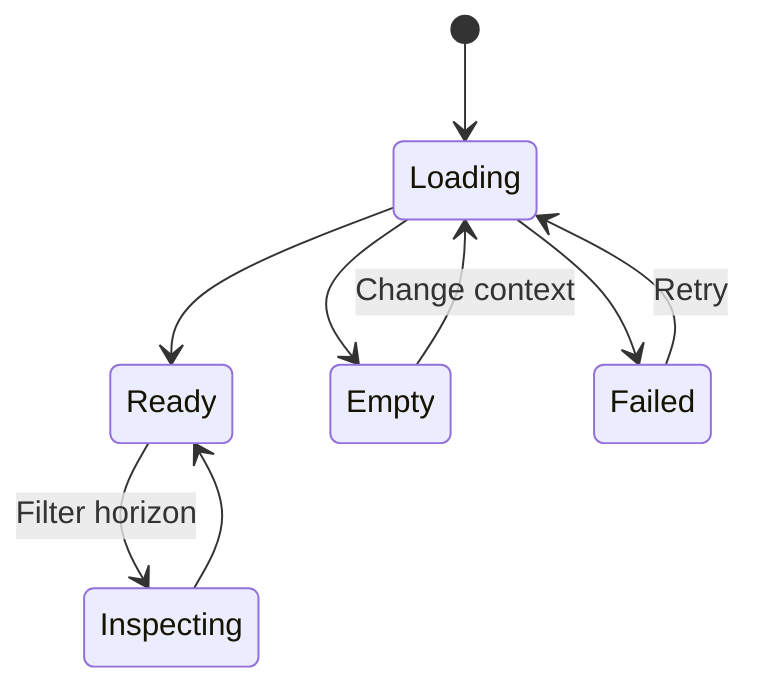

# UI16 · Resource allocation visualizer

Design study for directive §10. The official English dark reference governs visual geometry; the original draft studies are retained for history. The [reviewed module specification](review/modules/UI16.md) and [SP02 disposition](review/FINAL-DISPOSITION.md) govern implementation design; concrete provider and runtime acceptance are separate.

**Operator journey.** Optimization → Resource selector → Utilization grid → Inspect occupied capacity → Contributing operations.

[Wireframe](drafts/UI16-wire.svg) · [High-fidelity reference or draft](drafts/UI16.svg) · [Field and port dictionary](../pilot-contracts.md)

| Interaction requirement | Scope |
|---|---|
| UI16-01 | Utilization |
| UI16-02 | Capacity analysis |
| UI16-03 | Bottlenecks |
| UI16-04 | Heatmaps |
| UI16-05 | Allocation networks |

**Data contract.** API-ALLOCATION supplies the shared pilot context. Read F-MACHINE,F-START,F-DURATION. These are the cross-product fields used here; logical specialized field profiles are defined in [edition 1](../specialized-studio-ports-v1.md); concrete payloads and adapters require provider acceptance. Actions: Filter horizon,Inspect allocation.

**Component and data flow.**

**Interaction states.**

**Acceptance scenario.** Reconcile occupied machine minutes with capacity in the same frozen horizon and drill into each contributing operation.

**Failure and recovery.** Report unavailable utilization for zero capacity. Keep navigation and diagnostic focus available on failure.

**Implementation gates.** UI01, V03, SP02. Pin the visual comparison environment and test both input directions and keyboard operation before UI acceptance.
