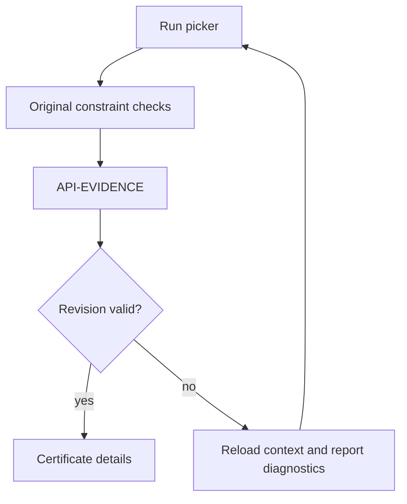
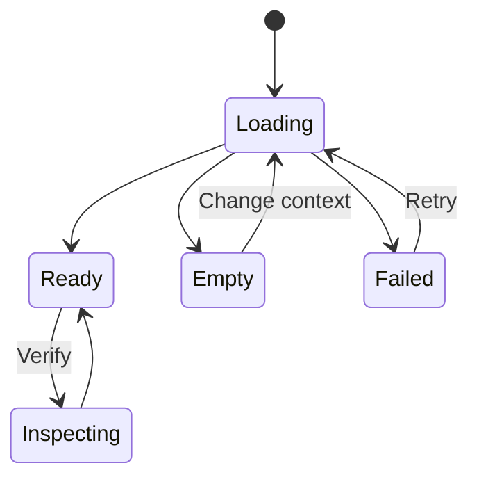

# UI17 · Decision evidence viewer

Design study for directive §10. The official English dark reference governs visual geometry; the original draft studies are retained for history. The [reviewed module specification](review/modules/UI17.md) and [SP02 disposition](review/FINAL-DISPOSITION.md) govern implementation design; concrete provider and runtime acceptance are separate.

**Operator journey.** Evidence → Run picker → Original constraint checks → Verify exported evidence → Certificate details.

[Wireframe](drafts/UI17-wire.svg) · [High-fidelity reference or draft](drafts/UI17.svg) · [Field and port dictionary](../pilot-contracts.md)

| Interaction requirement | Scope |
|---|---|
| UI17-01 | Math and verification status |
| UI17-02 | Evidence level |
| UI17-03 | Original constraint checks |
| UI17-04 | Objective recalculation |
| UI17-05 | Certificates |
| UI17-06 | Audit history |
| UI17-07 | Reproducibility |

**Data contract.** API-EVIDENCE supplies the shared pilot context. Read F-RUN,F-REV,F-STATUS,F-TERM,F-EVID. These are the cross-product fields used here; specialized edit payloads and adapters require SP01 and feature review. Actions: Verify,Export evidence.

**Component and data flow.**

**Interaction states.**

**Acceptance scenario.** Open a timed-out run with verified incumbent and inspect source rows, objective and absent certificate separately.

**Failure and recovery.** Reject a bundle whose frozen model digest differs. Keep navigation and diagnostic focus available on failure.

**Implementation gates.** UI01, S10, SP02. Pin the visual comparison environment and test both input directions and keyboard operation before UI acceptance.
