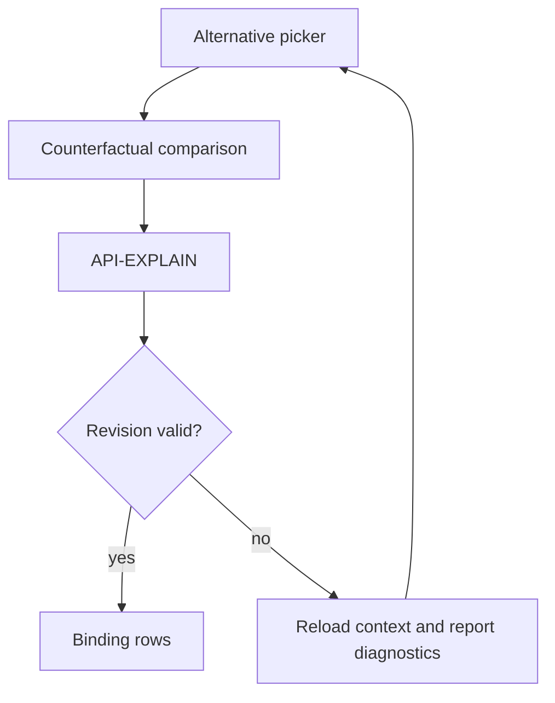
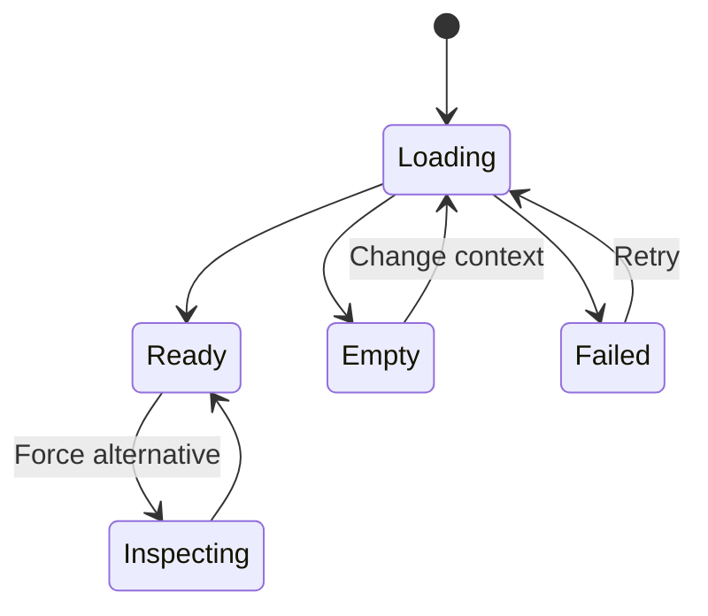

# UI18 · Explainability studio

Design study for directive §10. The official English dark reference governs visual geometry; individual screen studies are proposed layouts pending review.

**Operator journey.** Evidence → Alternative picker → Counterfactual comparison → Explain a rejected alternative → Binding rows.

[Wireframe](drafts/UI18-wire.svg) · [High-fidelity reference or draft](drafts/UI18.svg) · [Field and port dictionary](../pilot-contracts.md)

| Interaction requirement | Scope |
|---|---|
| UI18-01 | Why and why-not |
| UI18-02 | Binding constraints |
| UI18-03 | Counterfactual comparison |
| UI18-04 | Sensitivity |
| UI18-05 | Infeasibility explanations |

**Data contract.** API-EXPLAIN supplies the shared pilot context. Read F-REV,F-OBJ,F-BOUND,F-EVID. These are the cross-product fields used here; logical specialized field profiles are defined in [edition 1](../specialized-studio-ports-v1.md); concrete payloads and adapters require provider acceptance. Actions: Force alternative,Inspect proof.

**Component and data flow.**

**Interaction states.**

**Acceptance scenario.** Compare a forced alternative to the baseline using identical input and budget and trace any claim to its evidence.

**Failure and recovery.** Do not expose LP marginal values for unsupported discrete models. Keep navigation and diagnostic focus available on failure.

**Implementation gates.** UI17, A02, A03, SP02. Pin the visual comparison environment and test both input directions and keyboard operation before UI acceptance.
