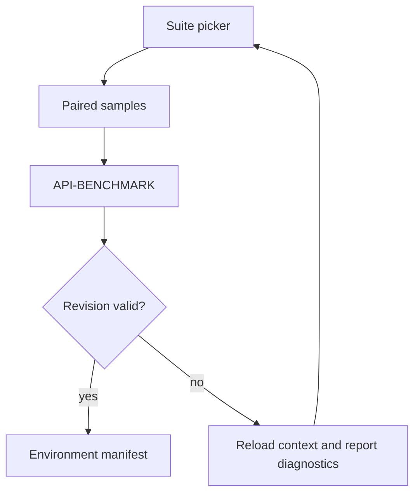
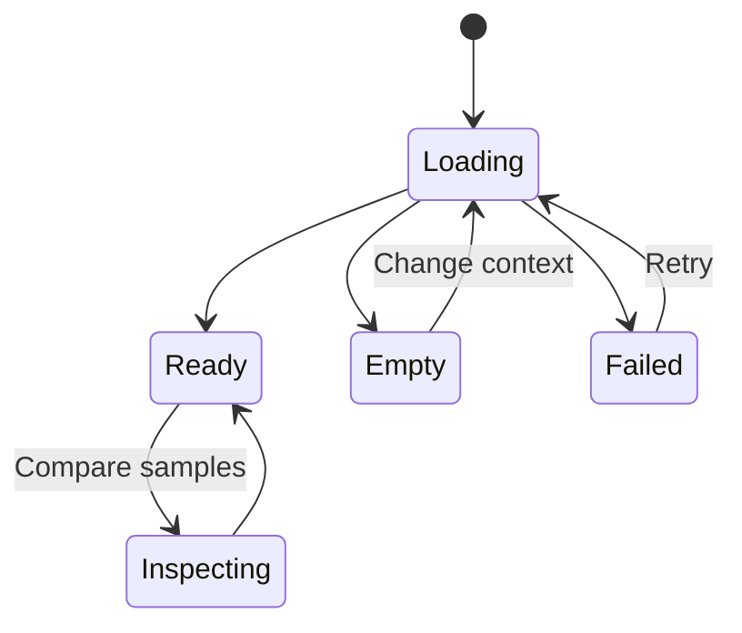

# UI19 · Performance and benchmark studio

Design study for directive §10. The official English dark reference governs visual geometry; the original draft studies are retained for history. The [reviewed module specification](review/modules/UI19.md) and [SP02 disposition](review/FINAL-DISPOSITION.md) govern implementation design; concrete provider and runtime acceptance are separate.

**Operator journey.** Benchmarks → Suite picker → Paired samples → Investigate a regression → Environment manifest.

[Wireframe](drafts/UI19-wire.svg) · [High-fidelity reference or draft](drafts/UI19.svg) · [Field and port dictionary](../pilot-contracts.md)

| Interaction requirement | Scope |
|---|---|
| UI19-01 | Benchmark execution |
| UI19-02 | Solver comparison |
| UI19-03 | CPU and memory |
| UI19-04 | Historical performance |
| UI19-05 | Regression detection |
| UI19-06 | Statistics and replay |

**Data contract.** API-BENCHMARK supplies the shared pilot context. Read F-RUN,F-CPU,F-MEM,F-ELAPSED. These are the cross-product fields used here; logical specialized field profiles are defined in [edition 1](../specialized-studio-ports-v1.md); concrete payloads and adapters require provider acceptance. Actions: Compare samples,Export manifest.

**Component and data flow.**

**Interaction states.**

**Acceptance scenario.** Display paired samples, hardware, seeds, peak memory and failed trials from a benchmark manifest.

**Failure and recovery.** Reject incomparable units and highlight unmatched instance families. Keep navigation and diagnostic focus available on failure.

**Implementation gates.** UI01, X07, SP02. Pin the visual comparison environment and test both input directions and keyboard operation before UI acceptance.
