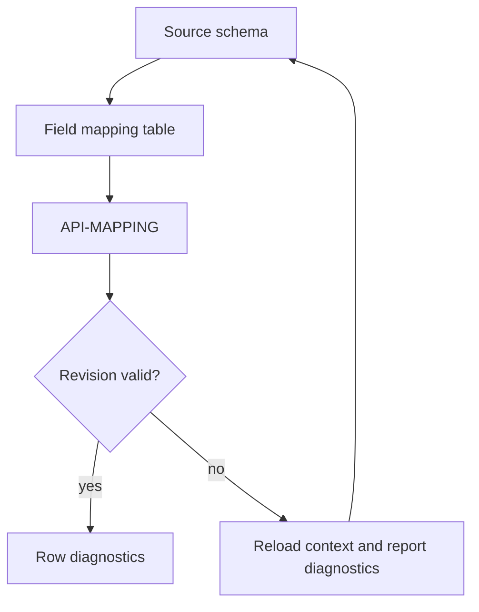
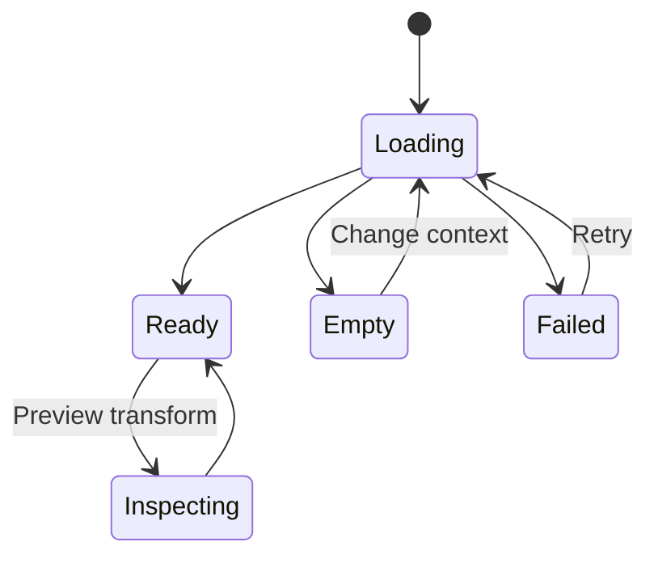

# UI20 · Integration mapping designer

Design study for directive §10. The official English dark reference governs visual geometry; the original draft studies are retained for history. The [reviewed module specification](review/modules/UI20.md) and [SP02 disposition](review/FINAL-DISPOSITION.md) govern implementation design; concrete provider and runtime acceptance are separate.

**Operator journey.** Integrations → Source schema → Field mapping table → Preview and validate a field mapping → Row diagnostics.

[Wireframe](drafts/UI20-wire.svg) · [High-fidelity reference or draft](drafts/UI20.svg) · [Field and port dictionary](../pilot-contracts.md)

| Interaction requirement | Scope |
|---|---|
| UI20-01 | Connectors and schemas |
| UI20-02 | Field mapping |
| UI20-03 | Transformations and units |
| UI20-04 | Synchronization health |
| UI20-05 | Import validation |

**Data contract.** API-MAPPING supplies the shared pilot context. Read F-REV,F-MACHINE,F-DURATION. These are the cross-product fields used here; logical specialized field profiles are defined in [edition 1](../specialized-studio-ports-v1.md); concrete payloads and adapters require provider acceptance. Actions: Preview transform,Validate import.

**Component and data flow.**

**Interaction states.**

**Acceptance scenario.** Map a source quantity to an engine field, preview normalized values and trace rejected rows to source fields.

**Failure and recovery.** Abort invalid imports atomically and redact credentials. Keep navigation and diagnostic focus available on failure.

**Implementation gates.** UI01, I01, I02, SP02. Pin the visual comparison environment and test both input directions and keyboard operation before UI acceptance.
