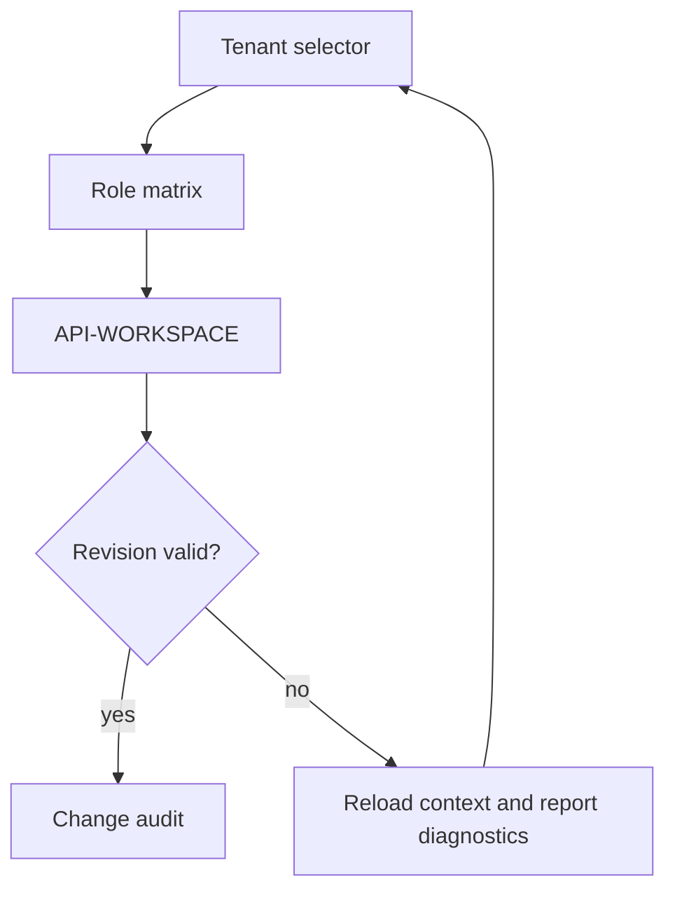
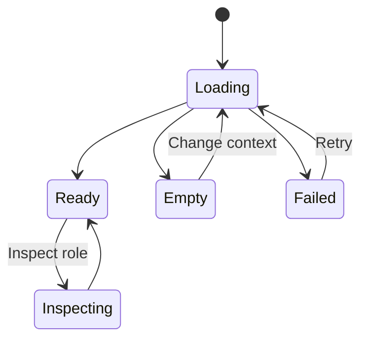

# UI21 · Administration and developer portal

Design study for directive §10. The official English dark reference governs visual geometry; individual screen studies are proposed layouts pending review.

**Operator journey.** Settings → Tenant selector → Role matrix → Inspect role permissions → Change audit.

[Wireframe](drafts/UI21-wire.svg) · [High-fidelity reference or draft](drafts/UI21.svg) · [Field and port dictionary](../pilot-contracts.md)

| Interaction requirement | Scope |
|---|---|
| UI21-01 | Tenants and users |
| UI21-02 | Roles and permissions |
| UI21-03 | API configuration |
| UI21-04 | SDK documentation |
| UI21-05 | Extension management |

**Data contract.** API-WORKSPACE supplies the shared pilot context. Read F-REV. These are the cross-product fields used here; specialized edit payloads and adapters require SP01 and feature review. Actions: Inspect role,Review history.

**Component and data flow.**

**Interaction states.**

**Acceptance scenario.** Use two tenant accounts to check a read-only role, an administrative operation and versioned SDK examples in Blazor.

**Failure and recovery.** Reject a cross-tenant request at the server even if the client is modified. Keep navigation and diagnostic focus available on failure.

**Implementation gates.** UI01, E01, I01, SP02. Pin the visual comparison environment and test both input directions and keyboard operation before UI acceptance.
