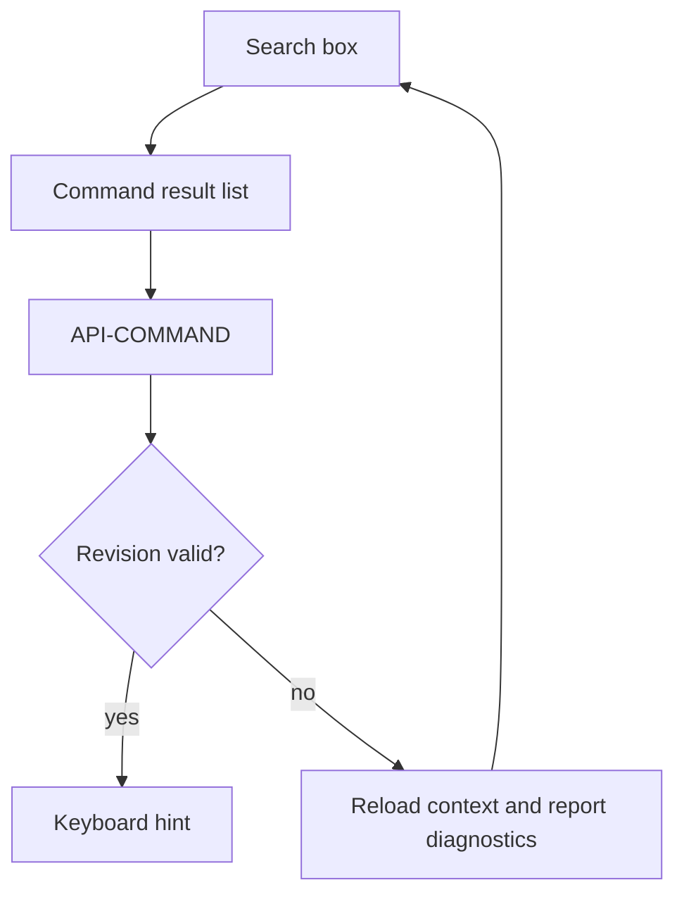
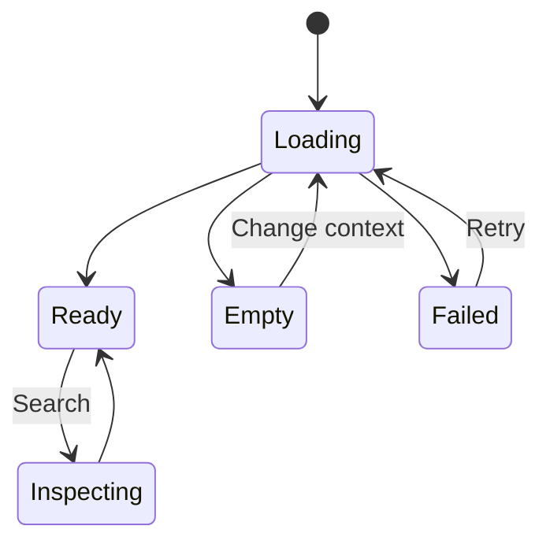

# UI22 · Command palette and productivity

Design study for directive §10. The official English dark reference governs visual geometry; individual screen studies are proposed layouts pending review.

**Operator journey.** Overview → Search box → Command result list → Navigate by command name → Keyboard hint.

[Wireframe](drafts/UI22-wire.svg) · [High-fidelity reference or draft](drafts/UI22.svg) · [Field and port dictionary](../pilot-contracts.md)

| Interaction requirement | Scope |
|---|---|
| UI22-01 | Search everywhere |
| UI22-02 | Keyboard shortcuts |
| UI22-03 | Context menus |
| UI22-04 | Quick navigation |
| UI22-05 | Command history |
| UI22-06 | Restricted terminal integration |

**Data contract.** API-COMMAND supplies the shared pilot context. Read F-REV. These are the cross-product fields used here; specialized edit payloads and adapters require SP01 and feature review. Actions: Search,Run selected command.

**Component and data flow.**

**Interaction states.**

**Acceptance scenario.** Invoke a registered command by name and shortcut with the same permission and workspace context.

**Failure and recovery.** A command requiring an external shell must demand an explicit local capability and structured arguments. Keep navigation and diagnostic focus available on failure.

**Implementation gates.** UI01, SP02, CLI01. Pin the visual comparison environment and test both input directions and keyboard operation before UI acceptance.
