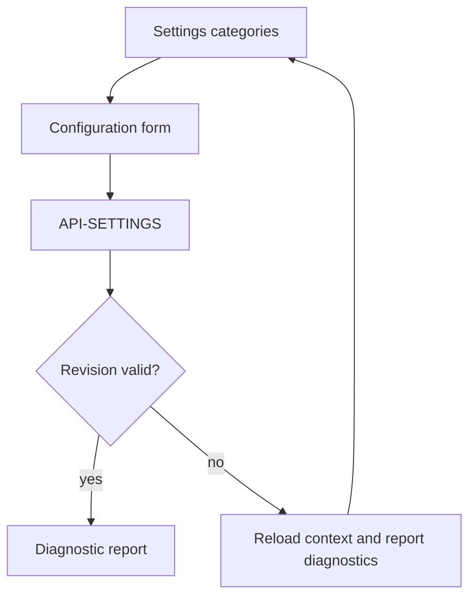
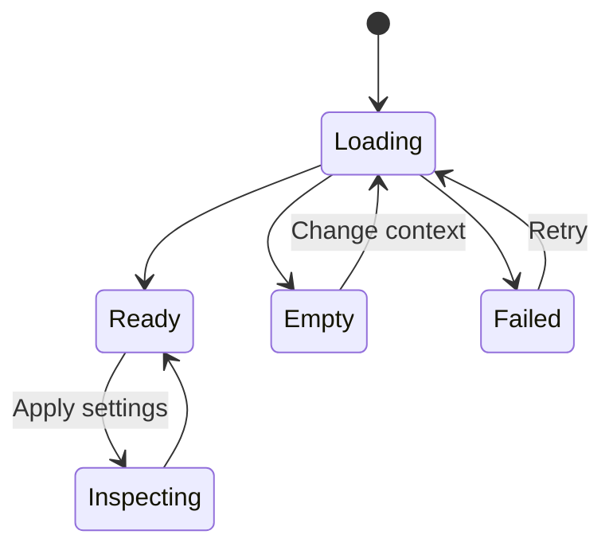

# UI23 · Settings and diagnostics

Design study for directive §10. The official English dark reference governs visual geometry; individual screen studies are proposed layouts pending review.

**Operator journey.** Settings → Settings categories → Configuration form → Review effective runtime settings → Diagnostic report.

[Wireframe](drafts/UI23-wire.svg) · [High-fidelity reference or draft](drafts/UI23.svg) · [Field and port dictionary](../pilot-contracts.md)

| Interaction requirement | Scope |
|---|---|
| UI23-01 | Application and engine settings |
| UI23-02 | Theme and language |
| UI23-03 | Logging |
| UI23-04 | Health |
| UI23-05 | Runtime diagnostics |

**Data contract.** API-SETTINGS supplies the shared pilot context. Read F-REV,F-RUN. These are the cross-product fields used here; specialized edit payloads and adapters require SP01 and feature review. Actions: Apply settings,Export diagnostics.

**Component and data flow.**

**Interaction states.**

**Acceptance scenario.** Change theme and language, restart and inspect the effective configuration and redacted health report.

**Failure and recovery.** Keep the last valid configuration after invalid edits. Keep navigation and diagnostic focus available on failure.

**Implementation gates.** UI01, CLI10, SP02. Pin the visual comparison environment and test both input directions and keyboard operation before UI acceptance.
