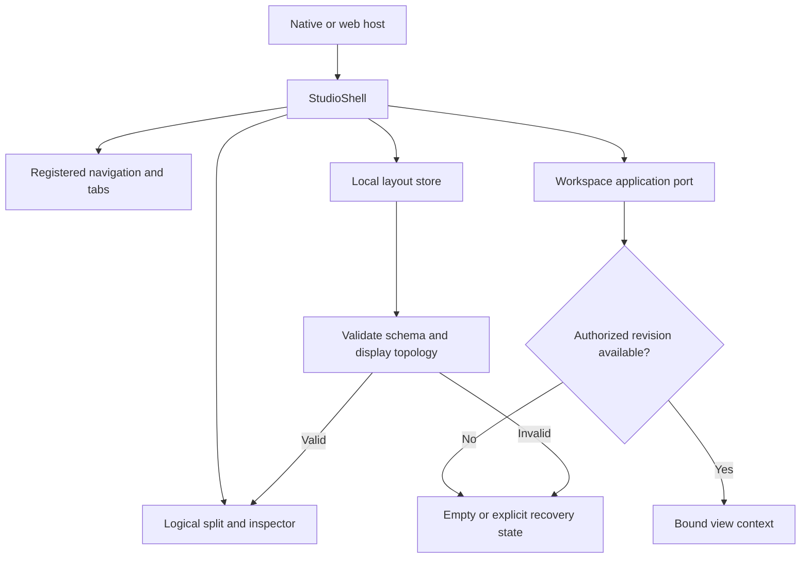
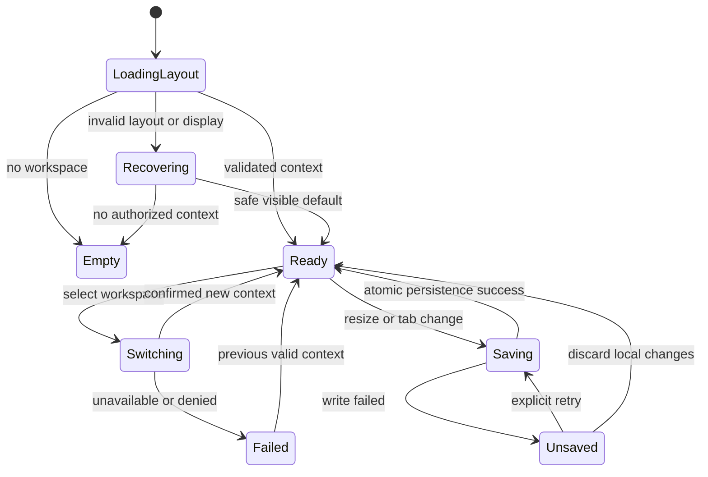

# UI01 — implementation review candidate

Status: proposed for SP02 review; this does not claim #90 or authorize its
implementation before SP02 is closed. The official English dark SVG remains
the only approved visual source. The attached shell study applies that
chrome, navigation and panel geometry to explicitly labeled local fixture
state. It is not a screenshot baseline or production output.

## Ownership

UI01 owns navigation, title/status chrome, tabs, split pane/docking layout and
presentation persistence. DS01/DS02 supply tokens and reusable components;
DS03 supplies direction, logical split and placement recovery. U02 owns native
window lifecycle and platform packaging. RT01/API-WORKSPACE own authoritative
workspace/revision context. UI01 must not open raw model databases or construct
engine requests directly. UI02–UI23 provide content through registered view
descriptors, not independent shell implementations.

## Presentation state (proposed, local only)

| Field | Type / validation | Default / recovery |
|---|---|---|
| LayoutVersion | Positive integer, exact supported schema | 1; unknown version uses defaults without overwriting saved source |
| WorkspaceKey | Opaque authorized workspace identity | No selected workspace; never substitute an arbitrary recent workspace |
| RevisionId | F-REV from authoritative workspace context | Null until selected; restore only if still available and authorized |
| Tabs | Ordered unique local tab keys with registered view descriptor and workspace/revision binding | Empty; drop unknown descriptors, report discarded tabs |
| ActiveTabKey | Key of a restored tab | First valid tab or null |
| PrimaryShare | Finite ratio in [0.25,0.75], proposed shell policy | 0.69 from reference graph/monitor proportions; clamp user resize |
| InspectorVisible | Boolean | True; collapsing does not close document or mutate revision |
| DisplayPlacement | Logical work area and stable display identity, supplied by host | DS03 recovery; invalid/disconnected display falls back to visible work area |

These are UI-local presentation fields, not approved database columns,
REST request fields or mathematical state. The exact workspace identity
and revision availability are provided by the owning application port.
Persist versioned layout separately from model content, atomically and
without credentials. A failed write retains current visible state with
an explicit unsaved-layout message. A failed restore retains the last
valid session, not an invented workspace or revision.

## Navigation and component boundaries

Reference navigation order: Overview, Decision Models, Decision Graph,
Optimization, Scenarios, Simulation, Integrations, Benchmarks, Evidence,
Settings. Each route is a stable registered view, resolved only after
workspace/authorization checks. Do not substitute the reference's
illustrative values for absent runtime data.

## Visual review

[Proposed reference-aligned shell SVG](shell-study.svg) preserves the
720×460 reference chrome dimensions, sidebar ordering, accent marker and
dark palette. The two pane extents follow the original 375/167 geometry.
The workspace control and tab row replace the graph module's KPI row
only in this proposed shell-specific state. Use scalable typography and
logical CSS properties at runtime. Native OS window controls remain
host-owned; do not duplicate them in a native title bar. The study does
not alter the official graph screen. Unavailable status is explicitly
labeled; fixture IDs are not production identifiers.

## Acceptance matrix

| Case | Action | Observable oracle |
|---|---|---|
| SH-01 | Navigate every registered view using keyboard | Nav order matches reference, active marker and aria-current synchronized, unavailable routes explicit |
| SH-02 | Open two tabs for frozen revision and switch via keyboard | Active tab changes, exact workspace/revision identity unchanged; focus returns to selected tab/panel |
| SH-03 | Resize splitter by pointer and arrow keys | Finite clamped ratio, both panes remain reachable, keyboard separator exposes value, no model mutation |
| SH-04 | Save, close and reopen layout | Stable valid tab order, selection and pane ratio restored; compare exact serialized local layout |
| SH-05 | Restore invalid version or unknown tab | Default/remaining valid tabs with diagnostic; original saved bytes retained until explicit save |
| SH-06 | Disconnect target display | Host topology changes; DS03 restores visible window; verify native bounds and monitor, not browser emulation |
| SH-07 | Workspace switch rejected | Previous valid context retained, error accessible; no mixed-tenant or stale revision view |
| SH-08 | Local layout write fails | Visible state remains usable; unsaved status and explicit retry; no successful persistence claim |
| SH-09 | Switch English/Arabic and high DPI | Logical focus order stable; IDs isolated; split usable at two real display scales |
| SH-10 | Compare dark reference chrome | Pinned font, viewport, theme, renderer and DPI; compare common regions only, no unapproved mockup baseline |

Any full feature implementation must link its exact source revision,
acceptance evidence and owning application contracts. This review does
not substitute for SP02 final disposition or U02/QA02 native evidence.
