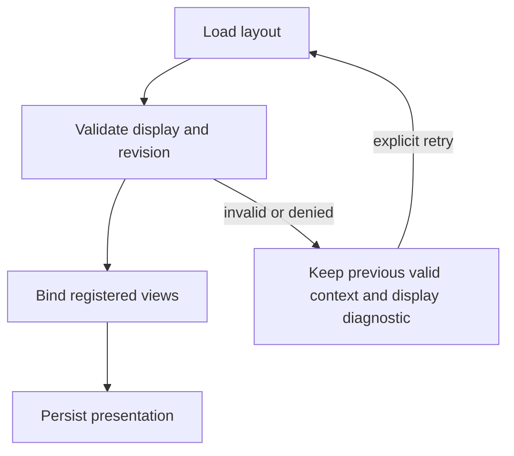
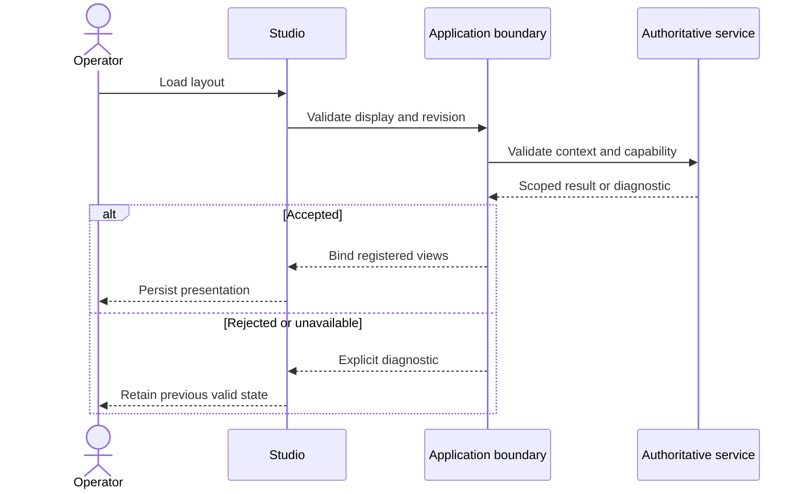

# UI01 — detailed specification review

Source: [functional scope](../../UI01.md) · [wireframe](../../drafts/UI01-wire.svg) · [proposed high-fidelity study](../UI01/shell-study.svg) · [accepted field dictionary](../../../pilot-field-dictionary-v1.md).

**Implementation gates:** DS01 (#125), DS02 (#126), SP02 (#160). No feature coding before its claimed dependencies close.

## User journey and component/data flow

The operator navigates through Load layout → Validate display and revision → Bind registered views → Persist presentation. The application boundary, not Studio, owns authoritative mutation, validation and storage.

## Fields and ports

| Module | Existing binding | Direction and validation | Remaining owner seam |
|---|---|---|---|
| UI01 | P:F-REV; R revision key; L shell layout contract | Switch authorized workspace then bind revision; persist only layout; keep previous context on failure | RT01 workspace handle/schema/availability; U02 display placement |

Approved pilot field IDs: F-REV. Baseline logical ports: API-WORKSPACE. Read inherited type, unit, requiredness, defaults, relationship and classification rules in the field profiles; do not invent wire DTOs or physical storage.

## Operation sequence

## Interaction states and recovery

| Module | Navigation and loading | Invalid / unavailable | Keyboard and recovery |
|---|---|---|---|
| UI01 | Navigate shell, load saved layout and selected tab; restore only after topology and revision validation. | Unknown layout version, invalid split ratio, missing monitor or inaccessible revision. | Tab to workspace and splitter; keyboard resize; restore defaults on invalid layout; verify visible window, selected revision unchanged, focus returns to selected tab. |

Named states: LoadingLayout, Recovering, Ready, Switching, Unsaved. Initial loading, empty, denied, invalid, unavailable and failed are separate presentation states; the owner result determines which is shown. Explicit retry never implies mutation.

## Acceptance and test trace

| Requirement | Review case | Action | Observable oracle | Feature acceptance IDs |
|---|---|---|---|---|
| UI01-01 Main navigation | SP02-UI01-01 | Navigate each registered view | Compare reference nav order, active ID and aria-current; unavailable route stays labeled | TC-UI01-A, TC-UI01-B |
| UI01-02 Title and status bars | SP02-UI01-02 | Read title and status | Compare workspace identity and observed connection; unknown is not connected | TC-UI01-A, TC-UI01-B |
| UI01-03 Workspace switching | SP02-UI01-03 | Switch workspace by keyboard | Accept only authorized returned revision; rejected switch retains prior context | TC-UI01-A, TC-UI01-B |
| UI01-04 Resizable and dockable panels | SP02-UI01-04 | Resize and dock two panes | Pointer and arrow resizing clamp finite ratio; separator exposes value and no model mutation | TC-UI01-A, TC-UI01-B |
| UI01-05 Split views and multi-tab restoration | SP02-UI01-05 | Restore tabs after restart | Order, active ID and revision equal saved valid state; disconnected display restores visible bounds | TC-UI01-A, TC-UI01-B |

Feature-level acceptance:

- TC-UI01-A: Resize two panes, reopen a saved layout and switch tabs by keyboard while the selected revision remains stable.
- TC-UI01-B: Discard a layout referring to a disconnected monitor and restore a visible window.

## Visual, localization and accessibility gates

Use approved DS01 tokens and DS02 components, with English LTR and Arabic RTL in separate scenarios. Isolate exact IDs, source spans and units; preserve logical focus order and named controls. Test keyboard and pointer equivalence for the actions above, focus recovery on errors and explicit unavailable/empty state. Compare common chrome with the reference and pin viewport, font, DPI, renderer and fixture. Do not use proposed mockups as approved screenshot baselines. Native monitor, screen-reader and feature-specific functional evidence belong to implementing issues.

**Disposition:** review proposal with implementation-specific acceptance cases. Domain-source bindings are checked, but owner seams are not approved by this document. No feature execution or final visual approval claimed.
