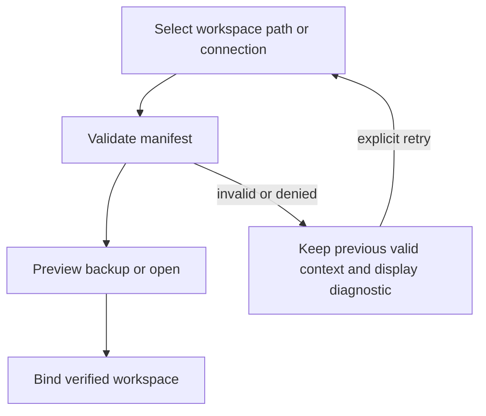
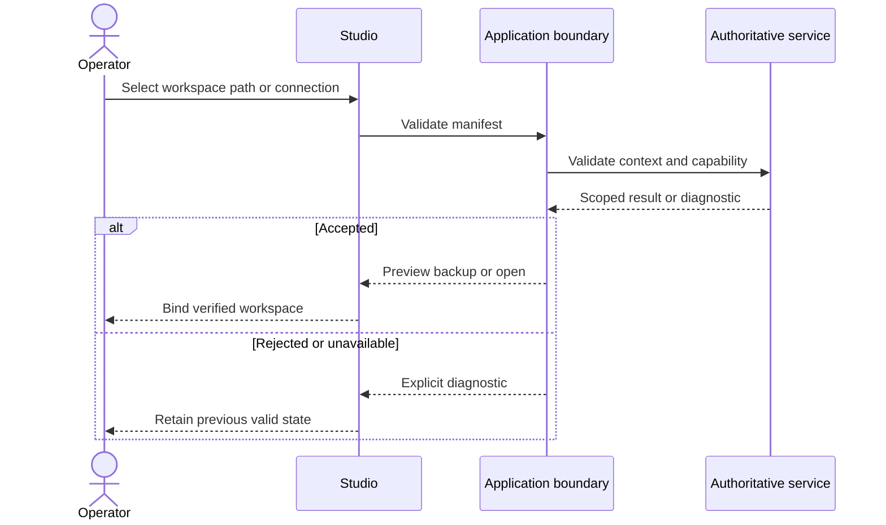

# UI02 — detailed specification review

Source: [functional scope](../../UI02.md) · [wireframe](../../drafts/UI02-wire.svg) · [proposed high-fidelity study](../studies/UI02.svg) · [accepted field dictionary](../../../pilot-field-dictionary-v1.md).

**Implementation gates:** UI01 (#90), RT01 (#129), SP02 (#160). No feature coding before its claimed dependencies close.

## User journey and component/data flow

The operator navigates through Select workspace path or connection → Validate manifest → Preview backup or open → Bind verified workspace. The application boundary, not Studio, owns authoritative mutation, validation and storage.

## Fields and ports

| Module | Existing binding | Direction and validation | Remaining owner seam |
|---|---|---|---|
| UI02 | P:F-REV; R revision key, model/graph hashes, input/source bytes | Open or restore via application port; verify exact content before replacing anything | RT01 workspace manifest, backup format, remote connection lifecycle |

Approved pilot field IDs: F-REV. Baseline logical ports: API-WORKSPACE. Read inherited type, unit, requiredness, defaults, relationship and classification rules in the field profiles; do not invent wire DTOs or physical storage.

## Operation sequence

## Interaction states and recovery

| Module | Navigation and loading | Invalid / unavailable | Keyboard and recovery |
|---|---|---|---|
| UI02 | Open recent workspace or connection, load manifest; enter backup preview before restore. | Non-workspace directory, corrupt digest, unsupported schema, expired connection or inaccessible path. | Keyboard select path and restore target, cancel preview without mutation; failed restore retains previous workspace and exposes retry. |

Named states: Selecting, ValidatingManifest, PreviewingRestore, Opening, Restoring, Rejected. Initial loading, empty, denied, invalid, unavailable and failed are separate presentation states; the owner result determines which is shown. Explicit retry never implies mutation.

## Acceptance and test trace

| Requirement | Review case | Action | Observable oracle | Feature acceptance IDs |
|---|---|---|---|---|
| UI02-01 Create and open workspaces | SP02-UI02-01 | Create and open explicit path | Reject non-workspace directory without explicit import; reopen exact manifest | TC-UI02-A, TC-UI02-B |
| UI02-02 Recent workspaces | SP02-UI02-02 | Choose recent workspace | History contains no credentials; missing path remains unavailable and removable | TC-UI02-A, TC-UI02-B |
| UI02-03 Local and remote connections | SP02-UI02-03 | Switch local and remote mode | Local works offline; remote denial does not fall back to unrelated local data | TC-UI02-A, TC-UI02-B |
| UI02-04 Workspace settings | SP02-UI02-04 | Edit workspace settings | Versioned validation failure retains previous effective configuration | TC-UI02-A, TC-UI02-B |
| UI02-05 Backup and recovery | SP02-UI02-05 | Backup and restore into new directory | Compare original and restored revision/evidence digests; incompatible backup never replaces current data | TC-UI02-A, TC-UI02-B |

Feature-level acceptance:

- TC-UI02-A: Create a local workspace, back it up, restore into another directory and compare revision and evidence digests.
- TC-UI02-B: Refuse an incompatible backup before replacing current data.

## Visual, localization and accessibility gates

Use approved DS01 tokens and DS02 components, with English LTR and Arabic RTL in separate scenarios. Isolate exact IDs, source spans and units; preserve logical focus order and named controls. Test keyboard and pointer equivalence for the actions above, focus recovery on errors and explicit unavailable/empty state. Compare common chrome with the reference and pin viewport, font, DPI, renderer and fixture. Do not use proposed mockups as approved screenshot baselines. Native monitor, screen-reader and feature-specific functional evidence belong to implementing issues.

**Disposition:** review proposal with implementation-specific acceptance cases. Domain-source bindings are checked, but owner seams are not approved by this document. No feature execution or final visual approval claimed.
