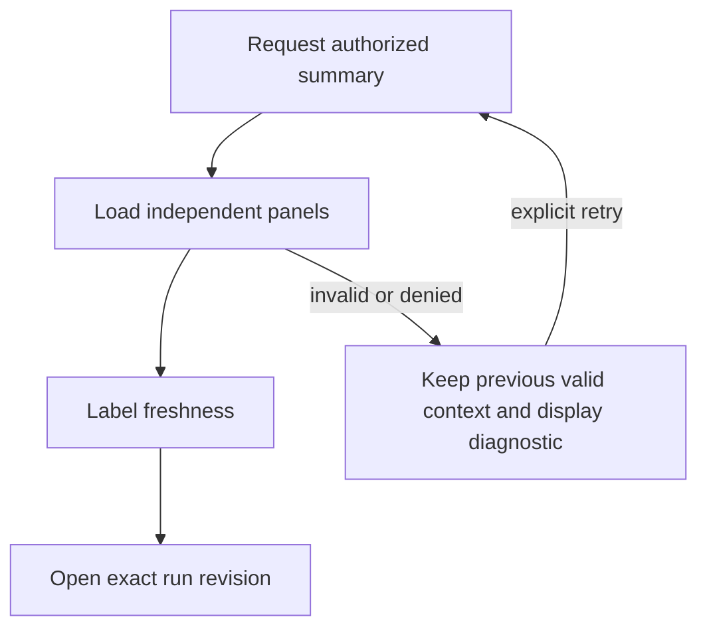
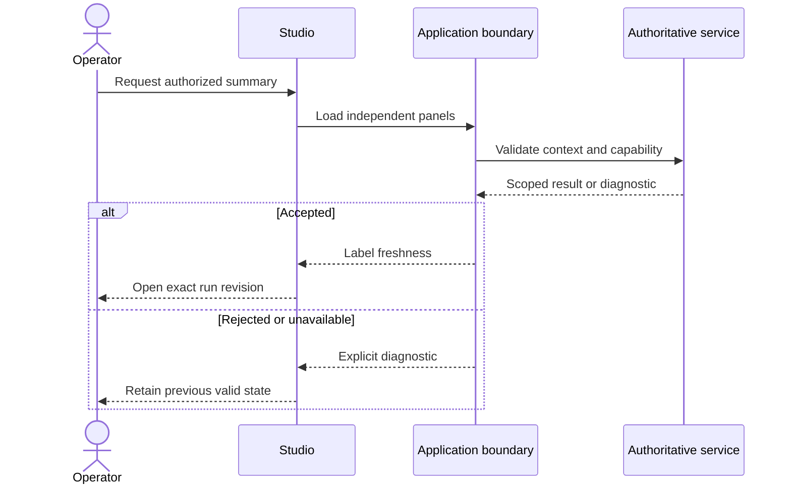
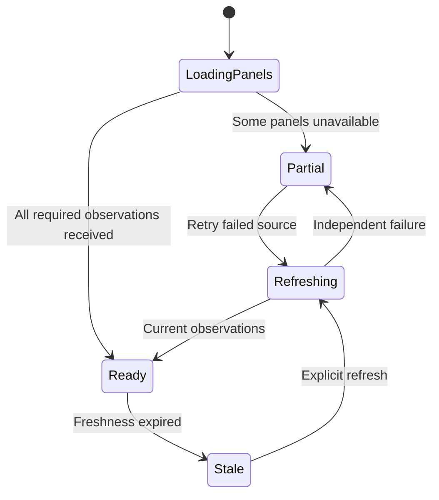

# UI03 — detailed specification review

Source: [functional scope](../../UI03.md) · [wireframe](../../drafts/UI03-wire.svg) · [proposed high-fidelity study](../studies/UI03.svg) · [accepted field dictionary](../../../pilot-field-dictionary-v1.md).

**Implementation gates:** UI01 (#90), RT01 (#129), SP02 (#160). No feature coding before its claimed dependencies close.

## User journey and component/data flow

The operator navigates through Request authorized summary → Load independent panels → Label freshness → Open exact run revision. The application boundary, not Studio, owns authoritative mutation, validation and storage.

## Fields and ports

| Module | Existing binding | Direction and validation | Remaining owner seam |
|---|---|---|---|
| UI03 | P:F-RUN,F-TERM,F-EVID,F-ELAPSED,F-CPU,F-MEM; S:Measurement, SolverResult identity/termination | Read-only per-source panels; null vs zero; no raw exception details | RT01/RT02 job summary, health/freshness and connector health projection |

### Approved pilot field definitions applicable to this module

| Field ID / JSON key | Type, units, presence | Source and relationship | Valid representation / rejected condition |
|---|---|---|---|
| F-RUN / runId | R, opaque text | Job registry → run key unique in tenant; referenced by evidence and cancellation | `"run-7"` / foreign tenant lookup |
| F-TERM / termination | R, case-sensitive enum | Worker → reason the run ended, independent of mathematical status | `"Timeout"` / mathematical outcome in termination slot |
| F-EVID / evidenceDigest | R on evidence export, lowercase SHA-256 hex text | Exact immutable bundle bytes → digest linked to revision and run | hash of exported bytes / malformed digest or changed bytes |
| F-ELAPSED / elapsedMs | N, nonnegative integer milliseconds | Monotonic runtime clock → elapsed duration observed for run | `56` / negative; unavailable is null |
| F-CPU / cpuMs | N, nonnegative integer milliseconds | Worker accounting → aggregate CPU of process tree for run | `31` / wrong unit or unknown counter reported as zero |
| F-MEM / peakBytes | N, nonnegative integer bytes | Worker accounting → peak process-tree measurement with platform and scope | `8192` / negative or undocumented measurement scope |

Ledger pilot field IDs: F-RUN, F-TERM, F-EVID. Baseline logical ports: API-RUN. Read inherited type, unit, requiredness, defaults, relationship and classification rules in the field profiles; do not invent wire DTOs or physical storage.

## Operation sequence

## Interaction states and recovery

| Module | Navigation and loading | Invalid / unavailable | Keyboard and recovery |
|---|---|---|---|
| UI03 | Load health, runs and connector panels independently; drill into exact revision. | Unavailable counters, empty runs, stale health, unauthorized integration. | Keyboard refresh only failed panel; inspect run link; distinguish empty history from failed run fetch and verify stale labels. |

Initial loading, empty, denied, invalid, unavailable and failed are separate presentation states; the owner result determines which is shown. Explicit retry never implies mutation.

## Acceptance and test trace

| Requirement | Review case | Action | Observable oracle | Feature acceptance IDs |
|---|---|---|---|---|
| UI03-01 Engine health | SP02-UI03-01 | Load engine health | Unavailable source renders unknown and timestamp absent; never healthy by default | TC-UI03-A, TC-UI03-B |
| UI03-02 Recent models and decisions | SP02-UI03-02 | Open recent model/decision | Selecting exact run and revision opens corresponding evidence; empty history distinct from failed lookup | TC-UI03-A, TC-UI03-B |
| UI03-03 Active jobs | SP02-UI03-03 | Inspect active jobs | Display authoritative job state and stable run ID; failed subscription refreshes snapshot | TC-UI03-A, TC-UI03-B |
| UI03-04 Measured performance | SP02-UI03-04 | Inspect performance | Measured elapsed/CPU/peak memory preserve units and null/zero distinction | TC-UI03-A, TC-UI03-B |
| UI03-05 Integration health | SP02-UI03-05 | Inspect integration health | Unavailable/denied connector separated from disconnected; refresh only failed panel | TC-UI03-A, TC-UI03-B |

Feature-level acceptance:

- TC-UI03-A: Exercise an empty workspace and one with two runs. Follow a recent decision to its exact revision.
- TC-UI03-B: Show an unknown health or measurement state when a source is unavailable.

## Visual, localization and accessibility gates

Use approved DS01 tokens and DS02 components, with English LTR and Arabic RTL in separate scenarios. Isolate exact IDs, source spans and units; preserve logical focus order and named controls. Test keyboard and pointer equivalence for the actions above, focus recovery on errors and explicit unavailable/empty state. Compare common chrome with the reference and pin viewport, font, DPI, renderer and fixture. Do not use proposed mockups as approved screenshot baselines. Native monitor, screen-reader and feature-specific functional evidence belong to implementing issues.

**Disposition:** review proposal with implementation-specific acceptance cases. Domain-source bindings are checked, but owner seams are not approved by this document. No feature execution or final visual approval claimed.
