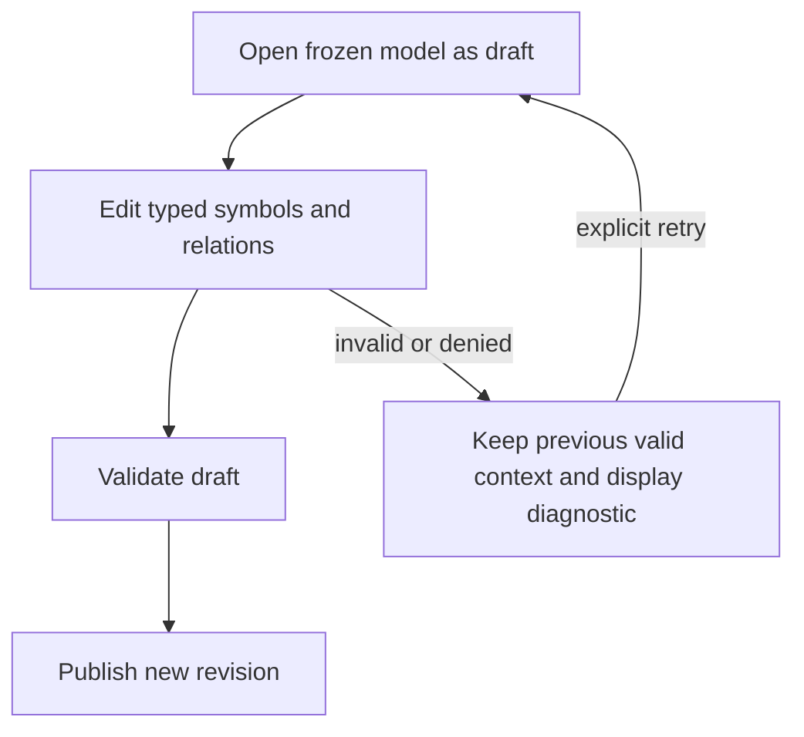
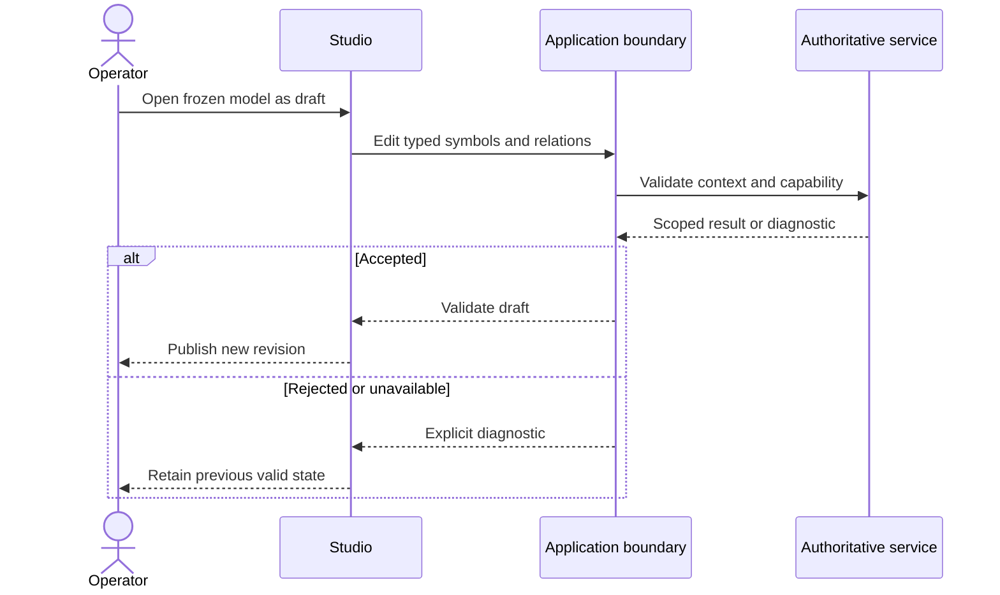
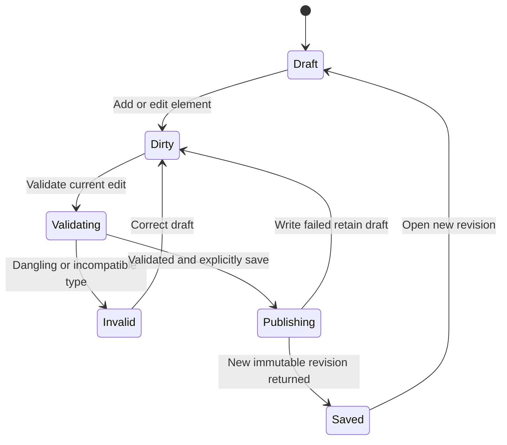

# UI04 — detailed specification review

Source: [functional scope](../../UI04.md) · [wireframe](../studies/wireframes/UI04.svg) · [reviewed high-fidelity study](../studies/UI04.svg) · [accepted field dictionary](../../../pilot-field-dictionary-v1.md).

Visual variants: [loading](../studies/states/UI04-loading.svg) · [empty](../studies/states/UI04-empty.svg) · [invalid](../studies/states/UI04-invalid.svg) · [unavailable](../studies/states/UI04-unavailable.svg) · [failed](../studies/states/UI04-failed.svg) · [actions](../studies/states/UI04-actions.svg) · [Arabic RTL](../studies/rtl/UI04.svg).

**Implementation gates:** UI01 (#90), M01 (#14), M09 (#22), SP02 (#160), M07 (#20). No feature coding before its claimed dependencies close.

## User journey and component/data flow

The operator navigates through Open frozen model as draft → Edit typed symbols and relations → Validate draft → Publish new revision. The application boundary, not Studio, owns authoritative mutation, validation and storage.

## Fields and ports

| Module | Existing binding | Direction and validation | Remaining owner seam |
|---|---|---|---|
| UI04 | U:Model identity, Types, Symbols, Expressions, Constraints, Objectives, Sources, SourceSpan; G:entity/relationship; P:F-REV,F-MACHINE,F-OP | Edit a draft, bind symbol/type/expression IDs, then validate and publish new revision; no direct graph mutation | M05/M09 visual editing and compilation commands, undo and diagnostics; no DML syntax invention |

### Approved pilot field definitions applicable to this module

| Field ID / JSON key | Type, units, presence | Source and relationship | Valid representation / rejected condition |
|---|---|---|---|
| F-REV / revisionId | R, nonblank immutable text | Registry → frozen revision within tenant and model; scopes every model read | `"r17"` / mutable alias or foreign revision |
| F-MACHINE / machineId | R, nonblank text | Resource import → machine key unique in revision; operation references it | `"M1"` / missing referenced machine |
| F-OP / operationId | R, nonblank text | Order import → operation key unique in revision; assignment references it | `"A"` / duplicate operation within revision |

Ledger pilot field IDs: F-REV, F-MACHINE, F-OP. Approved logical ports: API-MODEL. Read inherited type, unit, requiredness, defaults, relationship and classification rules in the field profiles; do not invent wire DTOs or physical storage.

### Reviewed integration relationships

- M05 (#18), transitive: Batch DSL equivalence requires an approved grammar and fixture, not a Studio-invented syntax.
- M07 (#20), hard: Normalized equivalent output must come from semantic analysis; structural UDIR alone is insufficient.

## Operation sequence

## Interaction states and recovery

| Module | Navigation and loading | Invalid / unavailable | Keyboard and recovery |
|---|---|---|---|
| UI04 | Open frozen revision into draft canvas; load palette and inspector. | Dangling variable, invalid resource unit, unsupported type or stale validation response. | Add/edit by keyboard instead of drag, navigate error to field; cancel edit preserves original revision; save creates new revision only after validation. |

Initial loading, empty, denied, invalid, unavailable and failed are separate presentation states; the owner result determines which is shown. Explicit retry never implies mutation.

## Acceptance and test trace

| Requirement | Review case | Action | Observable oracle | Feature acceptance IDs |
|---|---|---|---|---|
| UI04-01 Drag-and-drop editing | SP02-UI04-01 | Add model element by drag and keyboard | Equivalent normalized Batch output; keyboard path needs no pointer | TC-UI04-A, TC-UI04-B |
| UI04-02 Resources and variables | SP02-UI04-02 | Edit resources and variables | Type IDs resolve, exact bounds and source spans preserved; invalid reference blocks publication | TC-UI04-A, TC-UI04-B |
| UI04-03 Constraints and objectives | SP02-UI04-03 | Connect constraints and objectives | Boolean predicates and complete expression incidence retained; no dangling operand accepted | TC-UI04-A, TC-UI04-B |
| UI04-04 Live validation | SP02-UI04-04 | Validate during edits | Stale validation is discarded; invalid draft never mutates saved revision | TC-UI04-A, TC-UI04-B |

Feature-level acceptance:

- TC-UI04-A: Build the Batch example by pointer and keyboard, then compare normalized output with the DSL fixture.
- TC-UI04-B: Leave the saved revision intact on a dangling variable reference.

## Visual, localization and accessibility gates

Use approved DS01 tokens and DS02 components, with English LTR and Arabic RTL in separate scenarios. Isolate exact IDs, source spans and units; preserve logical focus order and named controls. Test keyboard and pointer equivalence for the actions above, focus recovery on errors and explicit unavailable/empty state. Compare common chrome with the reference and pin viewport, font, DPI, renderer and fixture. Static design approval is not executed screenshot acceptance. Pin the runtime fixture before establishing a screenshot baseline. Native monitor, screen-reader and feature-specific functional evidence belong to implementing issues.

**Disposition:** specification and logical contract reviewed against merged #190. Concrete provider payload/conformance and feature execution remain separate implementation gates. See [final visual disposition](../FINAL-DISPOSITION.md) for the accepted UI design specification.
