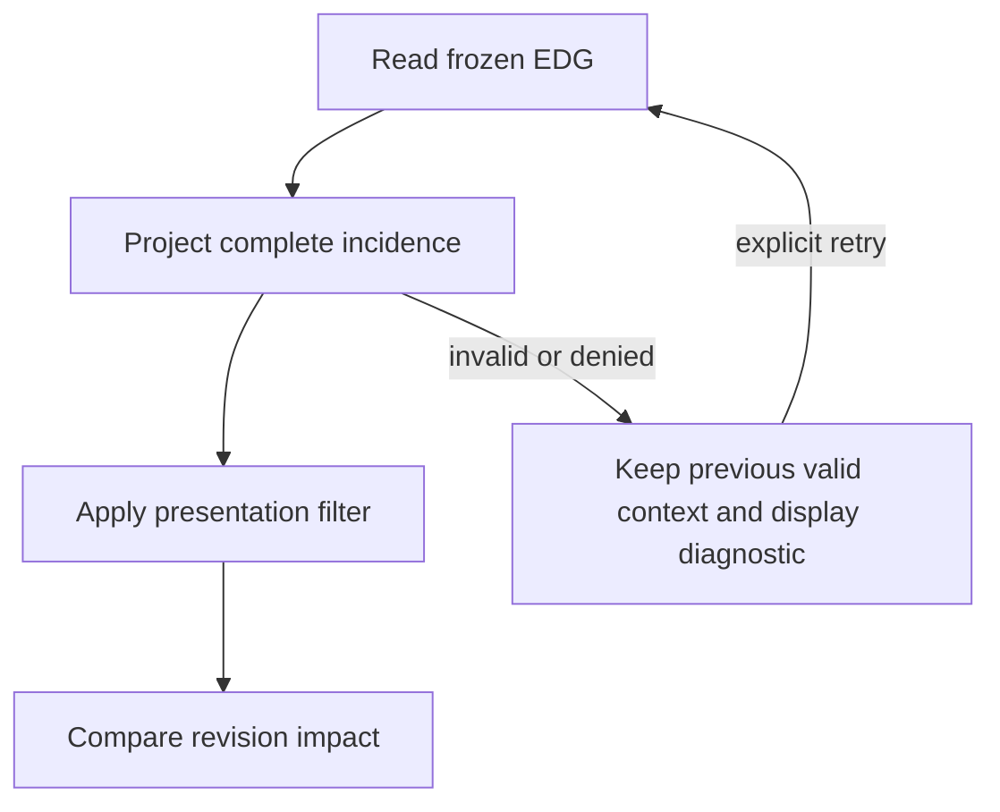
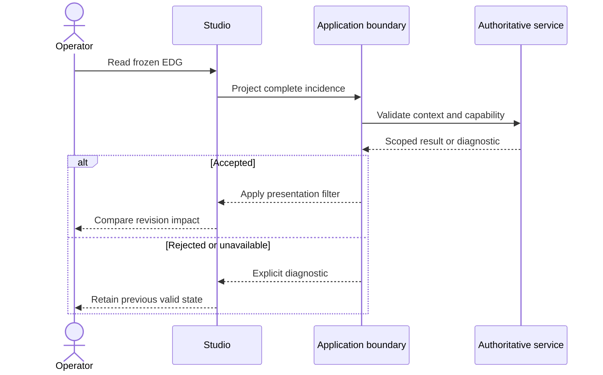
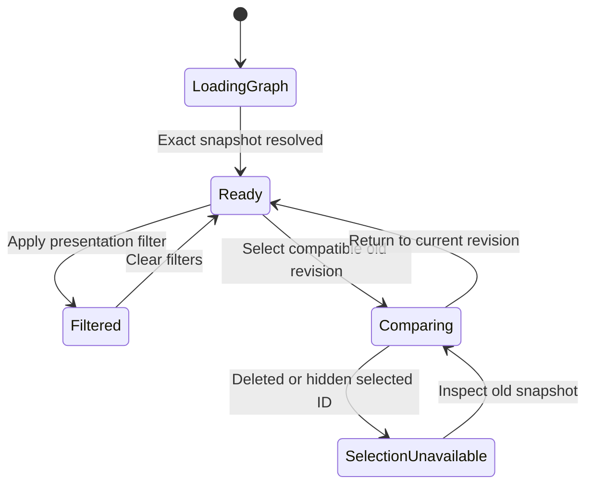

# UI05 — detailed specification review

Source: [functional scope](../../UI05.md) · [wireframe](../../drafts/UI05-wire.svg) · [official reference](../../../references/01-WOW-DI-Studio.svg) · [accepted field dictionary](../../../pilot-field-dictionary-v1.md).

**Implementation gates:** UI01 (#90), M01 (#14), M02 (#15), SP02 (#160). No feature coding before its claimed dependencies close.

## User journey and component/data flow

The operator navigates through Read frozen EDG → Project complete incidence → Apply presentation filter → Compare revision impact. The application boundary, not Studio, owns authoritative mutation, validation and storage.

## Fields and ports

| Module | Existing binding | Direction and validation | Remaining owner seam |
|---|---|---|---|
| UI05 | G:GraphRevision, GraphEntity, GraphRelationship, SourceStamp, TimeWindow, CapacityLimit; revision impact result; P:F-REV,F-MACHINE,F-OP | Read immutable incidence, filter presentation only; compare same tenant/model; keep deleted IDs | API-GRAPH query/filter response, viewport paging and capability manifest; M02 supplies impact semantics |

### Approved pilot field definitions applicable to this module

| Field ID / JSON key | Type, units, presence | Source and relationship | Valid representation / rejected condition |
|---|---|---|---|
| F-REV / revisionId | R, nonblank immutable text | Registry → frozen revision within tenant and model; scopes every model read | `"r17"` / mutable alias or foreign revision |
| F-MACHINE / machineId | R, nonblank text | Resource import → machine key unique in revision; operation references it | `"M1"` / missing referenced machine |
| F-OP / operationId | R, nonblank text | Order import → operation key unique in revision; assignment references it | `"A"` / duplicate operation within revision |

Ledger pilot field IDs: F-REV, F-MACHINE, F-OP. Baseline logical ports: API-GRAPH. Read inherited type, unit, requiredness, defaults, relationship and classification rules in the field profiles; do not invent wire DTOs or physical storage.

## Operation sequence

## Interaction states and recovery

| Module | Navigation and loading | Invalid / unavailable | Keyboard and recovery |
|---|---|---|---|
| UI05 | Load revision incidence; filter, search and trace selection; compare pinned second revision. | Missing/deleted node, unavailable provenance, unknown revision, incompatible comparison. | Select hyperedge and all incident IDs by keys; clear filter and restore selection; keep deleted node explicit in diff; verify unfiltered graph unchanged. |

Initial loading, empty, denied, invalid, unavailable and failed are separate presentation states; the owner result determines which is shown. Explicit retry never implies mutation.

## Acceptance and test trace

| Requirement | Review case | Action | Observable oracle | Feature acceptance IDs |
|---|---|---|---|---|
| UI05-01 Hypergraph incidence | SP02-UI05-01 | Select three-variable hyperedge | Owner and every operand accessible in table and graph; compare snapshot incidence | TC-UI05-A, TC-UI05-B |
| UI05-02 Zoom and pan | SP02-UI05-02 | Zoom and pan by pointer and keyboard | Viewport changes only; selected IDs and graph revision unchanged | TC-UI05-A, TC-UI05-B |
| UI05-03 Node search | SP02-UI05-03 | Search stable node ID | Ordinal ID exact match retained; no-result distinct from unknown revision | TC-UI05-A, TC-UI05-B |
| UI05-04 Edge filtering | SP02-UI05-04 | Filter edge kind | Underlying graph query and incidence unchanged; clear restores visible selection | TC-UI05-A, TC-UI05-B |
| UI05-05 Dependency tracing | SP02-UI05-05 | Trace dependency | Compare affected IDs against authoritative graph queries, not visual adjacency | TC-UI05-A, TC-UI05-B |
| UI05-06 Impact analysis | SP02-UI05-06 | Inspect cross-revision impact | New coupling/deleted edges included in union traversal; different tenant rejected | TC-UI05-A, TC-UI05-B |
| UI05-07 Provenance | SP02-UI05-07 | Open provenance | Show source key, record, mapping version and instant from exact snapshot | TC-UI05-A, TC-UI05-B |
| UI05-08 Revision comparison | SP02-UI05-08 | Compare two revisions | Deleted entity/relationship remains inspectable; same ID with changed source marked changed | TC-UI05-A, TC-UI05-B |

Feature-level acceptance:

- TC-UI05-A: Select a three-variable constraint, filter an edge and compare before/after reachability against the unfiltered graph queries.
- TC-UI05-B: Deletion must remain visible in the revision diff. Filtering is presentation-only.

## Visual, localization and accessibility gates

Use approved DS01 tokens and DS02 components, with English LTR and Arabic RTL in separate scenarios. Isolate exact IDs, source spans and units; preserve logical focus order and named controls. Test keyboard and pointer equivalence for the actions above, focus recovery on errors and explicit unavailable/empty state. Compare common chrome with the reference and pin viewport, font, DPI, renderer and fixture. Do not use proposed mockups as approved screenshot baselines. Native monitor, screen-reader and feature-specific functional evidence belong to implementing issues.

**Disposition:** review proposal with implementation-specific acceptance cases. Domain-source bindings are checked, but owner seams are not approved by this document. No feature execution or final visual approval claimed.
