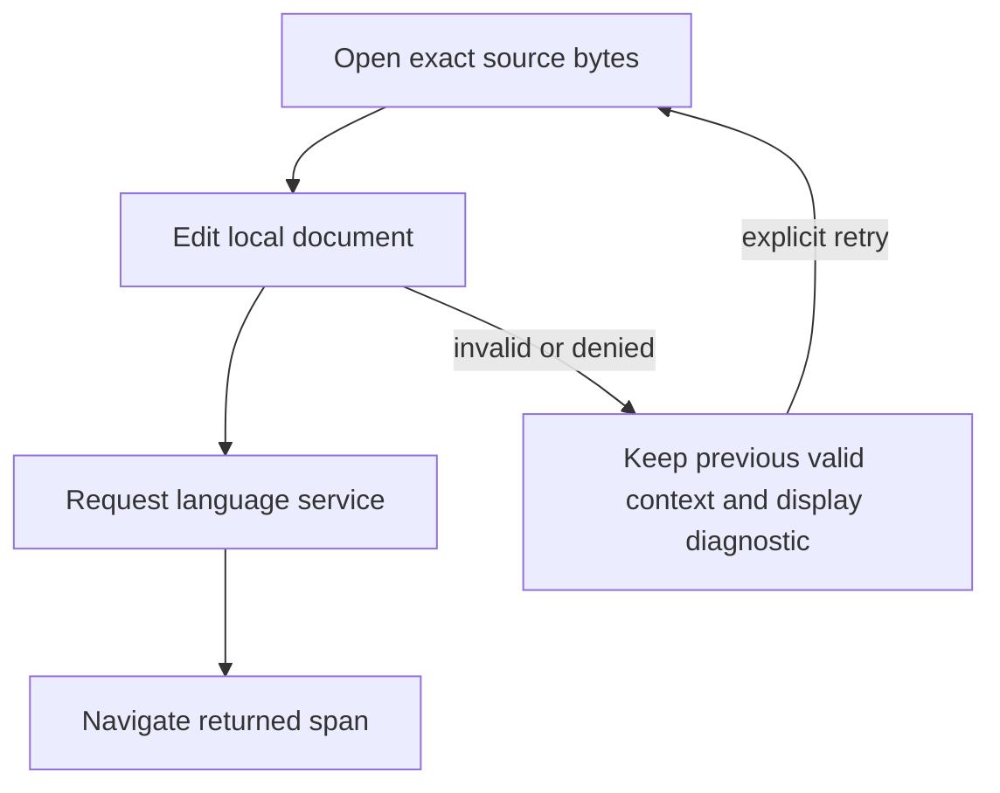
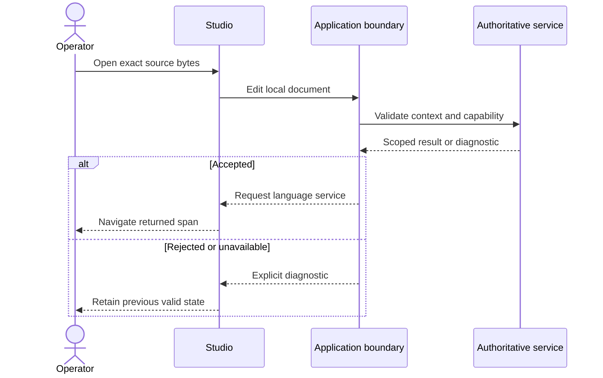
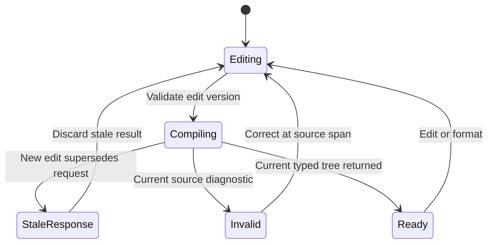

# UI06 — detailed specification review

Source: [functional scope](../../UI06.md) · [wireframe](../studies/wireframes/UI06.svg) · [reviewed high-fidelity study](../studies/UI06.svg) · [accepted field dictionary](../../../pilot-field-dictionary-v1.md).

Visual variants: [loading](../studies/states/UI06-loading.svg) · [empty](../studies/states/UI06-empty.svg) · [invalid](../studies/states/UI06-invalid.svg) · [unavailable](../studies/states/UI06-unavailable.svg) · [failed](../studies/states/UI06-failed.svg) · [actions](../studies/states/UI06-actions.svg) · [Arabic RTL](../studies/rtl/UI06.svg).

**Implementation gates:** UI01 (#90), M06 (#19), M07 (#20), SP02 (#160). No feature coding before its claimed dependencies close.

## User journey and component/data flow

The operator navigates through Open exact source bytes → Edit local document → Request language service → Navigate returned span. The application boundary, not Studio, owns authoritative mutation, validation and storage.

## Fields and ports

| Module | Existing binding | Direction and validation | Remaining owner seam |
|---|---|---|---|
| UI06 | U:SourceDocument.Id/Sha256/Utf16Length; SourceSpan.SourceId/Start/Length; Model.RevisionId | Read/edit exact source and correlate spans with edit version; no arbitrary execution | M06/M07 parser, completion, diagnostics, formatter and live compile service |

### Approved pilot field definitions applicable to this module

| Field ID / JSON key | Type, units, presence | Source and relationship | Valid representation / rejected condition |
|---|---|---|---|
| F-REV / revisionId | R, nonblank immutable text | Registry → frozen revision within tenant and model; scopes every model read | `"r17"` / mutable alias or foreign revision |

Ledger pilot field IDs: F-REV. Approved logical ports: API-MODEL. Read inherited type, unit, requiredness, defaults, relationship and classification rules in the field profiles; do not invent wire DTOs or physical storage.

## Operation sequence

## Interaction states and recovery

| Module | Navigation and loading | Invalid / unavailable | Keyboard and recovery |
|---|---|---|---|
| UI06 | Open source document, load language services; validate edit version. | Parse/type error, unsupported formatter feature, stale diagnostic. | Navigate source span, correct and revalidate; discard delayed result from previous edit; failed format retains original text and cursor. |

Initial loading, empty, denied, invalid, unavailable and failed are separate presentation states; the owner result determines which is shown. Explicit retry never implies mutation.

## Acceptance and test trace

| Requirement | Review case | Action | Observable oracle | Feature acceptance IDs |
|---|---|---|---|---|
| UI06-01 Syntax highlighting | SP02-UI06-01 | Highlight syntax | Token spans come from language service; unknown token remains text, no execution | TC-UI06-A, TC-UI06-B |
| UI06-02 Autocompletion | SP02-UI06-02 | Invoke completion by keyboard | Suggestions match current document revision and position; Escape restores editor | TC-UI06-A, TC-UI06-B |
| UI06-03 Source-span diagnostics | SP02-UI06-03 | Navigate source diagnostic | UTF-16 half-open span points to exact frozen source/edit, including Arabic and surrogate pairs | TC-UI06-A, TC-UI06-B |
| UI06-04 Formatting | SP02-UI06-04 | Format source | Compare typed trees before/after; failure retains original text and cursor | TC-UI06-A, TC-UI06-B |
| UI06-05 Validation and live compilation | SP02-UI06-05 | Live compile two overlapping edits | Older response ignored; invalid source stays draft, successful compile publishes only explicitly | TC-UI06-A, TC-UI06-B |

Feature-level acceptance:

- TC-UI06-A: Edit a symbol in Batch, navigate to its exact diagnostic, repair the edit and compare formatted and original typed trees.
- TC-UI06-B: Discard stale diagnostics arriving after a newer edit.

## Visual, localization and accessibility gates

Use approved DS01 tokens and DS02 components, with English LTR and Arabic RTL in separate scenarios. Isolate exact IDs, source spans and units; preserve logical focus order and named controls. Test keyboard and pointer equivalence for the actions above, focus recovery on errors and explicit unavailable/empty state. Compare common chrome with the reference and pin viewport, font, DPI, renderer and fixture. Static design approval is not executed screenshot acceptance. Pin the runtime fixture before establishing a screenshot baseline. Native monitor, screen-reader and feature-specific functional evidence belong to implementing issues.

**Disposition:** specification and logical contract reviewed against merged #190. Concrete provider payload/conformance and feature execution remain separate implementation gates. See [final visual disposition](../FINAL-DISPOSITION.md) for the accepted UI design specification.
