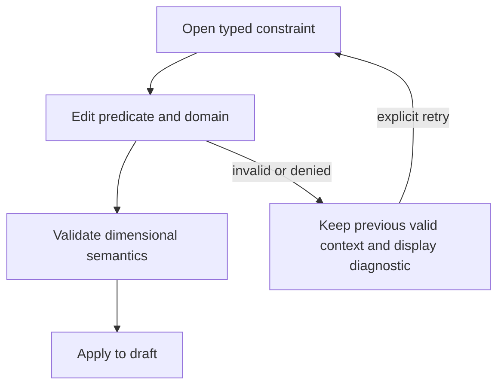
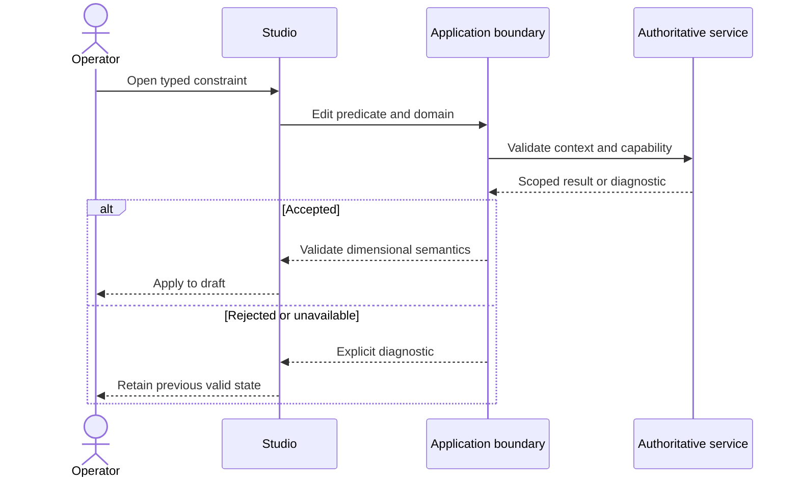
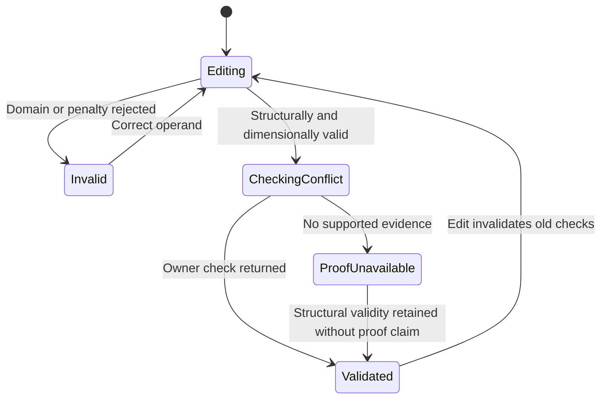

# UI07 — detailed specification review

Source: [functional scope](../../UI07.md) · [wireframe](../../drafts/UI07-wire.svg) · [proposed high-fidelity study](../studies/UI07.svg) · [accepted field dictionary](../../../pilot-field-dictionary-v1.md).

**Implementation gates:** UI04 (#93), M04 (#17), SP02 (#160). No feature coding before its claimed dependencies close.

## User journey and component/data flow

The operator navigates through Open typed constraint → Edit predicate and domain → Validate dimensional semantics → Apply to draft. The application boundary, not Studio, owns authoritative mutation, validation and storage.

## Fields and ports

| Module | Existing binding | Direction and validation | Remaining owner seam |
|---|---|---|---|
| UI07 | U:Constraint.Id/PredicateId/Hard/Penalty/Span; Expression; ScalarType; Symbol.Lower/Upper; P:F-DURATION | Hard no penalty, soft positive exact penalty; Boolean predicate, bounds in declared domain; structural checks before dimensional validation | M04 dimensional algebra and unit conversion; conflict proof from owning verifier, not UI heuristic |

Approved pilot field IDs: F-REV, F-DURATION. Baseline logical ports: API-MODEL. Read inherited type, unit, requiredness, defaults, relationship and classification rules in the field profiles; do not invent wire DTOs or physical storage.

## Operation sequence

## Interaction states and recovery

| Module | Navigation and loading | Invalid / unavailable | Keyboard and recovery |
|---|---|---|---|
| UI07 | Load constraint and typed expression; edit bounds, units and penalty. | Incompatible dimensions, invalid bound, unsupported soft constraint, proof unavailable. | Focus invalid operand and correct; compare equivalent units and preserve draft on failed save; proof unavailable not a conflict proof. |

Initial loading, empty, denied, invalid, unavailable and failed are separate presentation states; the owner result determines which is shown. Explicit retry never implies mutation.

## Acceptance and test trace

| Requirement | Review case | Action | Observable oracle | Feature acceptance IDs |
|---|---|---|---|---|
| UI07-01 Hard and soft constraints | SP02-UI07-01 | Toggle hard/soft | Hard has no penalty; soft positive exact penalty, reject zero or missing | TC-UI07-A, TC-UI07-B |
| UI07-02 Expressions | SP02-UI07-02 | Edit expression | Predicate resolves to Boolean DAG; reject wrong arity, cycle or dangling expression | TC-UI07-A, TC-UI07-B |
| UI07-03 Units and bounds | SP02-UI07-03 | Change units and bounds | Equivalent capacity in approved units matches normalized value and inclusivity; incompatible dimension rejected | TC-UI07-A, TC-UI07-B |
| UI07-04 Conflict detection | SP02-UI07-04 | Inspect conflict | Only supporting evidence permits proven label; unsupported check is unavailable | TC-UI07-A, TC-UI07-B |

Feature-level acceptance:

- TC-UI07-A: Save an equivalent capacity expression in two units and compare normalized quantities and bound inclusivity.
- TC-UI07-B: Reject incompatible dimensions. Label conflicts as proven only with supporting evidence.

## Visual, localization and accessibility gates

Use approved DS01 tokens and DS02 components, with English LTR and Arabic RTL in separate scenarios. Isolate exact IDs, source spans and units; preserve logical focus order and named controls. Test keyboard and pointer equivalence for the actions above, focus recovery on errors and explicit unavailable/empty state. Compare common chrome with the reference and pin viewport, font, DPI, renderer and fixture. Do not use proposed mockups as approved screenshot baselines. Native monitor, screen-reader and feature-specific functional evidence belong to implementing issues.

**Disposition:** review proposal with implementation-specific acceptance cases. Domain-source bindings are checked, but owner seams are not approved by this document. No feature execution or final visual approval claimed.
