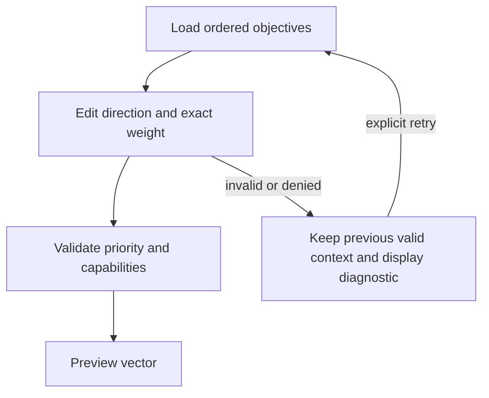
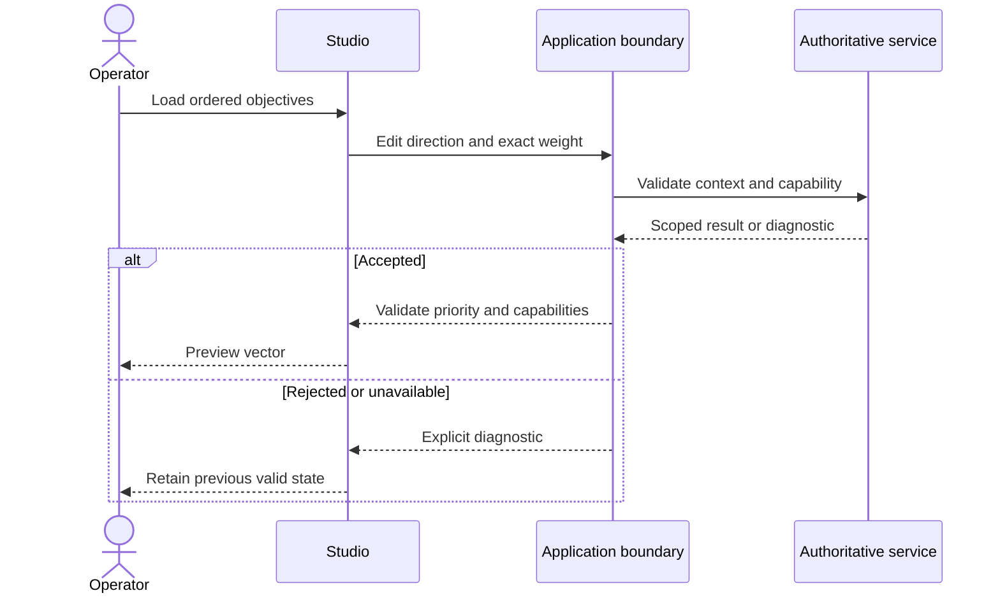
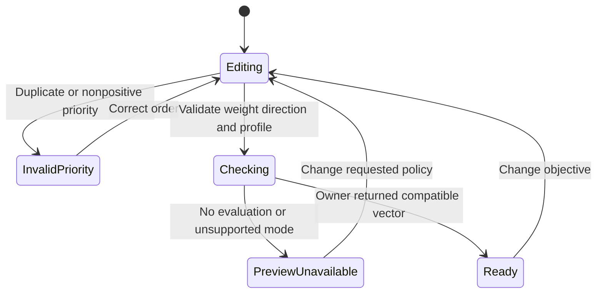

# UI08 — detailed specification review

Source: [functional scope](../../UI08.md) · [wireframe](../../drafts/UI08-wire.svg) · [proposed high-fidelity study](../studies/UI08.svg) · [accepted field dictionary](../../../pilot-field-dictionary-v1.md).

**Implementation gates:** UI04 (#93), NUM02 (#135), SP02 (#160). No feature coding before its claimed dependencies close.

## User journey and component/data flow

The operator navigates through Load ordered objectives → Edit direction and exact weight → Validate priority and capabilities → Preview vector. The application boundary, not Studio, owns authoritative mutation, validation and storage.

## Fields and ports

| Module | Existing binding | Direction and validation | Remaining owner seam |
|---|---|---|---|
| UI08 | U:Objective.Id/ExpressionId/Direction/Priority/Weight/Tolerance/Span; P:F-WEIGHT,F-OBJ; S:ObjectiveObservation | Unique positive priority, positive weight, nonnegative tolerance; preserve vector in declared units | NUM02 contribution/normalization and supported multiobjective policy; no Pareto claim under udir/1 |

### Approved pilot field definitions applicable to this module

| Field ID / JSON key | Type, units, presence | Source and relationship | Valid representation / rejected condition |
|---|---|---|---|
| F-REV / revisionId | R, nonblank immutable text | Registry → frozen revision within tenant and model; scopes every model read | `"r17"` / mutable alias or foreign revision |
| F-WEIGHT / tardinessWeight | R, nonnegative exact cost per minute | Order cost snapshot → objective coefficient in the fixture's single currency | `2` / negative or implicit currency change |
| F-OBJ / objectiveValue | N, finite exact value in objective units | Original model verifier → checked objective of candidate | `12` or `null` before evaluation / nonnumeric value |

Ledger pilot field IDs: F-REV, F-WEIGHT, F-OBJ. Baseline logical ports: API-MODEL. Read inherited type, unit, requiredness, defaults, relationship and classification rules in the field profiles; do not invent wire DTOs or physical storage.

## Operation sequence

## Interaction states and recovery

| Module | Navigation and loading | Invalid / unavailable | Keyboard and recovery |
|---|---|---|---|
| UI08 | Load ordered objective vector; edit goal and contribution preview. | Duplicate priority, invalid weight, incompatible currency, unsupported Pareto request. | Change direction/weight/order with keyboard; reject invalid save and preserve vector; unavailable preview has no fabricated contribution. |

Initial loading, empty, denied, invalid, unavailable and failed are separate presentation states; the owner result determines which is shown. Explicit retry never implies mutation.

## Acceptance and test trace

| Requirement | Review case | Action | Observable oracle | Feature acceptance IDs |
|---|---|---|---|---|
| UI08-01 Minimize and maximize | SP02-UI08-01 | Reverse goal direction | Canonical Minimize/Maximize retained; compare known assignment in correct direction | TC-UI08-A, TC-UI08-B |
| UI08-02 Weights | SP02-UI08-02 | Edit objective weight | Reject nonpositive UDIR weight; preserve nonnegative source tardiness coefficient separately | TC-UI08-A, TC-UI08-B |
| UI08-03 Lexicographic priority | SP02-UI08-03 | Reorder lexicographic goals | Unique positive priorities; duplicate priority rejected without changing saved revision | TC-UI08-A, TC-UI08-B |
| UI08-04 Multi-objective models | SP02-UI08-04 | Inspect multi-objective policy | Vector shown in own units; unsupported Pareto policy unavailable, no scalar aggregation | TC-UI08-A, TC-UI08-B |
| UI08-05 Contribution preview | SP02-UI08-05 | Preview contribution | Compare known assignment with owner evaluated vector; unavailable evaluation remains null | TC-UI08-A, TC-UI08-B |

Feature-level acceptance:

- TC-UI08-A: Reverse one goal direction, adjust a weight and compare a known assignment against the displayed objective vector.
- TC-UI08-B: Reject duplicate priorities in the v0 language and disable unsupported Pareto requests.

## Visual, localization and accessibility gates

Use approved DS01 tokens and DS02 components, with English LTR and Arabic RTL in separate scenarios. Isolate exact IDs, source spans and units; preserve logical focus order and named controls. Test keyboard and pointer equivalence for the actions above, focus recovery on errors and explicit unavailable/empty state. Compare common chrome with the reference and pin viewport, font, DPI, renderer and fixture. Do not use proposed mockups as approved screenshot baselines. Native monitor, screen-reader and feature-specific functional evidence belong to implementing issues.

**Disposition:** review proposal with implementation-specific acceptance cases. Domain-source bindings are checked, but owner seams are not approved by this document. No feature execution or final visual approval claimed.
