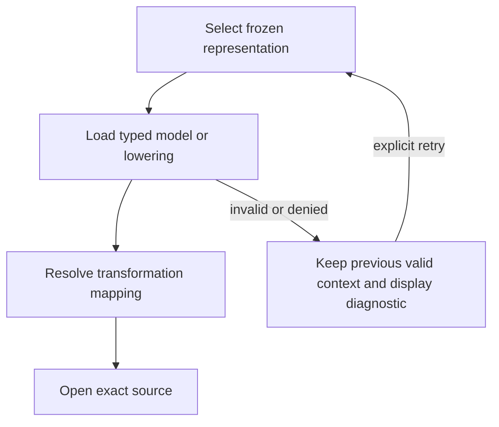
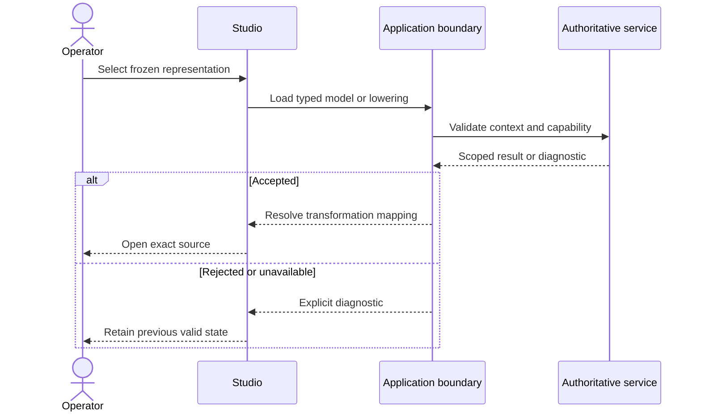
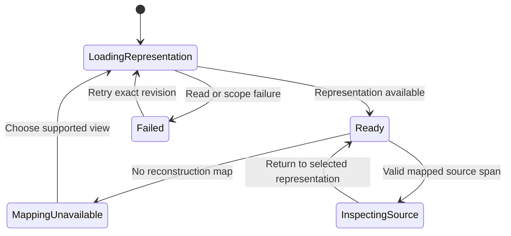

# UI09 — detailed specification review

Source: [functional scope](../../UI09.md) · [wireframe](../../drafts/UI09-wire.svg) · [proposed high-fidelity study](../studies/UI09.svg) · [accepted field dictionary](../../../pilot-field-dictionary-v1.md).

**Implementation gates:** UI06 (#95), M08 (#21), M12 (#25), SP02 (#160). No feature coding before its claimed dependencies close.

## User journey and component/data flow

The operator navigates through Select frozen representation → Load typed model or lowering → Resolve transformation mapping → Open exact source. The application boundary, not Studio, owns authoritative mutation, validation and storage.

## Fields and ports

| Module | Existing binding | Direction and validation | Remaining owner seam |
|---|---|---|---|
| UI09 | U:Model, SourceDocument, SourceSpan, Expression DAG; G:GraphRevision | Read-only exact revision and span, preserve identity between views; unavailable transform remains unavailable | M08/M12 normalized/solver representation, transformation and reconstruction ledger |

Approved pilot field IDs: F-REV. Baseline logical ports: API-MODEL. Read inherited type, unit, requiredness, defaults, relationship and classification rules in the field profiles; do not invent wire DTOs or physical storage.

## Operation sequence

## Interaction states and recovery

| Module | Navigation and loading | Invalid / unavailable | Keyboard and recovery |
|---|---|---|---|
| UI09 | Load representation and transform mapping; inspect exact source span. | Unsupported lowering, absent transform proof, stale revision. | Switch representations and follow mapped row; retain only valid selection; absent mapping shows unavailable and allows return to source. |

Initial loading, empty, denied, invalid, unavailable and failed are separate presentation states; the owner result determines which is shown. Explicit retry never implies mutation.

## Acceptance and test trace

| Requirement | Review case | Action | Observable oracle | Feature acceptance IDs |
|---|---|---|---|---|
| UI09-01 Source AST | SP02-UI09-01 | Inspect source AST | Exact source ID/span retained; unavailable parser AST clearly labeled | TC-UI09-A, TC-UI09-B |
| UI09-02 Typed UDIR | SP02-UI09-02 | Inspect typed UDIR | Show semantic profile and exact canonical values; no rounding | TC-UI09-A, TC-UI09-B |
| UI09-03 Normalized model | SP02-UI09-03 | Inspect normalized model | Only owner-provided normalization; unavailable stage not synthesized | TC-UI09-A, TC-UI09-B |
| UI09-04 Solver representation | SP02-UI09-04 | Inspect solver representation | Unsupported adapter lowering returns unavailable, no fabricated rows | TC-UI09-A, TC-UI09-B |
| UI09-05 Transformation ledger | SP02-UI09-05 | Follow transformation ledger | Inspect original and transformed identity and reconstruction evidence | TC-UI09-A, TC-UI09-B |
| UI09-06 Source mapping | SP02-UI09-06 | Navigate mapped source | UTF-16 source span resolves within exact frozen source; absent mapping explicit | TC-UI09-A, TC-UI09-B |

Feature-level acceptance:

- TC-UI09-A: Follow one normalized row across all views back to its original span and inspect the reconstruction rule.
- TC-UI09-B: Display unavailable lowering for an unsupported backend.

## Visual, localization and accessibility gates

Use approved DS01 tokens and DS02 components, with English LTR and Arabic RTL in separate scenarios. Isolate exact IDs, source spans and units; preserve logical focus order and named controls. Test keyboard and pointer equivalence for the actions above, focus recovery on errors and explicit unavailable/empty state. Compare common chrome with the reference and pin viewport, font, DPI, renderer and fixture. Do not use proposed mockups as approved screenshot baselines. Native monitor, screen-reader and feature-specific functional evidence belong to implementing issues.

**Disposition:** review proposal with implementation-specific acceptance cases. Domain-source bindings are checked, but owner seams are not approved by this document. No feature execution or final visual approval claimed.
