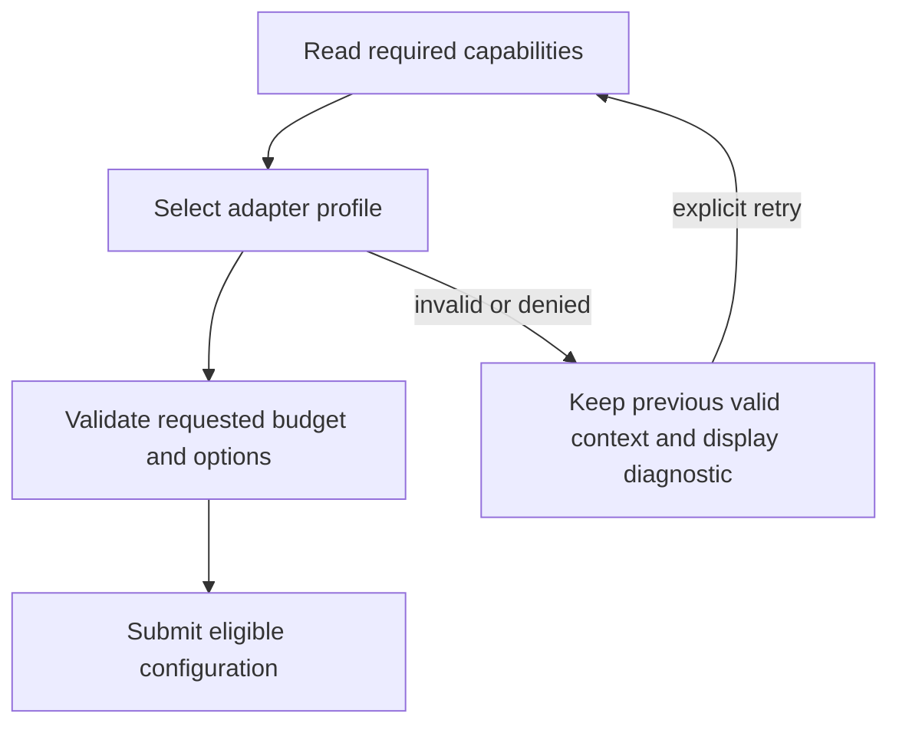
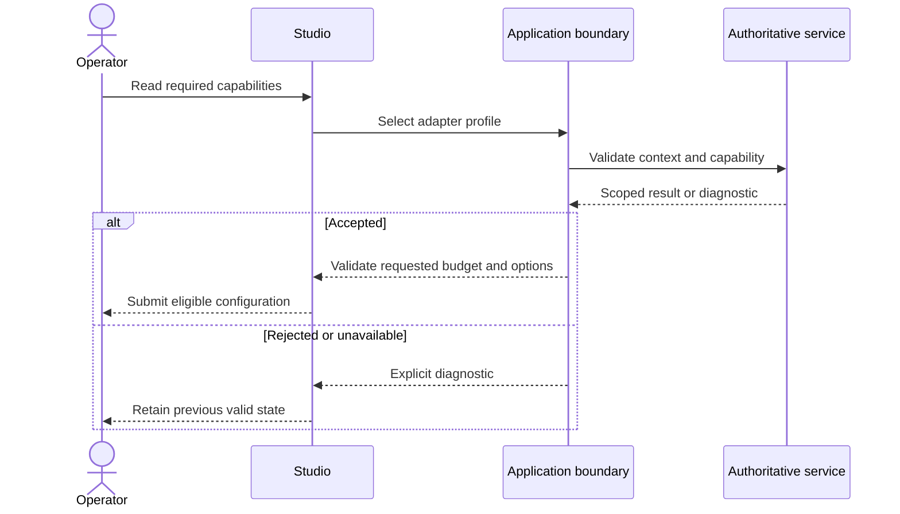
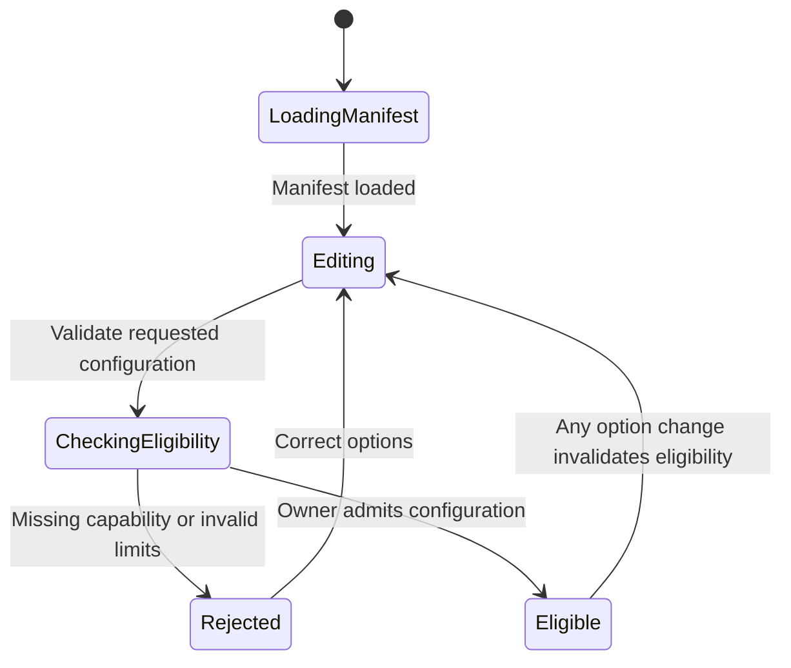

# UI10 — detailed specification review

Source: [functional scope](../../UI10.md) · [wireframe](../studies/wireframes/UI10.svg) · [reviewed high-fidelity study](../studies/UI10.svg) · [accepted field dictionary](../../../pilot-field-dictionary-v1.md).

Visual variants: [loading](../studies/states/UI10-loading.svg) · [empty](../studies/states/UI10-empty.svg) · [invalid](../studies/states/UI10-invalid.svg) · [unavailable](../studies/states/UI10-unavailable.svg) · [failed](../studies/states/UI10-failed.svg) · [actions](../studies/states/UI10-actions.svg) · [Arabic RTL](../studies/rtl/UI10.svg).

**Implementation gates:** UI01 (#90), S06 (#31), S07 (#32), SP02 (#160). No feature coding before its claimed dependencies close.

## User journey and component/data flow

The operator navigates through Read required capabilities → Select adapter profile → Validate requested budget and options → Submit eligible configuration. The application boundary, not Studio, owns authoritative mutation, validation and storage.

## Fields and ports

| Module | Existing binding | Direction and validation | Remaining owner seam |
|---|---|---|---|
| UI10 | U:Model.Requires/Types/TimeBasis; S:SolverIdentity, SolverCapabilities.Features/Domains/MaxCoefficientMagnitude/MaxHorizonTicks/MaxThreads/SupportsHints/SupportsInterruption/SupportsBounds | Read manifest before selection; exact required tokens; limits optional; reject unsupported settings before submit | S06/S07 planner selection, requested time/CPU/memory budget and options DTO; measurements are not budget fields |

### Approved pilot field definitions applicable to this module

| Field ID / JSON key | Type, units, presence | Source and relationship | Valid representation / rejected condition |
|---|---|---|---|
| F-REV / revisionId | R, nonblank immutable text | Registry → frozen revision within tenant and model; scopes every model read | `"r17"` / mutable alias or foreign revision |
| F-CPU / cpuMs | N, nonnegative integer milliseconds | Worker accounting → aggregate CPU of process tree for run | `31` / wrong unit or unknown counter reported as zero |
| F-MEM / peakBytes | N, nonnegative integer bytes | Worker accounting → peak process-tree measurement with platform and scope | `8192` / negative or undocumented measurement scope |

Ledger pilot field IDs: F-REV, F-CPU, F-MEM. Approved logical ports: API-SOLVE. Read inherited type, unit, requiredness, defaults, relationship and classification rules in the field profiles; do not invent wire DTOs or physical storage.

### Reviewed integration relationships

- RT01 (#129), capability: A usable local submit flow needs application runtime admission, not direct solver invocation from UI.

## Operation sequence

## Interaction states and recovery

| Module | Navigation and loading | Invalid / unavailable | Keyboard and recovery |
|---|---|---|---|
| UI10 | Load adapter capabilities and budget schema; check eligibility before submit. | Unsupported option, nonpositive budget, unavailable adapter manifest. | Navigate option diagnostics, correct and resubmit eligibility; cancel has no run side effect; rejected config never creates run. |

Initial loading, empty, denied, invalid, unavailable and failed are separate presentation states; the owner result determines which is shown. Explicit retry never implies mutation.

## Acceptance and test trace

| Requirement | Review case | Action | Observable oracle | Feature acceptance IDs |
|---|---|---|---|---|
| UI10-01 Solver capabilities and selection | SP02-UI10-01 | Choose auto or explicit profile | Compare feature tokens, domains, horizon and exact coefficient constraints; explain ineligibility | TC-UI10-A, TC-UI10-B |
| UI10-02 Time, CPU and memory budgets | SP02-UI10-02 | Set requested time CPU memory limits | Round-trip owner-approved units and values; reject invalid limits before run; measured counters distinct | TC-UI10-A, TC-UI10-B |
| UI10-03 Parallelism and options | SP02-UI10-03 | Set parallelism and options | Requested threads obey MaxThreads; unsupported adapter option rejected; no run created | TC-UI10-A, TC-UI10-B |

Feature-level acceptance:

- TC-UI10-A: Select auto on a finite interval model, explain eligibility and round-trip its budget through the planner.
- TC-UI10-B: Reject options outside the selected adapter manifest before creating a run.

## Visual, localization and accessibility gates

Use approved DS01 tokens and DS02 components, with English LTR and Arabic RTL in separate scenarios. Isolate exact IDs, source spans and units; preserve logical focus order and named controls. Test keyboard and pointer equivalence for the actions above, focus recovery on errors and explicit unavailable/empty state. Compare common chrome with the reference and pin viewport, font, DPI, renderer and fixture. Static design approval is not executed screenshot acceptance. Pin the runtime fixture before establishing a screenshot baseline. Native monitor, screen-reader and feature-specific functional evidence belong to implementing issues.

**Disposition:** specification and logical contract reviewed against merged #190. Concrete provider payload/conformance and feature execution remain separate implementation gates. See [final visual disposition](../FINAL-DISPOSITION.md) for the accepted UI design specification.
